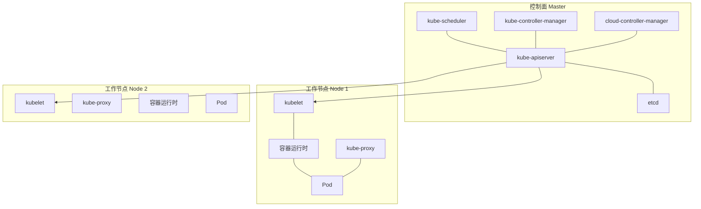
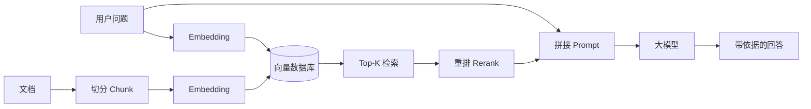

# 华为云赛道学习内容：全考点覆盖手册

> [!info] 这篇笔记怎么用
> - 这篇管“**考什么、怎么理解**”；时间安排、实验顺序、拿奖策略看 [[学习路线及方法]]。
> - 章节顺序 = 考纲顺序 = 实验顺序：基础 → 云服务 → 云原生 → AI/大数据 → 架构。
> - 标记说明：⭐ 高频必背｜🔁 易混对比｜🧪 对应实验｜📝 理论常考。
> - 每章末尾有「本章自测」，答不上就回到对应小节；全部学完做第 16 章综合自测。

> [!important] 覆盖范围声明
> 本文覆盖第十一届云赛道考纲的四大模块：**云服务、云原生、AI/大模型/AI Agent、大数据**，并补齐它们共同依赖的**云计算与网络基础、Linux、架构设计、安全、迁移灾备**。赛制、分值、时间以官网和本校通知为准。

---

## 0. 覆盖地图（先看这张表）

| 模块 | 章节 | 往届常见权重 | 对应实验 | 掌握标准 |
|---|---|---|---|---|
| 云计算与网络基础 | §1 | 贯穿全卷 | 全部实验的前置 | 能解释 IaaS/PaaS/SaaS、Region/AZ、子网与端口 |
| 华为云全局概念与 IAM | §2 | 云服务内 10% | 实验 1 | 能创建子用户并最小授权 |
| 计算服务 | §3 | 云服务内 25% | 实验 2、3、20 | 能开通 ECS、做镜像、配弹性伸缩 |
| 存储服务 | §4 | 云服务内 20% | 实验 4、9、10、11 | 能区分块/文件/对象并处理 403 |
| 网络服务 | §5 | 云服务内 25% | 实验 5—8、20 | 能画流量路径、按层排错 |
| 数据库服务 | §6 | 云服务内 12% | 实验 12、13、21 | 能连接、备份、只读、迁移 |
| 容器与云原生 | §7 | 约 20% | 实验 14、15 | 能解释 K8s 对象并部署应用 |
| Serverless | §8 | 云原生内 10% | 实验 16 | 能写函数 + 配触发器 |
| 运维监控 | §9 | 云服务内 8% | 实验 17 | 能配告警、查日志与审计 |
| 安全服务 | §10 | 云服务内 8% | 实验 18 | 能说出各层防护对应服务 |
| 迁移与灾备 | §11 | 云服务内 5% | 实验 21 | 能说出迁移五步与 RPO/RTO |
| AI / 大模型 / Agent | §12 | 约 30%—40% | 实验 19 | 能讲清 ML 流程、Transformer、RAG、Agent |
| 大数据 | §13 | 约 15%—20% | 无强制实验 | 能背高频组件与适用场景 |
| 架构设计 | §14 | 综合题 | 实验 20 | 能给需求画架构并做取舍 |

> [!tip] 学习顺序（零基础）
> §1 → §2 → §3 → §4 → §5 → §6 → §7 → §8 → §9 → §10 → §11 → §12 → §13 → §14 → §15/§16。
> 时间紧就按“**§3/§4/§5 云服务 → §12 AI → §7 云原生 → §13 大数据**”的顺序，先拿大分。

---

## 1. 云计算与网络基础（全卷地基）

### 1.1 云计算的定义与五大特征 ⭐📝

云计算：通过网络按需提供**可配置计算资源**（网络、服务器、存储、应用、服务）的模式，可快速开通和释放，管理成本低。

| 特征 | 含义 | 考试常见表述 |
|---|---|---|
| 按需自服务 | 用户自助开通，无需人工交互 | “分钟级开通” |
| 广泛网络接入 | 通过标准网络随时访问 | 手机/PC/API 都能用 |
| 资源池化 | 多租户共享资源池，按需分配 | “逻辑隔离、物理共享” |
| 快速弹性 | 快速扩容/缩容，对用户透明 | “弹性伸缩” |
| 可计量服务 | 按使用量计费与监控 | “用多少付多少” |

**云计算的价值**：降成本（资本支出转运营支出）、提效率、弹性、全球化、免运维、按需付费。

> [!note] CapEx vs OpEx
> 自建机房是**资本支出（CapEx）**，买硬件、建机房；公有云是**运营支出（OpEx）**，按用量付费。这是“上云”最常考的经济学理由。

### 1.2 三种服务模式（IaaS / PaaS / SaaS）⭐📝

| 模式 | 用户拿到什么 | 用户负责 | 云厂商负责 | 例子 |
|---|---|---|---|---|
| **IaaS** | 虚拟机、存储、网络 | OS、中间件、应用、数据 | 虚拟化、硬件、机房 | ECS、EVS、VPC |
| **PaaS** | 运行环境、数据库、中间件 | 应用、数据 | OS、运行时、平台 | RDS、CCE、FunctionGraph |
| **SaaS** | 可直接使用的软件 | 只负责使用与数据配置 | 全部 | 企业邮箱、在线文档、CRM |

**责任边界记忆法**：越往 SaaS 走，用户管得越少；**数据始终是用户的责任**。

补充模式：**FaaS**（函数即服务，Serverless 的一种）、**DaaS**（数据即服务）、**BaaS**（后端即服务）。

### 1.3 四种部署模式 📝

| 模式 | 特点 | 适用 |
|---|---|---|
| 公有云 | 多租户共享、按需付费、全球覆盖 | 互联网业务、初创 |
| 私有云 | 单租户独享、可控合规 | 金融、政务、大型企业 |
| 混合云 | 公有 + 私有，数据与业务分层 | 核心数据私有、前端弹性公有 |
| 社区云 | 特定群体共同使用 | 行业联盟、科研 |

### 1.4 虚拟化 vs 容器 🔁⭐

| 维度 | 虚拟机（VM） | 容器（Container） |
|---|---|---|
| 隔离级别 | 硬件级，每个 VM 有独立 OS | 进程级，共享宿主 OS 内核 |
| 启动速度 | 分钟级 | 秒级 |
| 资源开销 | 大（含完整 OS） | 小（只含应用与依赖） |
| 镜像大小 | GB 级 | MB 级 |
| 隔离强度 | 强 | 较弱（内核共享） |
| 典型产品 | ECS、BMS | Docker、CCE、CCI |
| 适用 | 强隔离、异构 OS、传统应用 | 微服务、快速迭代、高密度 |

**一句话**：虚拟机虚拟的是**硬件**，容器虚拟的是**操作系统**。

### 1.5 Region、AZ、Project、边缘 📝

| 概念 | 含义 | 关键点 |
|---|---|---|
| **Region（区域）** | 地理区域，如华北-北京四 | 不同 Region 内网默认不互通，需云连接 |
| **AZ（可用区）** | 同一 Region 内电力/网络独立的机房 | AZ 内低时延，AZ 间做高可用 |
| **Project（项目）** | 资源隔离与授权单位，通常一个 Region 一个 Project | IAM 授权按 Project 生效 |
| **边缘节点** | 靠近用户的算力节点 | 低时延场景（IEC） |

**高可用原则**：**同城多 AZ，异地多 Region**。单 AZ 故障不影响整体，才叫高可用。

### 1.6 网络基础（必须补的课）⭐

#### 1.6.1 OSI 七层 vs TCP/IP 四层

| OSI 七层 | TCP/IP 四层 | 典型协议/设备 | 云上对应 |
|---|---|---|---|
| 应用层 / 表示层 / 会话层 | 应用层 | HTTP、HTTPS、DNS、SSH | WAF、API 网关 |
| 传输层 | 传输层 | TCP、UDP | 安全组、ELB 四层 |
| 网络层 | 网络层 | IP、ICMP、路由 | VPC、路由表、EIP、NAT |
| 数据链路层 / 物理层 | 网络接口层 | Ethernet、ARP | 子网、网卡 |

**四层 vs 七层**：四层看 **IP + 端口**，七层看 **域名 / URL / HTTP 头**。ELB 的四层与七层监听器就是按这个分的。

#### 1.6.2 IP 地址与子网

- IPv4 32 位，点分十进制；IPv6 128 位。
- 私网地址段（RFC1918）：
  - `10.0.0.0/8`
  - `172.16.0.0/12`（172.16—172.31）
  - `192.168.0.0/16`
- CIDR：`192.168.1.0/24` 表示前 24 位是网络号，可用主机 254 个（去掉网络地址和广播地址）。
- 子网掩码：`/24` = `255.255.255.0`。
- 网关：子网内主机访问其他网段的出口。
- 常见规划：VPC `10.0.0.0/16`，子网 `10.0.1.0/24`、`10.0.2.0/24`。

**速算**：`/24` 254 台、`/25` 126 台、`/26` 62 台、`/27` 30 台、`/28` 14 台。

#### 1.6.3 NAT 与端口

- **NAT（网络地址转换）**：私网地址与公网地址互转。SNAT 让私网访问公网，DNAT 让公网访问私网。
- **端口**：标识主机上的进程。常见端口必须记：

| 端口 | 服务 |
|---|---|
| 22 | SSH |
| 53 | DNS |
| 80 | HTTP |
| 443 | HTTPS |
| 3306 | MySQL |
| 5432 | PostgreSQL |
| 6379 | Redis |
| 8080 | 常用 Web 备用端口 |
| 3389 | Windows 远程桌面 |

#### 1.6.4 DNS 解析过程 📝

```text
浏览器缓存 → 系统 hosts → 本地 DNS 服务器
   → 根域名服务器 → 顶级域（.com）→ 权威域名服务器
   → 返回 A/AAAA 记录 → 缓存 → 建立连接
```

常见记录类型：**A**（域名→IPv4）、**AAAA**（→IPv6）、**CNAME**（别名）、**MX**（邮件）、**TXT**（校验）、**NS**（域名服务器）。

#### 1.6.5 HTTP 与状态码 📝

| 状态码 | 含义 | 排错提示 |
|---|---|---|
| 200 | 成功 | — |
| 301/302 | 永久/临时重定向 | 检查跳转配置 |
| 400 | 请求错误 | 参数/格式问题 |
| 401 | 未认证 | 缺 Token/登录 |
| 403 | 禁止访问 | 权限、桶策略、WAF |
| 404 | 资源不存在 | 路径、路由 |
| 500 | 服务器内部错误 | 应用日志 |
| 502 | 网关错误 | 后端不可用、健康检查 |
| 503 | 服务不可用 | 后端全挂、限流 |
| 504 | 网关超时 | 后端慢、超时配置 |

#### 1.6.6 TCP 三次握手与四次挥手 📝

- 三次握手：SYN → SYN+ACK → ACK。目的：确认双方收发能力、同步序列号。
- 四次挥手：FIN → ACK → FIN → ACK。目的：双方各自关闭发送通道。
- 高频故障：**安全组没放行**、**后端端口没监听**、**连接数/带宽打满**。

### 1.7 Linux 最小命令集 🧪

| 命令 | 作用 | 示例 |
|---|---|---|
| `pwd` / `cd` / `ls` | 目录操作 | `cd /etc`、`ls -l` |
| `cat` / `less` / `tail -f` | 看文件/追日志 | `tail -f /var/log/nginx/access.log` |
| `grep` | 文本搜索 | `grep -i error app.log` |
| `find` | 找文件 | `find / -name "*.conf"` |
| `ps` / `top` | 进程与资源 | `ps -ef \| grep nginx` |
| `ss -lntp` | 看监听端口 | 排查“端口没起来” |
| `systemctl` | 服务管理 | `systemctl restart nginx` |
| `df -h` / `du -sh` | 磁盘空间 | 磁盘满导致 500 |
| `tar` | 压缩解压 | `tar -zxvf a.tar.gz` |
| `chmod` / `chown` | 权限与属主 | `chmod 755 app.sh` |
| `curl` | 发 HTTP 请求 | `curl -I http://127.0.0.1` |
| `ping` / `traceroute` | 连通性 | 分层排错 |
| `vim` / `nano` | 编辑文件 | 改配置 |

**权限数字**：`r=4, w=2, x=1`；`755` = 属主 rwx、组 r-x、其他 r-x。

### 1.8 计费模型 📝

| 模式 | 特点 | 适合 |
|---|---|---|
| 按需计费 | 用多久付多久，随时释放 | 实验、突发、短期 |
| 包年包月 | 预付，单价低 | 长期稳定业务 |
| 竞价计费 | 用闲置资源，价格浮动，可能被回收 | 容错型批处理 |
| 预留/节省计划 | 承诺用量换折扣 | 稳定大用量 |

**计费对象**：计算（vCPU/内存/时长）、存储（容量/请求）、网络（带宽/流量）、数据库（规格/存储/备份）。

> [!warning] 实验防欠费
> 关机不等于停止计费：**云硬盘、EIP、带宽、包年包月实例**仍可能收费。实验结束要**删除资源**，并设置预算告警。

### 1.9 本章自测

1. 云计算的五大特征是什么？
2. IaaS、PaaS、SaaS 的责任边界怎么分？RDS 属于哪一种？
3. 虚拟机和容器的本质区别是什么？
4. Region 和 AZ 分别解决什么问题？高可用为什么强调多 AZ？
5. `10.0.0.0/16` 划分 `10.0.1.0/24` 后，该子网可用 IP 有多少个？
6. 网站返回 502 和 504 分别优先查什么？
7. 为什么“关机”不一定停止计费？

---

## 2. 华为云全局概念与 IAM

### 2.1 华为云账号体系 ⭐📝

| 概念 | 说明 | 关键点 |
|---|---|---|
| **华为云账号（根账号）** | 注册主体，拥有全部权限 | 只用于实名、付费、创建管理员，日常不用 |
| **IAM 用户** | 根账号创建的子用户 | 一人一个，分配最小权限 |
| **用户组** | 用户的集合 | 对组授权，组内继承 |
| **策略（Policy）** | 权限的 JSON 描述 | 系统策略 + 自定义策略 |
| **角色（Role）** | 提供给受信任实体扮演的身份 | 跨账号、服务间 |
| **委托（Agency）** | 把权限委托给其他账号或云服务 | FunctionGraph 访问 OBS 常见 |
| **项目（Project）** | 资源与授权隔离单位 | 通常按 Region |
| **企业项目（EPS）** | 按业务/组织分组管理资源与成本 | 多业务成本分摊 |

**最佳实践**：根账号只做管理 → 创建管理员用户 → 按角色建用户组 → 开 MFA → 日常用子用户 → 程序用 AK/SK 或委托。

### 2.2 权限模型与最小权限 ⭐

- **授权三要素**：**谁（用户/组/委托）+ 对什么（资源）+ 能做什么（操作）**。
- **策略结构**：Effect（Allow/Deny）、Action、Resource、Condition。
- **显式 Deny 优先于 Allow**。
- **作用域**：全局服务（IAM、CES）vs 区域级服务（ECS、VPC）。
- **最小权限原则**：只给完成工作必需的权限，避免 `*:*`。

> [!tip] 考试常见坑
> - 用户没权限，不一定是策略没加，也可能是**没加入用户组**或**项目不对**。
> - 跨服务访问失败，先看**委托**是否配置、是否授权。
> - 桶无法访问，区分 **IAM 策略**、**桶策略**、**桶 ACL** 三层。

### 2.3 AK/SK 与临时凭证 📝

- **AK（Access Key ID）**：标识身份；**SK（Secret Access Key）**：签名密钥。
- AK/SK 用于 API/CLI/SDK 调用，**不能提交到代码仓库**。
- 更安全的方式：**临时凭证（STS）**、**委托**、**IAM 用户 + 最小权限**。
- 泄露处理：立即禁用/删除 AK，排查 CTS 审计日志。

### 2.4 资源管理与成本控制

- **标签（Tag）**：给资源打业务/环境/负责人标签，便于检索与分账。
- **企业项目**：按项目隔离资源与账单。
- **配额（Quota）**：每个 Region 对实例数量、EIP、磁盘等有限制，超限需提工单。
- **预算与告警**：设置预算提醒，避免实验资源忘记释放。

### 2.5 新手开通顺序 🧪

1. 注册华为云账号 → **实名认证**。
2. 创建 IAM 管理员用户，开启 MFA。
3. 创建实验用用户组与用户，授予必要权限。
4. 领取免费试用/代金券，设置预算告警。
5. 选择 Region，创建 VPC 与子网。
6. 再开 ECS 等资源；实验结束按“删除 → 解绑 → 释放”顺序清理。

### 2.6 本章自测

1. 根账号、IAM 用户、委托分别适合什么场景？
2. 用户有策略但仍无权限，可能是什么原因？
3. AK/SK 泄露后第一时间做什么？
4. 标签和企业项目分别解决什么问题？
5. 为什么日常操作不建议使用根账号？

---

## 3. 计算服务：ECS 与弹性计算

### 3.1 ECS 是什么 ⭐

**ECS（Elastic Cloud Server，弹性云服务器）**：由 CPU、内存、操作系统、云硬盘、网络组成的可弹性伸缩的计算实例。

**核心价值**：免硬件采购、分钟级交付、按需付费、可弹性伸缩、支持多种规格与镜像。

**组成**：

```text
ECS 实例
├── 规格（vCPU + 内存）——决定算力
├── 镜像（OS + 预装软件）——决定初始环境
├── 云硬盘（系统盘 + 数据盘）——决定持久化存储
├── 网络（VPC、子网、安全组、EIP）——决定连通性
└── 登录凭证（密码 / 密钥对）——决定访问方式
```

### 3.2 规格族与选型 ⭐📝

| 规格族 | 前缀 | 特点 | 典型场景 |
|---|---|---|---|
| 通用型 | s | CPU 内存均衡 | Web、中小数据库 |
| 计算型 | c | CPU 占比高 | 高并发计算、批处理 |
| 内存型 | m | 内存占比高 | 缓存、大数据、内存数据库 |
| 超大内存型 | e | 超大内存 | SAP HANA 等 |
| 磁盘增强型 | d | 本地盘大 | 大数据存储、日志 |
| 超高 I/O 型 | i | 本地 NVMe | 高性能数据库、NoSQL |
| GPU 型 | g | 图形/并行计算 | 渲染、深度学习推理 |
| AI 加速型 | ai | 昇腾/GPU | 训练、推理 |
| 通用入门型 | t | 基准性能 + 积分 | 低负载测试、个人站点 |
| 鲲鹏型 | kc/km | ARM 架构 | 国产化、高能效 |

**规格命名**：如 `c6.large.2`——`c` 规格族、`6` 代数、`large` 规格大小、末尾 `2` 通常表示 vCPU 数；内存按规格族比例配置。

**选型四问**：
1. 计算密集还是内存密集？（c / m）
2. 要不要 GPU/AI 加速？（g / ai）
3. 要不要本地盘高 IO？（d / i）
4. 预算敏感、负载波动？（t 或 按需）

### 3.3 镜像服务 IMS ⭐

**镜像**：包含操作系统、预装软件、配置的模板，用于批量创建 ECS。

| 类型 | 说明 | 用途 |
|---|---|---|
| 公共镜像 | 华为云提供（CentOS、Ubuntu、Windows 等） | 快速起步 |
| 私有镜像 | 用户自制（系统盘/数据盘/整机镜像） | 批量复制环境 |
| 共享镜像 | 其他账号共享 | 跨账号交付 |
| 市场镜像 | 第三方预装软件 | 建站、数据库等 |

**制作私有镜像的两种方式**：
1. 用已有 ECS 创建**系统盘镜像**（最常用）。
2. 用外部镜像文件导入（需符合格式与驱动要求）。

**整机镜像**：包含系统盘 + 数据盘 + 实例配置，适合整机搬迁。

> [!tip] 镜像 vs 备份
> **镜像**用于“再造一台一样的机器”；**备份（CBR）**用于“把数据恢复到某个时间点”。IMG 管交付，CBR 管容灾。

### 3.4 登录与日常运维 🧪

| 方式 | 适用 | 要点 |
|---|---|---|
| SSH（密码/密钥） | Linux | 22 端口；密钥登录更安全 |
| RDP | Windows | 3389 端口 |
| VNC 控制台 | 系统起不来 | 不依赖网络，应急用 |
| 云助手/运维编排 | 批量执行命令 | 免登录批量运维 |

**高频运维动作**：
- 规格变更（升配/降配，可能需关机）。
- 系统盘/数据盘扩容（控制台扩容后，还要在 OS 内扩展分区与文件系统）。
- 创建快照/备份。
- 重置密码、绑定密钥对。
- 修改安全组、绑定 EIP。
- 查看监控（CES）与日志（LTS）。

> [!warning] 扩容的“两步”
> 控制台把云硬盘扩到 100G，操作系统里仍是 50G。必须再执行分区扩容（`growpart`）和文件系统扩容（`resize2fs` / `xfs_growfs`）。

### 3.5 ECS 生命周期与计费 ⭐

```text
创建 → 开机 → 运行 → 关机 →（重启）→ 删除
                └── 创建镜像 / 创建备份 / 变更规格
```

- **按需实例**：开机计费，关机后计算资源通常不计费，但**磁盘、EIP、带宽**继续计费。
- **包年包月**：到期前续费；到期未续费会停机、保留一段时间后释放。
- **竞价实例**：价格低，但可能因市场价被回收，适合可中断任务。
- **删除保护**：防止误删；删除前先解绑 EIP、删除磁盘/备份（视策略）。

### 3.6 弹性伸缩 AS ⭐📝

**AS（Auto Scaling，弹性伸缩）**：根据策略自动增加或减少 ECS 实例。

| 概念 | 作用 |
|---|---|
| 伸缩组 | 一组 ECS 的逻辑集合，定义最小/最大/期望实例数 |
| 伸缩配置 | 新实例用什么规格、镜像、网络、密钥 |
| 伸缩策略 | 何时扩缩：定时、周期、告警（CPU/内存）、手动 |
| 冷却时间 | 两次伸缩之间的等待，防止抖动 |
| 负载均衡 | 伸缩组可绑定 ELB，新实例自动加入后端组 |

**典型架构**：ELB + AS + ECS + CES 告警。CPU > 70% 扩容，< 30% 缩容。

> [!note] AS 与 HPA 的区别
> **AS** 伸缩的是**虚拟机/实例**；**HPA** 伸缩的是 **K8s Pod**。一个在 IaaS 层，一个在容器层。

### 3.7 其他计算形态 🔁

| 服务 | 是什么 | 适用 | 关键差异 |
|---|---|---|---|
| **ECS** | 虚拟服务器 | 通用业务 | 要管 OS |
| **BMS** | 裸金属服务器 | 高性能、强隔离、Oracle RAC | 无虚拟化开销 |
| **DeH** | 专属主机 | 合规、独占物理机 | 按主机计费 |
| **CCI** | 云容器实例 | 突发、免运维容器 | 不用管节点 |
| **CCE** | 容器集群 | 长期容器化业务 | 要管集群/节点 |
| **FunctionGraph** | 函数计算 | 事件驱动、定时任务 | 按调用计费，有冷启动 |

**选型口诀**：要 OS → ECS；要物理隔离 → BMS/DeH；要容器但不想管节点 → CCI；要完整编排 → CCE；只要跑一段代码 → FunctionGraph。

### 3.8 高频故障与排查 🧪

| 现象 | 优先排查 |
|---|---|
| SSH 连不上 | 安全组 22 端口、EIP 是否绑定、实例是否运行、密钥/密码 |
| 网站打不开 | 安全组 80/443、进程是否监听、ELB 后端健康 |
| 磁盘满 | `df -h`、日志清理、扩容 |
| 实例卡顿 | CES 看 CPU/内存/磁盘 IO、带宽是否打满 |
| 规格变更失败 | 是否关机、目标规格是否有库存、配额 |
| 无法创建实例 | 配额、库存、子网 IP 是否耗尽 |

### 3.9 本章自测

1. ECS 由哪五部分组成？
2. c 系列、m 系列、g 系列分别适合什么场景？
3. 公共镜像、私有镜像、整机镜像的区别？
4. 云硬盘扩容后为什么还要在 OS 内操作？
5. AS 的伸缩组、伸缩配置、伸缩策略分别是什么？
6. ECS、BMS、CCI、CCE、FunctionGraph 怎么选？
7. 关机后哪些资源仍计费？

---

## 4. 存储服务：块、文件、对象

### 4.1 三种存储形态总览 ⭐🔁

| 形态 | 服务 | 访问方式 | 特点 | 典型场景 |
|---|---|---|---|---|
| **块存储** | EVS | 挂载为磁盘（/dev/vdb） | 低时延、高性能、单机/共享盘 | 系统盘、数据库盘 |
| **文件存储** | SFS | NFS / CIFS 共享目录 | 多机同时读写、按目录管理 | 共享文档、Web 集群 |
| **对象存储** | OBS | HTTP/HTTPS API、SDK | 海量、扁平、便宜、高持久 | 图片、视频、备份、静态站 |

**记忆**：**块给数据库，文件给多机共享，对象给海量非结构化数据。**

### 4.2 云硬盘 EVS ⭐

**EVS（Elastic Volume Service）**：为 ECS/BMS 提供块级存储，可挂载、扩容、快照、加密。

| 类型 | 性能 | 适用 |
|---|---|---|
| 极速型 SSD | 极低时延、超高 IOPS | 高性能数据库、NoSQL |
| 超高 IO | 高 IOPS/吞吐 | 大型数据库、高并发 |
| 通用型 SSD | 均衡 | 企业通用 |
| 高 IO | 中等 | 一般业务 |
| 普通 IO | 低 | 测试、冷数据 |

**关键能力**：
- **挂载/卸载**：一块盘可挂到一台 ECS；共享云硬盘可挂多台（需集群文件系统与 SCSI 锁）。
- **快照**：某一时刻的磁盘状态，用于回滚/创建新盘。
- **扩容**：在线/离线扩容，扩容后需 OS 内扩展。
- **加密**：支持云硬盘加密，密钥由 KMS 管理。
- **备份**：配合 CBR 做策略化备份。

> [!warning] 共享云硬盘的坑
> 多台 ECS 同时读写同一块普通云硬盘会损坏文件系统。必须使用**共享云硬盘 + 集群文件系统/SCSI 锁**，或改用 SFS。

### 4.3 弹性文件服务 SFS ⭐

**SFS（Scalable File Service）**：按需扩展的共享文件存储，兼容 POSIX。

| 类型 | 协议 | 特点 |
|---|---|---|
| SFS 容量型 | NFS | 大容量、成本低 |
| SFS 性能型 | NFS | 高吞吐、低时延 |
| SFS Turbo | NFS | 高性能、低时延，适合 AI 训练/渲染 |
| SFS Turbo 文件系统 | NFS/CIFS | 企业级共享 |

**适用**：多台 ECS 共享同一目录、Web 集群上传目录、AI 训练数据、日志共享。

**与 OBS 的区别**：SFS 是**文件系统语义**（目录、权限、随机读写），OBS 是**对象语义**（Key-Value、HTTP API、不适合频繁改写）。

### 4.4 对象存储 OBS ⭐⭐

**OBS（Object Storage Service）**：海量、安全、高可靠、低成本的对象存储。

#### 4.4.1 核心概念

| 概念 | 说明 |
|---|---|
| **桶（Bucket）** | 对象的容器，**名称全局唯一**，创建后 Region 固定 |
| **对象（Object）** | 数据 + 元数据，通过 Key 唯一标识 |
| **Key** | 对象名，可含 `/` 模拟目录，本质仍是扁平结构 |
| **区域** | 桶所属 Region，跨 Region 访问有延迟与流量费 |
| **多 AZ** | 数据跨 AZ 冗余，更高可靠 |

**桶命名规则**：3—63 个字符，只能小写字母、数字、`-`、`.`，不能以 `-` 或 `.` 开头/结尾，不能是 IP 形式。

#### 4.4.2 存储类别 📝

| 类别 | 特点 | 适用 |
|---|---|---|
| 标准存储 | 高可靠、低时延、高频访问 | 热数据、网站图片 |
| 温存储 | 较低成本，取回有延迟/费用 | 月级访问 |
| 冷存储 | 低成本，取回较慢 | 季度级访问 |
| 深度归档 | 最低成本，取回最慢 | 合规归档、长期备份 |

**生命周期规则**：按天数自动转冷/归档/删除，是降本高频考点。

#### 4.4.3 权限模型（三层）🔁⭐

| 层级 | 作用范围 | 说明 |
|---|---|---|
| **IAM 策略** | 用户/组 | 控制“这个用户能不能操作 OBS” |
| **桶策略（Bucket Policy）** | 桶 | 控制“谁对这个桶能做什么”，支持匿名/跨账号 |
| **桶 ACL** | 桶/对象 | 粗粒度读写权限 |
| **对象 ACL** | 单个对象 | 更细粒度 |

**403 排查顺序**：IAM 是否有 OBS 权限 → 桶策略是否 Deny → 桶/对象 ACL → 是否开启了防盗链 → 是否被 WAF 拦截 → 请求签名/时间是否正确。

#### 4.4.4 常用能力

- **静态网站托管**：桶配置网站首页/错误页，通过桶域名访问。
- **版本控制**：保留对象历史版本，防误删/覆盖。
- **跨区域复制**：异地容灾。
- **事件通知**：对象上传触发 FunctionGraph 等。
- **防盗链**：Referer 白名单。
- **WORM**：一次写入多次读取，合规防篡改。
- **并行文件系统/加速**：高性能场景。
- **CDN 加速**：静态资源分发。

#### 4.4.5 计费 📝

| 计费项 | 说明 |
|---|---|
| 存储容量 | 按 GB/月，类别不同单价不同 |
| 请求次数 | PUT/GET 等 |
| 流量 | 公网下行流量收费，内网通常免费 |
| 取回 | 归档类取回费用 |

> [!tip] 降本三板斧
> 生命周期转冷 → 内网访问替公网 → 清理无用版本与碎片。

### 4.5 云备份 CBR ⭐

**CBR（Cloud Backup and Recovery）**：为 ECS、EVS、SFS、OBS 等提供备份与恢复。

| 概念 | 说明 |
|---|---|
| 备份存储库 | 存放备份的容器，按容量计费 |
| 备份策略 | 备份时间、频率、保留数量 |
| 应用一致性备份 | 保证数据库/文件系统一致性 |
| 跨区域复制 | 备份复制到另一 Region |
| 即时恢复 | 快速从备份恢复 |

**备份 vs 快照 vs 复制**：
- **快照**：某一时刻的磁盘状态，通常同 Region，用于快速回滚。
- **备份**：独立存储、可长期保留、可跨 Region，用于容灾。
- **复制**：实时/近实时同步到另一处，用于容灾切换。

**3-2-1 原则**：3 份数据、2 种介质、1 份异地。

### 4.6 存储容灾 SDRS 📝

**SDRS（Storage Disaster Recovery Service）**：基于存储复制的容灾，把生产站点数据复制到灾备站点，支持一键切换/回切。

- 关注指标：**RPO**（能丢多少数据）、**RTO**（多久恢复）。
- 同城容灾：低时延、RPO 小；异地容灾：抗区域级灾难。

### 4.7 存储选型与成本 🔁

| 需求 | 选择 |
|---|---|
| 装系统、跑数据库 | EVS（超高 IO/极速型 SSD） |
| 多台 Web 共享上传目录 | SFS / SFS Turbo |
| 图片、视频、备份、静态站 | OBS |
| 长期归档 | OBS 冷/深度归档 |
| 数据保护 | CBR + 快照 + 跨区域复制 |
| 跨地域容灾 | SDRS / OBS 跨区域复制 |

### 4.8 本章自测

1. 块、文件、对象存储的本质区别？
2. OBS 桶名为什么必须全局唯一？
3. OBS 的三层权限分别是什么？403 怎么排？
4. 快照、备份、复制的区别？
5. SFS 和 OBS 都能共享，什么时候选 SFS？
6. 共享云硬盘为什么需要集群文件系统？
7. RPO 和 RTO 分别是什么？

---

## 5. 网络服务：VPC、ELB、EIP、NAT

### 5.1 VPC：隔离的虚拟网络 ⭐⭐

**VPC（Virtual Private Cloud）**：在公有云上为你划分的**逻辑隔离**网络，可自定义网段、子网、路由、安全策略。

```text
Region
└── VPC 10.0.0.0/16
    ├── 子网 A 10.0.1.0/24（可用区 1）── ECS、RDS 主
    ├── 子网 B 10.0.2.0/24（可用区 2）── ECS、RDS 备
    └── 路由表 / 安全组 / ACL / 对等连接
```

**核心组成**：

| 组件 | 作用 | 关键点 |
|---|---|---|
| VPC | 网络边界 | 网段创建后一般不可改 |
| 子网 | 划分网段与 AZ | 子网内 IP 由 DHCP 分配 |
| 路由表 | 决定流量下一跳 | 系统路由 + 自定义路由 |
| 安全组 | 实例级防火墙 | **有状态** |
| 网络 ACL | 子网级防火墙 | **无状态** |
| 对等连接 | 两个 VPC 私网互通 | 同 Region，网段不能重叠 |
| 终端节点 | 私网访问云服务 | 不走公网，更安全 |

### 5.2 子网与路由 ⭐

- **子网**绑定一个 AZ；跨 AZ 高可用要把实例分布到不同子网。
- **路由表**：每条路由 = 目的网段 + 下一跳（本地、对等连接、NAT、VPN、专线）。
- **默认路由**：`0.0.0.0/0` 指向 NAT 或 VPN/专线，决定默认出口。
- **VPC 内默认互通**：同一 VPC 内不同子网默认通过本地路由互通（仍受安全组/ACL 限制）。

**常见故障**：
- 跨子网不通 → 路由表缺路由 / ACL 拦截 / 安全组未放行。
- 能 ping 通但端口不通 → 安全组或应用未监听。
- 私网访问公网失败 → 没有 NAT 或 EIP。

### 5.3 安全组 vs 网络 ACL 🔁⭐📝

| 维度 | 安全组 | 网络 ACL |
|---|---|---|
| 作用对象 | 实例（ECS/DB 等） | 子网 |
| 状态 | **有状态**（回包自动放行） | **无状态**（出入都要写规则） |
| 规则类型 | 只有允许（白名单） | 允许 + 拒绝 |
| 优先级 | 按规则匹配 | 按规则编号，**编号小的先匹配** |
| 默认 | 默认拒绝入站、允许出站（默认组仅同组互通） | 默认允许全部 |
| 典型用途 | 放行 80/22/3306 | 子网级隔离、封禁网段 |

**记忆锚点**：**安全组有状态、默认拒绝入站；ACL 无状态、规则有编号。**

> [!tip] 排错时先看方向
> 安全组要同时看**入方向**和**出方向**；ACL 要同时看**入站**和**出站**。只放行一个方向，常出现“请求到了、回包回不去”。

### 5.4 EIP 与带宽 ⭐

**EIP（Elastic IP）**：可独立申请、绑定/解绑的公网 IP。

- 绑定到 ECS、ELB、NAT 等资源。
- 支持**按带宽**或**按流量**计费；可加入**共享带宽**，多 EIP 共用一条带宽，降本。
- 解绑后保留 EIP 可能产生保有费。

**公网访问的三种方式**：

| 方式 | 场景 | 特点 |
|---|---|---|
| EIP 直接绑定 ECS | 单机对外 | 简单，暴露单机 |
| ELB + EIP | 多机对外 | 负载均衡、健康检查 |
| NAT + EIP | 私网主动访问公网 | 共享出口，外部不能主动进 |

### 5.5 负载均衡 ELB ⭐⭐

**ELB（Elastic Load Balance）**：把流量分发到多台后端，提升可用性与并发能力。

#### 5.5.1 组成

```text
客户端 → EIP/域名 → 监听器（协议+端口）→ 后端服务器组 → ECS/CCE
                          ↑
                      健康检查
```

| 概念 | 说明 |
|---|---|
| 监听器 | 定义前端协议与端口（TCP/UDP/HTTP/HTTPS） |
| 后端服务器组 | 一组接收流量的 ECS/容器，可跨 AZ |
| 健康检查 | 定期探测后端，异常则摘除 |
| 会话保持 | 同一客户端固定到同一后端 |
| 证书 | HTTPS 监听器需绑定证书 |

#### 5.5.2 四层 vs 七层 🔁📝

| 维度 | 四层（TCP/UDP） | 七层（HTTP/HTTPS） |
|---|---|---|
| 看什么 | IP + 端口 | 域名、URL、Header、Cookie |
| 能力 | 转发性能高 | 内容路由、改写、会话保持 |
| 健康检查 | TCP 端口探测 | HTTP GET 路径 + 状态码 |
| 典型场景 | 数据库代理、TCP 服务 | Web、API、微服务 |

#### 5.5.3 调度算法 📝

| 算法 | 说明 | 适用 |
|---|---|---|
| 加权轮询 | 按权重轮流 | 后端性能不一致 |
| 加权最少连接 | 优先给连接少的 | 长连接、请求耗时差异大 |
| 源 IP 哈希 | 同源 IP 固定后端 | 需要会话粘性 |
| 一致性哈希 | 按参数哈希 | 缓存命中优化 |

**健康检查失败常见原因**：路径写错、返回码不符、端口没监听、安全组没放行 ELB 网段、后端超时。

### 5.6 NAT 网关 ⭐

**NAT（Network Address Translation）**：私网与公网地址转换。

| 类型 | 方向 | 用途 |
|---|---|---|
| **SNAT** | 私网 → 公网 | ECS 主动访问互联网（下载依赖、更新） |
| **DNAT** | 公网 → 私网 | 外部访问内部服务（端口映射） |

**NAT 网关 vs EIP**：
- 多台 ECS 需要访问公网 → NAT 网关（共享出口，省钱）。
- 单台需要被公网访问 → EIP。
- NAT 网关本身不提供“外部主动访问内部”的能力（DNAT 需配置映射）。

### 5.7 跨 VPC / 跨地域 / 上云互联 🔁

| 方式 | 范围 | 说明 |
|---|---|---|
| **对等连接** | 同 Region 两个 VPC | 私网互通，网段不能重叠 |
| **云连接 CC** | 跨 Region、跨账号 | 全球网络互通 |
| **VPN** | 本地 IDC ↔ 云 | 走公网加密隧道，成本低 |
| **云专线 DC** | 本地 IDC ↔ 云 | 专线，稳定低时延，成本高 |
| **VPC 终端节点** | VPC ↔ 云服务 | 私网访问 OBS 等，避免公网 |

### 5.8 DNS、域名与 CDN ⭐

- **云解析 DNS**：把域名解析到 EIP/ELB/CNAME；支持公网域名与内网域名。
- **备案**：在中国大陆使用公网域名提供网站服务，需要 ICP 备案。
- **CDN**：把静态资源缓存到边缘节点，降低源站压力、提升访问速度。
  - 适用：图片、视频、JS/CSS、下载。
  - 不适用：强一致性、频繁变化的个性化接口。

**CDN 回源**：边缘未命中 → 回源站取 → 缓存。命中率是关键指标。

### 5.9 一个请求的完整路径（背下来）⭐

```text
用户浏览器
   │ DNS 解析域名
   ▼
EIP / ELB（四层或七层）
   │ VPC 路由表
   ▼
安全组 / 网络 ACL
   ▼
ECS / CCE Pod
   ├── RDS（结构化数据）
   ├── DCS Redis（缓存）
   └── OBS（图片、附件、备份）
```

**分层排错（从外到内）**：

1. DNS 能否解析？`nslookup`
2. EIP 是否绑定、带宽是否足够？
3. ELB 监听器、后端组、健康检查是否正常？
4. 安全组 / ACL 是否放行？
5. 子网、路由表、NAT 是否正确？
6. 服务器进程与端口是否监听？`ss -lntp`
7. 看 LTS 日志、CES 指标、CTS 审计。

> [!tip] 排错口诀
> 先解析，再公网；看监听，看后端；安全组，ACL；路由表，NAT；最后日志和监控。

### 5.10 本章自测

1. VPC、子网、路由表、安全组、ACL 各管什么？
2. 安全组和 ACL 的“有状态/无状态”怎么影响排错？
3. ELB 四层和七层的区别？健康检查分别怎么做？
4. 加权轮询、最少连接、源 IP 哈希分别适合什么场景？
5. EIP、NAT、ELB 三者的公网访问方式怎么选？
6. 对等连接、云连接、VPN、专线的区别？
7. 网站 502 的排查顺序是什么？

---

## 6. 数据库服务

### 6.1 云数据库全景 ⭐

| 类型 | 服务 | 特点 | 场景 |
|---|---|---|---|
| 关系型（托管） | **RDS** | MySQL/PostgreSQL/SQL Server/MariaDB | 通用业务 |
| 分布式关系型 | **GaussDB** | 高并发、强一致、金融级 | 核心交易、大表 |
| 数据仓库 | **GaussDB(DWS)** | 列存、MPP、分析型 | BI、报表、数仓 |
| 文档型 | **DDS** | MongoDB 兼容 | JSON、内容、日志 |
| 缓存 | **DCS** | Redis/Memcached | 加速、会话、排行榜 |
| 时序 | GeminiDB Influx | 时序数据 | IoT、监控 |
| 宽表 | GeminiDB Cassandra | 高写入 | 推荐、画像 |

**托管数据库的价值**：免安装、自动备份、主备高可用、监控告警、按需扩容、安全补丁。

### 6.2 RDS ⭐⭐

**RDS（Relational Database Service）**：托管关系型数据库。

#### 6.2.1 架构与高可用

| 模式 | 说明 | 可用性 |
|---|---|---|
| 单机 | 一个实例 | 低，适合测试 |
| 主备 | 主库 + 备库，实时同步，故障自动切换 | 高 |
| 只读 | 只读实例，分担读流量 | 扩展读 |

- **主备**：同 Region 不同 AZ，主库故障自动切到备库。
- **读写分离**：写主库、读只读实例，需应用或代理支持。
- **备份**：自动备份 + 手动备份，支持**按时间点恢复（PITR）**。
- **参数模板**：统一管理数据库参数。
- **白名单**：只有白名单内的 IP 能连接。
- **安全组**：网络层放行。

#### 6.2.2 连接与排错 🔁

**连不上 RDS 的排查顺序**：

1. RDS 实例是否运行、是否在正确 VPC/子网。
2. **白名单**是否加入 ECS 私网 IP。
3. **安全组**是否放行数据库端口（3306/5432）。
4. 连接地址用**内网地址**还是公网地址（公网需绑定 EIP）。
5. 用户名/密码/数据库名是否正确。
6. 客户端版本、SSL 要求。

> [!warning] 高频坑
> RDS 默认只有内网地址；从本地电脑连，需要绑定 EIP 或通过跳板机。白名单加的是**客户端出口 IP**，不是 ECS 的内网 IP 时也要注意。

#### 6.2.3 备份与恢复 📝

- **自动备份**：按策略每天备份，保留 N 天。
- **手动备份**：上线前/大变更前手动打点。
- **PITR**：恢复到任意时间点，依赖 binlog。
- **跨区域备份**：容灾。
- **恢复**：恢复到新实例，验证后再切换。

### 6.3 GaussDB ⭐

**GaussDB**：华为自研分布式数据库，面向金融级核心场景。

- 分布式架构：协调节点 + 数据节点，支持水平扩展。
- 高兼容：兼容 MySQL/PostgreSQL 生态（不同版本）。
- 强一致、高可用、高安全。
- **GaussDB(DWS)**：分析型数据仓库，列存 + MPP，适合海量数据分析。

**RDS vs GaussDB**：一般业务用 RDS（简单、便宜）；高并发、大表、核心交易用 GaussDB。

### 6.4 DDS（文档数据库）⭐

**DDS（Document Database Service）**：MongoDB 兼容的文档数据库。

- 数据以 JSON/BSON 文档存储，**无固定表结构**。
- 适合：内容管理、用户画像、日志、IoT。
- 部署模式：副本集（高可用）、集群（分片扩展）。
- 与 RDS 区别：**灵活 Schema vs 强事务/复杂 Join**。

### 6.5 DCS（分布式缓存）⭐

**DCS（Distributed Cache Service）**：Redis/Memcached 托管缓存。

| 模式 | 特点 |
|---|---|
| 单机 | 测试 |
| 主备 | 高可用，自动切换 |
| 集群 | 水平扩展，大容量高并发 |
| 读写分离 | 主写从读 |

**缓存三大问题** 📝：

| 问题 | 现象 | 解决 |
|---|---|---|
| 缓存穿透 | 查不存在的数据，打到 DB | 空值缓存、布隆过滤器 |
| 缓存击穿 | 热点 Key 过期，瞬间打爆 DB | 互斥锁、逻辑过期 |
| 缓存雪崩 | 大量 Key 同时过期 | 过期时间加随机、多级缓存、限流 |

**缓存一致性**：先更新数据库再删缓存（Cache Aside）；延迟双删；订阅 binlog。

### 6.6 DRS 与 DAS ⭐

- **DRS（Data Replication Service）**：数据库迁移/同步/灾备。
  - 全量 + 增量迁移，停机时间短。
  - 支持 MySQL、PostgreSQL、MongoDB、SQL Server 等。
  - 迁移流程：预检查 → 全量 → 增量 → 校验 → 切换。
- **DAS（Data Admin Service）**：免安装的数据库管理客户端，支持 SQL 执行、诊断、慢日志。

### 6.7 数据库选型 🔁

| 需求 | 选择 |
|---|---|
| 一般 OLTP 业务 | RDS MySQL/PostgreSQL |
| 高并发核心交易 | GaussDB |
| 海量分析/报表 | GaussDB(DWS) |
| JSON/灵活 Schema | DDS |
| 加速/会话/排行榜 | DCS Redis |
| 迁移上云 | DRS |
| 数据库审计 | DBSS |

**OLTP vs OLAP**：OLTP 面向交易（增删改查、高并发、短事务）；OLAP 面向分析（大批量扫描、聚合、列存）。

### 6.8 本章自测

1. RDS 主备、只读实例分别解决什么问题？
2. RDS 连不上的排查顺序？
3. 白名单和安全组分别在什么层生效？
4. GaussDB 和 RDS 怎么选？
5. 缓存穿透、击穿、雪崩的区别与解法？
6. DDS 适合什么数据？和 RDS 的核心差异？
7. DRS 的迁移流程是什么？

---

## 7. 容器与云原生

### 7.1 云原生是什么 ⭐📝

**云原生（Cloud Native）**：以容器、微服务、服务网格、声明式 API、不可变基础设施为基础，构建**弹性、可观测、可快速迭代**的应用。

四大支柱：**容器化、微服务、DevOps/CI-CD、持续交付**。

| 概念 | 一句话 |
|---|---|
| 微服务 | 按业务拆成小服务，独立部署与伸缩 |
| DevOps | 开发与运维一体化，自动化交付 |
| CI/CD | 持续集成/持续交付，代码提交自动构建测试部署 |
| 12-Factor | 配置外置、无状态、可移植、日志当事件流等 |
| 不可变基础设施 | 不修改运行中的实例，用新镜像替换 |

**单体 vs 微服务**：单体简单但耦合、难扩展；微服务独立伸缩但带来网络、治理、运维复杂度。

### 7.2 Docker 基础 ⭐

| 概念 | 说明 |
|---|---|
| **镜像（Image）** | 只读模板，分层存储 |
| **容器（Container）** | 镜像的运行实例，有可写层 |
| **仓库（Registry）** | 存放镜像，如 SWR、Docker Hub |
| **Dockerfile** | 构建镜像的脚本 |
| **数据卷（Volume）** | 持久化数据，独立于容器生命周期 |

**Dockerfile 常用指令**：

| 指令 | 作用 |
|---|---|
| `FROM` | 基础镜像 |
| `WORKDIR` | 工作目录 |
| `COPY` / `ADD` | 复制文件（ADD 支持解压/URL） |
| `RUN` | 构建时执行命令 |
| `ENV` | 环境变量 |
| `EXPOSE` | 声明端口（仅文档作用） |
| `CMD` / `ENTRYPOINT` | 容器启动命令 |
| `USER` | 运行用户 |

**镜像分层**：每条指令一层，层可复用；把变化少的放前面，利用缓存。

**常用命令**：

```bash
docker build -t myapp:v1 .
docker images
docker run -d -p 8080:80 --name web myapp:v1
docker ps / docker logs / docker exec -it web sh
docker tag myapp:v1 swr.cn-north-4.myhuaweicloud.com/ns/myapp:v1
docker push ...
```

**容器 vs 镜像 vs 仓库**：镜像是“类”，容器是“对象”，仓库是“存放类的地方”。

### 7.3 Kubernetes 架构 ⭐⭐



| 组件 | 职责 |
|---|---|
| **kube-apiserver** | 集群唯一入口，认证/授权/准入 |
| **etcd** | 键值存储，保存集群全部状态 |
| **kube-scheduler** | 决定 Pod 调度到哪个节点 |
| **kube-controller-manager** | 控制器循环，维持期望状态 |
| **cloud-controller-manager** | 对接云厂商（负载均衡、节点） |
| **kubelet** | 节点代理，管理 Pod 生命周期 |
| **kube-proxy** | 实现 Service 网络转发 |
| **容器运行时** | 真正运行容器（containerd/Docker） |

**声明式与控制器模式**：你声明“期望状态”（YAML），控制器不断把“实际状态”拉向“期望状态”。

### 7.4 核心对象 ⭐⭐

| 对象 | 作用 | 关键点 |
|---|---|---|
| **Pod** | 最小调度单元 | 一个或多个容器共享网络/存储 |
| **ReplicaSet** | 维持 Pod 副本数 | 通常由 Deployment 管理 |
| **Deployment** | 无状态应用部署 | 滚动更新、回滚、扩缩容 |
| **StatefulSet** | 有状态应用 | 稳定网络标识、有序部署、独立存储 |
| **DaemonSet** | 每节点一个 Pod | 日志/监控 Agent |
| **Job / CronJob** | 一次性/定时任务 | 批处理 |
| **Service** | 稳定访问入口 | ClusterIP/NodePort/LoadBalancer/ExternalName |
| **Ingress** | 七层路由 | 域名/路径转发到 Service |
| **ConfigMap** | 配置 | 非敏感配置 |
| **Secret** | 密钥 | 敏感信息 |
| **PV / PVC / StorageClass** | 持久卷/申请/动态供给 | 存储与 Pod 解耦 |
| **Namespace** | 逻辑隔离 | 多环境/多团队 |
| **HPA** | 水平自动扩缩容 | 按 CPU/内存/自定义指标 |
| **NetworkPolicy** | 网络策略 | Pod 级访问控制 |
| **RBAC** | 权限 | Role/ClusterRole + Binding |

**Service 四种类型** 🔁：

| 类型 | 作用 |
|---|---|
| ClusterIP | 集群内虚拟 IP，默认 |
| NodePort | 每个节点开端口对外 |
| LoadBalancer | 对接云 ELB，公网/私网 |
| ExternalName | CNAME 到外部域名 |

**Ingress vs Service**：Service 是四层/集群内入口，Ingress 是七层 HTTP 路由（域名、路径、TLS）。

### 7.5 调度与资源管理 📝

- **requests**：调度依据（保证资源）；**limits**：运行上限（超限被限流/驱逐）。
- **QoS 等级**：Guaranteed（requests=limits）> Burstable > BestEffort（最易被驱逐）。
- **亲和/反亲和**：nodeAffinity、podAffinity、podAntiAffinity。
- **污点（Taint）与容忍（Toleration）**：节点排斥/允许特定 Pod。
- **探针**：liveness（存活，失败重启）、readiness（就绪，失败摘流量）、startup（启动）。

### 7.6 容器网络模型 🔁

| 模型 | 说明 | 特点 |
|---|---|---|
| 容器隧道网络（Overlay） | VXLAN 封装 | 不占 VPC IP，通用 |
| VPC 网络 | 容器直接使用 VPC 子网 IP | 性能好，IP 消耗大 |
| 云原生网络 2.0 | 弹性网卡直通 | 高性能、大规模 |

**CNI**：容器网络接口，负责给 Pod 分配 IP 与连通性。
**CoreDNS**：集群内服务发现，`service.namespace.svc.cluster.local`。

### 7.7 CCE（云容器引擎）⭐⭐

**CCE（Cloud Container Engine）**：托管的 Kubernetes 集群。

| 概念 | 说明 |
|---|---|
| 集群 | 控制面由华为云托管，用户管节点 |
| 节点池 | 同规格节点组，支持弹性伸缩 |
| 工作负载 | Deployment/StatefulSet/DaemonSet/Job |
| 服务与路由 | Service、Ingress |
| 插件 | CoreDNS、kube-proxy、网络插件、存储插件、监控 |
| 弹性伸缩 | 节点池伸缩（CA）+ HPA |
| 权限 | 集群内 RBAC + IAM |

**CCE vs CCI**：CCE 要管节点/集群，适合长期业务；CCI 无需节点，按实例计费，适合突发/批处理。

**CCE 部署一个应用的流程** 🧪：

1. 构建镜像 → 推送 SWR。
2. 创建 CCE 集群与节点池。
3. 创建 Deployment（镜像、副本数、资源限制）。
4. 创建 Service（ClusterIP/NodePort/LoadBalancer）。
5. 创建 Ingress（域名/路径/TLS）。
6. 配置 HPA 与监控告警。
7. 验证滚动更新与回滚。

### 7.8 SWR（镜像仓库）⭐

**SWR（SoftWare Repository for Container）**：企业级容器镜像仓库。

- 组织（Namespace）→ 仓库 → 镜像版本（Tag）。
- 支持镜像同步、触发器、漏洞扫描、权限控制。
- 与 CCE 同 Region 拉取更快，内网免流量费。
- **拉取密钥（ImagePullSecret）**：私有仓库需要认证。

### 7.9 Helm 与服务网格 📝

- **Helm**：K8s 包管理器。Chart（包）+ values.yaml（参数）+ Release（部署实例）。
- **Helm 价值**：模板化、版本化、一键部署/回滚。
- **Istio**：服务网格，Sidecar（Envoy）拦截流量，提供流量治理、熔断、灰度、可观测性。
- **Service Mesh 解决**：微服务间的通信治理从业务代码中剥离。

### 7.10 CI/CD 与 DevOps 📝

```text
代码提交 → 构建 → 单元测试 → 镜像构建 → 镜像推送 → 部署 → 验证
```

- 华为云 **CodeArts**：代码托管、构建、部署、流水线、测试。
- **DevOps 核心**：自动化、小步快跑、可回滚、可观测。
- **蓝绿部署**：两套环境切换；**灰度/金丝雀**：按比例放量；**滚动更新**：逐步替换。

### 7.11 容器高频故障 ⭐🧪

| 现象 | 常见原因 | 排查 |
|---|---|---|
| `ImagePullBackOff` | 镜像地址错、私有仓库未认证、网络不通 | 检查镜像名/Tag、ImagePullSecret |
| `CrashLoopBackOff` | 启动命令错、配置缺失、依赖不可用 | `kubectl logs`、`describe` |
| `Pending` | 资源不足、亲和性不满足、PVC 未绑定 | `describe pod` 看事件 |
| `OOMKilled` | 超过内存 limit | 调 limit 或优化内存 |
| Service 访问不通 | 标签选择器不匹配、端口错、无 Endpoint | `kubectl get endpoints` |
| Ingress 502/504 | 后端 Service/端口错、超时 | 查 Ingress 规则与后端 |
| 节点 NotReady | kubelet 异常、磁盘压力、网络 | 节点事件与日志 |

**万能排查四件套**：`kubectl get` → `kubectl describe` → `kubectl logs` → `kubectl exec`。

### 7.12 本章自测

1. 镜像、容器、仓库的关系？
2. K8s 控制面与节点各有哪些组件？
3. Deployment、StatefulSet、DaemonSet 的区别？
4. Service 四种类型分别怎么用？Ingress 解决什么？
5. requests 和 limits 的区别？QoS 有哪三档？
6. CCE 和 CCI 怎么选？
7. `ImagePullBackOff`、`CrashLoopBackOff`、`Pending` 分别怎么查？
8. 滚动更新、蓝绿、灰度发布有什么区别？

---

## 8. Serverless 与函数计算

### 8.1 Serverless 是什么 ⭐📝

**Serverless（无服务器）**：不用管理服务器，按事件触发、按用量计费、自动伸缩。

两个关键词：**FaaS（函数即服务）** + **BaaS（后端即服务）**。

**特点**：
- 免运维、自动弹性（0 到 N）。
- 按调用次数/执行时长/资源计费。
- 有**冷启动**（首次调用初始化慢）。
- 适合短时、事件驱动、突发流量。

**不适合**：长时运行、强状态、极低时延、需要特殊内核/硬件的任务。

### 8.2 FunctionGraph ⭐

**FunctionGraph（函数工作流）**：华为云函数计算服务。

| 概念 | 说明 |
|---|---|
| 函数 | 一段代码 + 配置（运行时、内存、超时） |
| 触发器 | 定时、API 网关、OBS、消息、IoT 等 |
| 委托 | 函数访问其他云服务的权限 |
| 版本/别名 | 灰度发布与回滚 |
| 运行时 | Python、Java、Node.js、Go 等 |

**执行流程**：事件触发 → 调度函数实例 → 初始化（冷启动）→ 执行 → 返回 → 实例保留/回收。

**典型场景**：
- 定时任务（清理、报表）。
- 图片上传后自动压缩/加水印（OBS 触发）。
- API 后端（APIG 触发）。
- 消息处理（Kafka/RabbitMQ 触发）。

### 8.3 配套服务 🔁

| 服务 | 作用 |
|---|---|
| **APIG（API 网关）** | API 托管、认证、限流、监控 |
| **EG（事件网格）** | 事件路由，连接事件源与目标 |
| **FunctionGraph** | 事件处理逻辑 |
| **SMN** | 消息通知（邮件/短信） |

**Serverless vs 容器**：函数更轻、更省心，但冷启动、运行时长、状态受限；容器更可控，适合长期服务。

### 8.4 本章自测

1. Serverless 的两个关键词是什么？
2. 函数计算的计费维度有哪些？
3. 冷启动是什么？怎么缓解？
4. FunctionGraph 的触发器有哪些？
5. 什么场景不适合 Serverless？

---

## 9. 运维、监控与可观测性

### 9.1 可观测性三支柱 ⭐📝

| 支柱 | 回答的问题 | 华为云服务 |
|---|---|---|
| **指标（Metrics）** | 系统现在怎么样？ | CES |
| **日志（Logs）** | 发生了什么？ | LTS |
| **追踪（Traces）** | 请求慢在哪一段？ | APM |
| **审计（Audit）** | 谁改了什么？ | CTS |

### 9.2 CES 云监控 ⭐

**CES（Cloud Eye Service）**：监控云资源指标并告警。

- **指标**：CPU 使用率、内存使用率、磁盘使用率、网络流入/流出、连接数等。
- **告警规则**：指标 + 阈值 + 周期 + 通知。
- **通知**：SMN 主题 → 邮件/短信/HTTP。
- **监控面板**：多指标可视化。
- **Agent**：部分 OS 级指标需安装 Agent。
- **站点监控**：从外部探测域名/端口可用性。

**告警设计四要素**：**监控对象 + 指标 + 阈值 + 通知人**。没有通知人的告警等于没有告警。

### 9.3 LTS 日志服务 ⭐

**LTS（Log Tank Service）**：日志采集、存储、检索、分析、转储、告警。

- **日志组 / 日志流**：两级组织。
- **采集**：ICAgent 采集 ECS 日志；云服务日志可直接接入。
- **检索**：关键字、SQL 分析。
- **转储**：转存到 OBS 长期保存。
- **日志告警**：按关键词/频率触发。

**日志分级**：DEBUG < INFO < WARN < ERROR < FATAL。

### 9.4 CTS 云审计 ⭐

**CTS（Cloud Trace Service）**：记录所有 API 调用（谁、何时、从哪里、做了什么、结果）。

- 用于**安全审计、合规、故障回溯**。
- 追踪器可把审计日志保存到 OBS/LTS。
- 与 CES（指标）、LTS（日志）并称运维三件套。

> [!tip] 三者的区别（必考）
> **CES 看指标趋势，LTS 看日志内容，CTS 看操作记录。**
> “CPU 高了”找 CES；“报错堆栈”找 LTS；“谁删了安全组”找 CTS。

### 9.5 AOM 与 APM 📝

- **AOM（Application Operations Management）**：应用运维管理，统一监控应用、主机、日志、告警。
- **APM（Application Performance Management）**：应用性能管理，调用链追踪、拓扑、慢接口分析。
- **SMN（Simple Message Notification）**：消息通知服务，主题 + 订阅，用于告警触达。

### 9.6 运维体系建设 ⭐

| 能力 | 做法 |
|---|---|
| 监控 | 指标 + 日志 + 追踪 + 审计 |
| 告警 | 分级（P0—P3）、去噪、值班 |
| 备份 | 策略化、定期恢复演练 |
| 变更 | 灰度、回滚预案、变更窗口 |
| 容量 | 趋势预测、弹性伸缩 |
| 安全 | 最小权限、补丁、审计 |

**故障处理流程**：发现 → 止损（回滚/切流）→ 定位 → 修复 → 复盘 → 改进。

### 9.7 本章自测

1. CES、LTS、CTS、APM 分别解决什么问题？
2. 一条完整告警由哪四要素组成？
3. 日志组和日志流的关系？
4. 为什么说“没有通知人的告警等于没有告警”？
5. 故障处理的第一步为什么是止损而不是定位？

---

## 10. 安全服务

### 10.1 责任共担模型 ⭐📝

- **云厂商负责“云的安全”**：物理机房、虚拟化、网络基础设施。
- **用户负责“云中的安全”**：账号权限、数据、应用、OS 补丁、安全组配置。

> 上云不等于自动安全，**配置错误是最大的风险来源**。

### 10.2 纵深防御体系 ⭐

| 层次 | 威胁 | 华为云服务 |
|---|---|---|
| 网络层 | DDoS、扫描 | Anti-DDoS、WAF（七层） |
| 边界层 | 端口暴露 | 安全组、ACL、NAT |
| 主机层 | 漏洞、木马、暴力破解 | HSS |
| 应用层 | SQL 注入、XSS、CC | WAF |
| 数据层 | 泄露、篡改 | KMS/DEW、DBSS、DSC |
| 身份层 | 账号盗用、越权 | IAM、MFA、CTS |
| 容器层 | 镜像漏洞、逃逸 | 容器安全、SWR 扫描 |

### 10.3 核心安全服务 ⭐

| 服务 | 全称 | 作用 |
|---|---|---|
| **IAM** | Identity and Access Management | 身份与权限 |
| **WAF** | Web Application Firewall | 防 SQL 注入、XSS、CC 攻击 |
| **HSS** | Host Security Service | 主机安全：基线、漏洞、入侵检测、防篡改 |
| **Anti-DDoS** | — | 流量清洗，防 DDoS |
| **KMS / DEW** | Key Management Service / Data Encryption Workshop | 密钥与凭据管理、加密 |
| **VSS** | Vulnerability Scan Service | 漏洞扫描 |
| **SA** | Situation Awareness | 安全态势感知 |
| **DBSS** | Database Security Service | 数据库审计与防护 |
| **DSC** | Data Security Center | 数据安全治理 |
| **CGS** | Container Guard Service | 容器安全 |

### 10.4 WAF 与 HSS 的区别 🔁

| 维度 | WAF | HSS |
|---|---|---|
| 防护对象 | Web 应用（HTTP/HTTPS） | 主机/服务器 |
| 部署 | 域名接入（CNAME） | 安装 Agent |
| 防什么 | SQL 注入、XSS、CC、爬虫 | 暴力破解、木马、漏洞、基线 |
| 层次 | 应用层（七层） | 主机层 |

**WAF 接入**：域名 CNAME 指向 WAF → WAF 回源到源站 → 策略防护。接入后要确认回源地址与证书。

### 10.5 常见攻击与防护 📝

| 攻击 | 原理 | 防护 |
|---|---|---|
| DDoS | 海量流量耗尽带宽/资源 | Anti-DDoS、高防、弹性带宽 |
| SQL 注入 | 拼接恶意 SQL | WAF、参数化查询 |
| XSS | 注入恶意脚本 | WAF、输出转义 |
| CC 攻击 | 大量请求耗尽应用 | WAF 限流、人机验证 |
| 暴力破解 | 反复试密码 | 密钥登录、MFA、HSS |
| 勒索病毒 | 加密文件 | 备份、HSS、最小权限 |
| 越权 | 权限配置错误 | 最小权限、审计 |

### 10.6 安全配置检查清单 🧪

- [ ] 根账号开启 MFA，日常不用根账号。
- [ ] 按角色授权，避免 `*:*`。
- [ ] 安全组只开必要端口，不对 `0.0.0.0/0` 开放 22/3306。
- [ ] 数据库使用白名单 + 私网。
- [ ] 公网 Web 接入 WAF，主机装 HSS。
- [ ] 数据加密（EVS/OBS/RDS），密钥用 KMS。
- [ ] 开启 CTS 审计与 LTS 日志。
- [ ] 定期漏洞扫描与补丁。
- [ ] 备份 + 恢复演练。
- [ ] AK/SK 不落代码库，定期轮换。

### 10.7 本章自测

1. 责任共担模型怎么划分？
2. WAF 和 HSS 的防护对象与部署方式？
3. 安全组、ACL、WAF 分别在哪一层？
4. DDoS 和 CC 攻击的区别？
5. 为什么“上云不等于安全”？
6. 数据库安全要做哪几件事？

---

## 11. 迁移与灾备

### 11.1 迁移五步法 ⭐📝

```text
评估 → 设计 → 迁移 → 验证 → 切换
```

| 阶段 | 做什么 | 产出 |
|---|---|---|
| 评估 | 盘点应用、依赖、数据量、停机窗口 | 迁移清单与风险 |
| 设计 | 目标架构、网络、安全、迁移工具 | 迁移方案 |
| 迁移 | 全量 + 增量同步 | 数据/主机到位 |
| 验证 | 功能、性能、数据一致性 | 验证报告 |
| 切换 | 切流量、回滚预案 | 正式上线 |

### 11.2 迁移工具 ⭐

| 工具 | 迁移对象 | 特点 |
|---|---|---|
| **SMS** | 主机（物理机/VM/其他云） | 源端装 Agent，块级复制，全量+增量 |
| **DRS** | 数据库 | 全量+增量，支持多种数据库 |
| **OMS** | 对象存储 | 跨云/跨桶迁移 |
| **CDM** | 数据仓库/大数据 | 批量数据迁移 |
| **DES** | 海量数据 | 硬盘寄送，适合 TB/PB 级离线迁移 |

**SMS 流程**：源端安装 Agent → 创建迁移任务 → 全量复制 → 增量同步 → 割接 → 验证。

### 11.3 RPO 与 RTO ⭐📝

| 指标 | 含义 | 越小越 |
|---|---|---|
| **RPO（Recovery Point Objective）** | 能容忍丢失多少数据（时间点） | 数据越不丢 |
| **RTO（Recovery Time Objective）** | 能容忍多久恢复业务 | 恢复越快 |

**关系**：RPO 决定“备份/复制频率”，RTO 决定“切换/恢复速度”。两者越严格，成本越高。

### 11.4 灾备等级 🔁

| 模式 | 说明 | RTO/RPO |
|---|---|---|
| 备份 | 定期备份，故障后恢复 | RTO 长、RPO 较大 |
| 冷备 | 灾备环境不运行 | 较长 |
| 温备 | 灾备环境部分运行 | 中等 |
| 热备/双活 | 生产与灾备同时承载 | RTO 接近 0、RPO 接近 0 |

**两地三中心**：同城双中心 + 异地灾备，兼顾局部故障与区域灾难。

### 11.5 迁移上云的 5R 策略 📝

| 策略 | 说明 |
|---|---|
| Rehost（搬迁） | 原样迁移，最快 |
| Replatform（改造） | 换托管服务（如自建 MySQL → RDS） |
| Repurchase（替换） | 换 SaaS |
| Refactor（重构） | 云原生重构，收益最大 |
| Retire（下线） | 不再需要的系统直接淘汰 |

### 11.6 本章自测

1. 迁移五步是什么？
2. SMS、DRS、OMS、CDM、DES 分别迁什么？
3. RPO 和 RTO 的区别？
4. 冷备、温备、热备、双活的差异？
5. 5R 策略分别是什么？

---

## 12. AI、大模型与 AI Agent（拉分重点）

### 12.1 AI、ML、DL 的关系 ⭐📝

```text
人工智能 AI（让机器表现出智能）
└── 机器学习 ML（从数据中自动学习规律）
    └── 深度学习 DL（用多层神经网络学习表示）
        └── 大模型 LLM（超大规模参数的语言模型）
```

**AI 三要素**：**数据、算法、算力**。

### 12.2 机器学习的类型 ⭐

| 类型 | 有无标签 | 任务 | 例子 |
|---|---|---|---|
| **监督学习** | 有 | 分类、回归 | 垃圾邮件识别、房价预测 |
| **无监督学习** | 无 | 聚类、降维 | 用户分群、PCA |
| **半监督学习** | 少量 | 分类 | 标注成本高的场景 |
| **强化学习** | 奖励信号 | 决策序列 | 游戏、机器人、RLHF |
| **自监督学习** | 数据自身构造标签 | 预训练 | LLM 预训练 |

### 12.3 机器学习完整流程 ⭐⭐

```text
问题定义 → 数据采集 → 数据清洗/标注 → 特征工程
→ 模型选择 → 训练 → 评估 → 调参 → 部署推理 → 监控迭代
```

| 阶段 | 关键点 |
|---|---|
| 数据 | 质量决定上限；训练/验证/测试划分 |
| 特征工程 | 归一化、编码、特征选择 |
| 训练 | 损失函数、优化器、学习率、批次 |
| 评估 | 准确率、精确率、召回率、F1、AUC |
| 部署 | 在线推理/批量推理/边缘推理 |
| 监控 | 数据漂移、模型退化 |

**数据划分**：训练集（学）、验证集（调参）、测试集（最终评估）。测试集不能参与训练。

### 12.4 过拟合与欠拟合 ⭐📝

| 问题 | 现象 | 解决 |
|---|---|---|
| **过拟合** | 训练集好、测试集差 | 更多数据、正则化（L1/L2）、Dropout、早停、数据增强、简化模型、交叉验证 |
| **欠拟合** | 训练集也差 | 更复杂模型、更多特征、减少正则、训练更久 |

**偏差 vs 方差**：偏差高 → 欠拟合；方差高 → 过拟合。

**交叉验证**：K 折交叉验证，把数据分 K 份，轮流做验证，评估更稳定。

### 12.5 神经网络基础 📝

- **神经元**：加权求和 + 激活函数。
- **激活函数**：Sigmoid、Tanh、ReLU（缓解梯度消失）、Softmax（多分类输出）。
- **损失函数**：回归用 MSE，分类用交叉熵。
- **反向传播**：链式法则求梯度，优化器更新参数（SGD、Adam）。
- ** epoch / batch / learning rate**：训练轮数 / 批大小 / 学习率。

### 12.6 CNN（卷积神经网络）⭐

| 组成 | 作用 |
|---|---|
| 卷积层 | 提取局部特征，权值共享 |
| 池化层 | 降维、保留主要特征 |
| 全连接层 | 分类输出 |
| 激活函数 | 非线性 |

**特点**：局部感受野、权值共享、平移不变性 → 适合**图像**。
**典型模型**：LeNet、AlexNet、VGG、ResNet、YOLO（检测）、U-Net（分割）。

### 12.7 RNN / LSTM / GRU ⭐

- **RNN**：按序列处理，有隐藏状态；长序列易**梯度消失/爆炸**。
- **LSTM**：门控（遗忘门、输入门、输出门），缓解长依赖。
- **GRU**：简化版 LSTM，参数更少。
- 适合：文本、语音、时间序列。
- 缺点：难以并行，长依赖仍有限 → 被 Transformer 取代。

### 12.8 Transformer ⭐⭐（大模型基石）

**核心：自注意力（Self-Attention）**。

```text
输入 → 词嵌入 + 位置编码
→ 多头自注意力 → 残差 + 归一化
→ 前馈网络 → 残差 + 归一化
→（堆叠 N 层）→ 输出
```

| 概念 | 说明 |
|---|---|
| **Q/K/V** | Query、Key、Value，计算注意力权重 |
| **多头注意力** | 多个子空间并行捕捉不同关系 |
| **位置编码** | 补充序列顺序信息 |
| **残差连接** | 缓解深层网络退化 |
| **LayerNorm** | 稳定训练 |

**优势**：并行计算、长依赖建模、可扩展 → 支撑大模型。
**BERT vs GPT**：BERT 用 Encoder，擅长理解（分类、抽取）；GPT 用 Decoder，擅长生成。

### 12.9 CV 与 NLP 常见任务 ⭐

| 领域 | 任务 | 说明 |
|---|---|---|
| CV | 图像分类 | 这张图是什么 |
| CV | 目标检测 | 框出物体并分类 |
| CV | 语义/实例分割 | 像素级分类 |
| CV | OCR | 文字识别 |
| NLP | 文本分类 | 情感、垃圾识别 |
| NLP | 命名实体识别 | 人名/地名/机构 |
| NLP | 机器翻译 | 序列到序列 |
| NLP | 问答/摘要/生成 | LLM 主战场 |

### 12.10 大模型 LLM ⭐⭐

**LLM（Large Language Model）**：在海量文本上预训练、参数规模巨大的语言模型。

**训练三阶段**：

| 阶段 | 做什么 | 目的 |
|---|---|---|
| **预训练（Pre-training）** | 海量无标注文本，自监督预测下一个 Token | 获得通用语言能力 |
| **监督微调（SFT）** | 高质量指令数据 | 学会遵循指令 |
| **对齐（RLHF/DPO）** | 人类偏好反馈 | 更有用、更安全 |

**关键概念**：

| 概念 | 说明 |
|---|---|
| Token | 文本切分单位，计费与上下文长度按 Token |
| 上下文窗口 | 一次能处理的 Token 数 |
| 参数量 | 模型规模（B = 十亿） |
| 幻觉 | 生成看似合理但错误的内容 |
| 知识截止 | 训练数据有时间边界 |
| 温度（Temperature） | 越低越确定，越高越随机 |
| Top-p / Top-k | 采样策略 |
| 量化 | 降低精度换显存与速度（FP16→INT8/INT4） |
| 蒸馏 | 大模型教小模型 |
| MoE | 混合专家，稀疏激活降成本 |

**LLM 的局限**：幻觉、知识过时、私有数据缺失、上下文有限、推理成本高、可解释性差。

### 12.11 Prompt 工程 ⭐

| 技巧 | 说明 |
|---|---|
| Zero-shot | 直接给任务 |
| Few-shot | 给几个示例 |
| 角色设定 | “你是资深架构师” |
| 结构化输出 | 指定 JSON/表格格式 |
| 思维链 CoT | “一步一步思考” |
| 分步拆解 | 复杂任务拆子任务 |
| 约束与边界 | 明确不能做什么 |
| 迭代优化 | 根据输出调整提示词 |

**好 Prompt 四要素**：**角色 + 任务 + 上下文/约束 + 输出格式**。

### 12.12 RAG（检索增强生成）⭐⭐

**RAG（Retrieval-Augmented Generation）**：先检索外部知识，再让大模型基于检索结果生成。



| 环节 | 关键点 |
|---|---|
| 文档切分 | 按语义/段落，控制 chunk 大小与重叠 |
| Embedding | 把文本转成向量 |
| 向量库 | 相似度检索（余弦/内积） |
| 检索 | Top-K，可加关键词混合检索 |
| 重排 | 提升相关性 |
| 生成 | 把检索内容放进 Prompt，要求引用来源 |

**RAG 解决**：知识过时、私有数据、幻觉、可溯源。
**RAG vs 微调**：RAG 改“知识”，微调改“能力/风格”；知识频繁更新优先 RAG。

### 12.13 AI Agent ⭐⭐

**Agent（智能体）**：能感知环境、规划任务、调用工具、记忆历史、反思改进的 AI 系统。

```text
目标 → 规划（Plan）→ 选择工具（Tool）→ 执行（Act）
     → 观察结果（Observe）→ 反思（Reflect）→ 继续/结束
```

| 能力 | 说明 |
|---|---|
| **规划** | 把复杂任务拆成步骤 |
| **工具调用** | Function Calling / API / 检索 / 代码执行 |
| **记忆** | 短期上下文 + 长期向量记忆 |
| **反思** | 检查结果、纠错、重试 |
| **多智能体** | 多个 Agent 分工协作 |

**常见模式**：ReAct（推理+行动交替）、Plan-and-Execute、Reflection、Multi-Agent。

**Agent vs RAG**：RAG 是“查资料再回答”；Agent 是“自己决定查什么、做什么、做几步”。

**Agent 的风险**：工具误用、循环、权限过大、不可控 → 需要**权限最小化、人工确认、可观测**。

### 12.14 微调与 PEFT ⭐

| 方式 | 说明 | 成本 |
|---|---|---|
| 全量微调 | 更新全部参数 | 高 |
| **LoRA** | 冻结原模型，训练低秩矩阵 | 低，常用 |
| Prefix/Prompt Tuning | 只训练少量提示参数 | 很低 |
| RLHF | 人类偏好对齐 | 高 |

**什么时候微调**：需要特定风格/格式/领域能力，且 RAG 不够；数据质量比数量重要。

### 12.15 ModelArts ⭐

**ModelArts**：华为云一站式 AI 开发平台。

| 功能 | 说明 |
|---|---|
| 数据管理 | 数据集、标注、版本 |
| Notebook | 在线开发环境 |
| 训练作业 | 分布式训练、GPU/昇腾 |
| 自动学习（ExeML） | 零代码训练 |
| 模型管理 | 模型版本、评估 |
| 推理部署 | 在线/批量/边缘 |
| Workflow | 流水线编排 |
| AI Gallery | 模型/数据集市场 |

**典型流程**：准备数据 → Notebook 开发 → 训练作业 → 模型评估 → 部署在线服务 → 调用 API。

### 12.16 盘古大模型 ⭐

**盘古大模型**：华为云行业大模型体系。

**5+N+X 分层**：

| 层 | 含义 |
|---|---|
| **L0 基础大模型** | 自然语言、视觉、多模态、预测、科学计算 |
| **L1 行业大模型** | 政务、金融、制造、矿山、气象等 |
| **L2 场景模型** | 具体场景微调，如公文写作、缺陷检测 |

**价值**：行业知识 + 大模型能力，降低行业落地门槛。

### 12.17 昇腾与 MindSpore 📝

- **昇腾（Ascend）**：华为 AI 芯片。**310 偏推理，910 偏训练**。
- **CANN**：昇腾异构计算架构，算子库与编译。
- **MindSpore**：华为自研深度学习框架，支持端边云。
- **Atlas**：基于昇腾的服务器/边缘设备。
- **ModelArts + 昇腾**：国产化 AI 全栈。

### 12.18 AI 安全与伦理 📝

- 数据隐私：脱敏、授权、合规。
- 模型安全：对抗样本、后门、越狱。
- 内容安全：有害内容过滤。
- 可解释性：决策依据。
- 版权与幻觉：生成内容需校验。
- **AI 治理**：分级分类、审计、责任边界。

### 12.19 本章自测

1. AI、ML、DL、LLM 的关系？
2. 监督、无监督、强化学习的区别？
3. 过拟合的现象与五种解法？
4. CNN、RNN、Transformer 各自适合什么数据？
5. Transformer 的自注意力在解决什么问题？
6. LLM 训练三阶段是什么？RLHF 解决什么？
7. RAG 的完整流程？它和微调的区别？
8. Agent 的四大能力？ReAct 是什么？
9. ModelArts 的主要功能？
10. 盘古 5+N+X 分别指什么？

---

## 13. 大数据

### 13.1 大数据技术全景 ⭐

| 环节 | 组件 | 作用 |
|---|---|---|
| 采集 | Flume、Kafka、CDM | 日志/数据接入 |
| 存储 | HDFS、HBase、OBS | 分布式存储 |
| 计算 | MapReduce、Spark、Flink | 批/流计算 |
| 查询 | Hive、Impala、Spark SQL | SQL 分析 |
| 调度 | YARN、K8s | 资源调度 |
| 治理 | DataArts | 数据治理 |
| 数仓 | DWS、Hive | 分析型存储 |

**大数据 5V**：Volume（量大）、Velocity（速度快）、Variety（多样）、Value（价值密度低）、Veracity（真实性）。

### 13.2 HDFS ⭐⭐

**HDFS（Hadoop Distributed File System）**：分布式文件系统。

| 组件 | 作用 |
|---|---|
| **NameNode** | 管理元数据（目录树、块映射） |
| **DataNode** | 存储实际数据块 |
| **SecondaryNameNode** | 合并元数据快照，**不是热备** |
| **Client** | 读写入口 |

**核心机制**：
- **分块存储**：默认块大小 128MB（Hadoop 2.x+）。
- **多副本**：默认 3 副本，机架感知。
- **一次写入、多次读取**：不适合频繁修改。
- **主节点单点**：生产用 HA（Active/Standby NameNode）。

**适合**：海量文件、顺序读、批处理。
**不适合**：大量小文件（NameNode 压力）、低延迟随机写、频繁修改。

### 13.3 YARN ⭐

**YARN（Yet Another Resource Negotiator）**：集群资源管理与任务调度。

| 组件 | 作用 |
|---|---|
| **ResourceManager（RM）** | 全局资源管理，分配 Container |
| **NodeManager（NM）** | 单节点资源与容器管理 |
| **ApplicationMaster（AM）** | 单个应用的调度与协调 |
| **Container** | 资源抽象（CPU/内存） |

**流程**：提交应用 → RM 分配 AM → AM 申请资源 → NM 启动 Container → 执行 → 汇报。

### 13.4 MapReduce 📝

**分而治之**：Map（映射）→ Shuffle（排序/分组）→ Reduce（聚合）。

- 优点：简单、容错、适合批处理。
- 缺点：磁盘 IO 多、延迟高，已被 Spark/Flink 替代（但概念常考）。

### 13.5 Hive ⭐

**Hive**：把 SQL 翻译成 MapReduce/Spark/Tez 任务，**SQL on Hadoop**。

| 概念 | 说明 |
|---|---|
| MetaStore | 元数据（表结构）存 MySQL 等 |
| 表 | 内部表/外部表/分区表/分桶表 |
| 分区 | 按目录切分（如按日期），减少扫描 |
| 分桶 | 按哈希切文件，利于 Join/采样 |

**适合**：离线批量分析、数据仓库。
**不适合**：实时查询、事务、低延迟。

### 13.6 HBase ⭐

**HBase**：基于 HDFS 的分布式列式数据库，支持**随机读写**。

| 概念 | 说明 |
|---|---|
| RowKey | 行键，唯一，按字典序排序 |
| Column Family | 列族，物理存储单位 |
| Region | 数据分片，按 RowKey 范围切分 |
| RegionServer | 管理 Region |
| ZooKeeper | 协调与选主 |

**特点**：海量、稀疏、随机读写、强一致（单行）。
**适合**：画像、订单、时序、消息。
**不适合**：复杂 Join、多表关联、事务。

**RowKey 设计**：避免热点（加盐/哈希/反转），长度短，查询模式驱动。

### 13.7 Spark ⭐⭐

**Spark**：基于内存的分布式计算框架。

| 模块 | 作用 |
|---|---|
| Spark Core | RDD、任务调度 |
| Spark SQL | 结构化数据 SQL |
| Spark Streaming | 微批流处理 |
| MLlib | 机器学习 |
| GraphX | 图计算 |

**核心概念**：

| 概念 | 说明 |
|---|---|
| **RDD** | 弹性分布式数据集，不可变、可分区 |
| **Transformation** | 惰性转换：map、filter、join |
| **Action** | 触发计算：count、collect、save |
| **DAG** | 有向无环图，优化执行 |
| **宽/窄依赖** | 是否跨分区 Shuffle |
| **Shuffle** | 数据重分布，性能瓶颈 |

**为什么快**：内存计算、DAG 优化、算子流水线。
**Spark vs MapReduce**：Spark 内存迭代快，MR 磁盘落盘多。

### 13.8 Flink ⭐⭐

**Flink**：流批一体的分布式计算引擎，**以流为核心**。

| 概念 | 说明 |
|---|---|
| Event Time / Processing Time | 事件时间 / 处理时间 |
| **Watermark** | 处理乱序事件的时间进度 |
| **Window** | 滚动/滑动/会话窗口 |
| **State** | 算子状态，支持大状态 |
| **Checkpoint** | 周期性快照，故障恢复 |
| **Savepoint** | 手动触发的状态快照，用于升级 |
| **Exactly-Once** | 端到端精确一次 |
| **反压（Backpressure）** | 下游慢导致上游限速 |

**Flink vs Spark Streaming**：Flink 是真正流处理（低延迟），Spark Streaming 是微批。

**适合**：实时风控、实时大屏、实时 ETL、事件驱动。

### 13.9 Kafka ⭐

**Kafka**：分布式消息队列 / 流平台。

| 概念 | 说明 |
|---|---|
| Topic | 消息主题 |
| Partition | 分区，并行与顺序性单位 |
| Offset | 消费位点 |
| Producer / Consumer | 生产/消费 |
| Broker | 服务节点 |
| Replica / ISR | 副本 / 同步副本集合 |
| Consumer Group | 消费组，组内分区负载均衡 |

**特点**：高吞吐、可持久化、削峰解耦、顺序写磁盘。
**顺序性**：**仅保证单 Partition 内有序**。
**适用**：日志采集、埋点、异步解耦、流处理数据源。

### 13.10 批处理 vs 流处理 / 数仓 vs 数据湖 ⭐🔁

| 维度 | 批处理 | 流处理 |
|---|---|---|
| 数据范围 | 有界 | 无界 |
| 延迟 | 分钟/小时 | 毫秒/秒 |
| 代表 | MapReduce、Spark | Flink、Spark Streaming |
| 场景 | 报表、离线分析 | 实时监控、风控 |

| 维度 | 数据仓库 | 数据湖 |
|---|---|---|
| 数据结构 | 结构化，Schema-on-Write | 原始数据，Schema-on-Read |
| 用户 | BI/分析师 | 数据科学家 |
| 成本 | 较高 | 低 |
| 代表 | DWS、Hive | OBS + DLI、Hudi/Iceberg |
| 湖仓一体 | 数据湖存原始数据 + 数仓做治理分析 | — |

### 13.11 华为云大数据服务 ⭐

| 服务 | 作用 |
|---|---|
| **MRS（MapReduce Service）** | 托管 Hadoop/Spark/HBase/Flink/Kafka 集群 |
| **DWS（GaussDB(DWS)）** | 企业级数据仓库，MPP + 列存 |
| **DLI（Data Lake Insight）** | Serverless 数据湖分析（SQL/Spark/Flink） |
| **DataArts Studio** | 数据治理：集成、开发、质量、资产、安全 |
| **CDM** | 数据迁移 |
| **OBS** | 数据湖底座 |
| **DGC** | 数据治理中心（旧称） |

### 13.12 组件选型速查 🔁

| 需求 | 选择 |
|---|---|
| 海量文件存储 | HDFS / OBS |
| 随机读写、KV | HBase / DDS |
| 离线 SQL 分析 | Hive / Spark SQL / DWS |
| 内存迭代计算 | Spark |
| 实时流处理 | Flink |
| 消息缓冲/解耦 | Kafka |
| 资源调度 | YARN / K8s |
| 数据治理 | DataArts |

### 13.13 本章自测

1. HDFS 的 NameNode、DataNode、SecondaryNameNode 分别做什么？
2. HDFS 为什么不适合大量小文件？
3. YARN 的 RM、NM、AM、Container 是什么？
4. Hive 的适用与不适用场景？
5. HBase 的 RowKey 为什么重要？怎么防热点？
6. Spark 的 RDD、Transformation、Action 是什么？
7. Flink 的 Watermark、Checkpoint、Exactly-Once 是什么？
8. Kafka 为什么只保证分区内有序？
9. 批处理和流处理、数据仓库和数据湖的区别？
10. MRS、DWS、DLI、DataArts 分别做什么？

---

## 14. 架构设计（综合题主线）

### 14.1 分层架构 ⭐

```text
接入层：DNS、CDN、WAF、ELB、EIP
应用层：ECS/CCE、微服务、API 网关
数据层：RDS、DCS、OBS、SFS、DWS
支撑层：IAM、CES、LTS、CTS、CBR、SMN
```

**答题模板**：先画分层，再标流量与数据流向，最后说高可用、安全、成本。

### 14.2 高可用设计 ⭐📝

| 手段 | 说明 |
|---|---|
| 冗余 | 多实例、多 AZ、多 Region |
| 健康检查 | ELB 探活，异常摘除 |
| 故障转移 | 主备切换、DNS 切换 |
| 限流降级 | 保护核心链路 |
| 熔断 | 下游故障快速失败 |
| 重试与超时 | 避免雪崩 |
| 数据备份 | CBR、跨区域复制 |

**高可用三件事**：**冗余、健康检查、故障转移**。
**可用性公式**：`99.9%` 年停机约 8.76 小时；`99.99%` 约 52.6 分钟。

### 14.3 弹性设计 ⭐

- **IaaS 弹性**：AS 自动扩缩 ECS。
- **容器弹性**：HPA 扩 Pod、节点池扩节点。
- **Serverless**：按请求自动伸缩。
- **数据库弹性**：规格变更、只读实例、分库分表。
- **存储弹性**：EVS/SFS/OBS 按需扩展。

### 14.4 解耦与异步 ⭐

| 手段 | 作用 |
|---|---|
| 消息队列（Kafka/RabbitMQ） | 削峰、解耦、异步 |
| 事件驱动 | 事件触发函数/服务 |
| API 网关 | 统一入口、限流、认证 |
| 微服务 | 独立部署与伸缩 |

**同步 vs 异步**：同步简单但耦合、易雪崩；异步解耦但复杂度高、最终一致。

### 14.5 缓存设计 ⭐

| 层次 | 手段 |
|---|---|
| 客户端 | 本地缓存、HTTP 缓存 |
| CDN | 静态资源边缘缓存 |
| 应用 | 本地缓存（Guava/Caffeine） |
| 分布式 | Redis（DCS） |
| 数据库 | 物化视图、读写分离 |

**缓存策略**：Cache Aside、Read/Write Through、Write Behind。
**注意**：穿透、击穿、雪崩、一致性。

### 14.6 数据层扩展 ⭐

| 手段 | 说明 |
|---|---|
| 读写分离 | 主写从读 |
| 垂直分库 | 按业务拆库 |
| 水平分表 | 按分片键拆表 |
| 冷热分离 | 热数据 SSD、冷数据 OBS |
| 搜索 | 全文检索用 ES/OpenSearch |
| 数仓 | 分析走 DWS，不压业务库 |

### 14.7 安全架构 ⭐

**纵深防御**：网络 → 边界 → 主机 → 应用 → 数据 → 身份 → 审计。
**最小权限**：IAM、安全组、桶策略、数据库白名单。
**加密**：传输 TLS、存储 KMS、密钥轮换。
**审计**：CTS + LTS。

### 14.8 成本优化 ⭐

| 手段 | 说明 |
|---|---|
| 按需 vs 包年包月 | 稳定业务包年，波动业务按需 |
| 弹性伸缩 | 低峰缩容 |
| 存储分层 | 冷数据转 OBS 归档 |
| 带宽优化 | 共享带宽、CDN |
| 资源回收 | 清理闲置 EIP/磁盘/快照 |
| 架构优化 | 缓存、异步、合并服务 |

### 14.9 架构设计答题框架 📝

1. **需求拆解**：用户量、并发、数据量、时延、可用性、合规。
2. **画分层架构**：接入/应用/数据/支撑。
3. **选服务**：每层给出 1—2 个候选并说明取舍。
4. **说高可用**：多 AZ、ELB、主备、备份。
5. **说安全**：IAM、WAF、HSS、加密、审计。
6. **说成本**：计费模式、弹性、存储分层。
7. **说运维**：监控、日志、告警、发布。
8. **说风险**：单点、瓶颈、容量、回滚。

### 14.10 本章自测

1. 一个 Web 应用上云，接入层、应用层、数据层分别放什么服务？
2. 高可用的三个基本手段是什么？
3. 99.9% 和 99.99% 的年停机时间差多少？
4. 消息队列解决什么问题？带来什么代价？
5. 缓存穿透、击穿、雪崩分别怎么防？
6. 数据层扩展有哪些手段？
7. 架构题应该按什么顺序作答？

---

## 15. 速查：服务一句话 + 易混对比 + 记忆锚点

### 15.1 服务一句话总表 ⭐

| 服务 | 一句话 | 分类 |
|---|---|---|
| ECS | 弹性云服务器 | 计算 |
| BMS | 裸金属服务器 | 计算 |
| DeH | 专属主机 | 计算 |
| CCI | 免节点容器实例 | 计算 |
| AS | 弹性伸缩 | 计算 |
| IMS | 镜像服务 | 计算 |
| EVS | 云硬盘（块存储） | 存储 |
| SFS | 共享文件存储 | 存储 |
| OBS | 对象存储 | 存储 |
| CBR | 云备份 | 存储 |
| SDRS | 存储容灾 | 存储 |
| VPC | 隔离虚拟网络 | 网络 |
| EIP | 弹性公网 IP | 网络 |
| ELB | 负载均衡 | 网络 |
| NAT | 私网访问公网出口 | 网络 |
| DNS | 域名解析 | 网络 |
| CDN | 内容分发 | 网络 |
| CC | 云连接 | 网络 |
| DC | 云专线 | 网络 |
| VPN | 虚拟专用网络 | 网络 |
| RDS | 托管关系型数据库 | 数据库 |
| GaussDB | 分布式关系型数据库 | 数据库 |
| DWS | 数据仓库 | 数据库/大数据 |
| DDS | 文档数据库 | 数据库 |
| DCS | 分布式缓存 | 数据库 |
| DRS | 数据复制/迁移 | 数据库 |
| DAS | 数据库管理 | 数据库 |
| CCE | 容器集群 | 云原生 |
| SWR | 镜像仓库 | 云原生 |
| FunctionGraph | 函数计算 | Serverless |
| APIG | API 网关 | Serverless |
| EG | 事件网格 | Serverless |
| IAM | 身份与权限 | 安全 |
| WAF | Web 应用防火墙 | 安全 |
| HSS | 主机安全 | 安全 |
| Anti-DDoS | DDoS 防护 | 安全 |
| KMS/DEW | 密钥管理 | 安全 |
| VSS | 漏洞扫描 | 安全 |
| SA | 态势感知 | 安全 |
| DBSS | 数据库安全 | 安全 |
| DSC | 数据安全中心 | 安全 |
| CGS | 容器安全 | 安全 |
| CES | 云监控 | 运维 |
| LTS | 日志服务 | 运维 |
| CTS | 云审计 | 运维 |
| AOM | 应用运维 | 运维 |
| APM | 应用性能 | 运维 |
| SMN | 消息通知 | 运维 |
| SMS | 主机迁移 | 迁移 |
| OMS | 对象迁移 | 迁移 |
| CDM | 数据迁移 | 迁移 |
| DES | 数据快递 | 迁移 |
| ModelArts | AI 开发平台 | AI |
| 盘古 | 行业大模型 | AI |
| MRS | 大数据集群 | 大数据 |
| DLI | 数据湖分析 | 大数据 |
| DataArts | 数据治理 | 大数据 |

**补充：其他可能出现的服务**

| 服务 | 一句话 | 分类 |
|---|---|---|
| DMS | 分布式消息服务（Kafka/RabbitMQ） | 中间件 |
| CSE | 微服务引擎（注册、配置、治理） | 云原生 |
| ROMA | 应用与数据集成平台 | 集成 |
| IoTDA | 物联网设备接入 | IoT |
| RFS | 资源编排，模板化创建资源 | 运维 |
| Config | 配置审计与合规检查 | 运维/安全 |
| Organizations | 多账号组织管理 | 管理 |
| Workspace | 云桌面 | 终端 |

### 15.2 易混对比总表 🔁

| 易混 | 一句话区别 | 选择依据 |
|---|---|---|
| ECS / BMS / CCI / CCE | 虚拟机 / 物理机 / 免节点容器 / 容器集群 | 是否管 OS、是否要编排 |
| EVS / SFS / OBS | 块 / 文件 / 对象 | 数据库盘 / 多机共享 / 海量文件 |
| ELB / NAT / EIP | 负载均衡 / 出口共享 / 公网地址 | 分摊流量 / 私网出公网 / 单机公网 |
| 安全组 / ACL / WAF | 实例有状态 / 子网无状态 / 应用层防护 | 放行端口 / 子网隔离 / 防 Web 攻击 |
| RDS / GaussDB / DDS / DCS | 托管关系型 / 分布式 / 文档 / 缓存 | 通用 / 核心高并发 / JSON / 加速 |
| IMS / CBR | 镜像 / 备份 | 批量装系统 / 数据恢复 |
| CES / LTS / CTS / APM | 指标 / 日志 / 审计 / 调用链 | 告警 / 查日志 / 查操作 / 查慢请求 |
| CCE / CCI | 容器集群 / 免运维实例 | 长期业务 / 突发任务 |
| 快照 / 备份 / 复制 | 磁盘状态 / 独立备份 / 实时同步 | 回滚 / 容灾 / 切换 |
| Deployment / StatefulSet / DaemonSet | 无状态 / 有状态 / 每节点一个 | Web / 数据库 / Agent |
| ClusterIP / NodePort / LoadBalancer | 集群内 / 节点端口 / 云 LB | 内部 / 测试 / 公网 |
| RAG / 微调 | 改知识 / 改能力 | 知识更新 / 风格能力 |
| Hive / HBase / Spark / Flink | 离线 SQL / 随机读写 / 内存批算 / 实时流 | 分析 / KV / 迭代 / 实时 |
| 批处理 / 流处理 | 有界高延迟 / 无界低延迟 | 报表 / 实时 |
| 数据仓库 / 数据湖 | Schema-on-Write / Schema-on-Read | BI / 原始数据 |
| RPO / RTO | 丢多少数据 / 多久恢复 | 备份频率 / 切换速度 |
| 冷备 / 温备 / 热备 / 双活 | 不运行 / 部分运行 / 就绪 / 同时承载 | 成本与恢复速度 |

### 15.3 必背数字与口诀 ⭐

- 云计算 **5** 特征、**3** 服务模式、**4** 部署模式。
- 安全组**有状态**，ACL **无状态**；安全组默认**拒绝入站**。
- ELB 四层看 **IP+端口**，七层看 **域名/URL**。
- OBS 桶名**全局唯一**；HDFS 默认块 **128MB**、**3** 副本。
- RDS 连不上先看**白名单 + 安全组**。
- 备份 **3-2-1**：3 份数据、2 种介质、1 份异地。
- 迁移 **5** 步：评估 → 设计 → 迁移 → 验证 → 切换。
- 高可用 **3** 件事：冗余、健康检查、故障转移。
- AI **3** 要素：数据、算法、算力。
- Agent **4** 能力：规划、工具、记忆、反思。
- 盘古 **5+N+X**：基础大模型 + 行业大模型 + 场景模型。
- 可用性：99.9% ≈ 年停机 8.76 h；99.99% ≈ 52.6 min。

### 15.4 排错总口诀 ⭐

```text
网络：先解析，再公网；看监听，看后端；安全组，ACL；路由表，NAT。
存储：先权限，再策略；看 ACL，看防盗；生命周期，看计费。
数据库：先实例，再白名单；看安全组，看地址；最后看账号和端口。
容器：先状态，再事件；看日志，看端点；镜像、资源、探针。
性能：先指标，再日志；看调用链，看慢 SQL；最后扩容与缓存。
```

---

## 16. 综合自测（40 题）

> 先独立作答，再展开答案。错题回到对应章节，按“错因四分类”记录。

### 16.1 单选（20 题）

1. 下列**不属于**云计算五大特征的是：A. 按需自服务 B. 资源池化 C. 固定带宽 D. 可计量服务
2. RDS 属于哪种服务模式？A. IaaS B. PaaS C. SaaS D. FaaS
3. 容器与虚拟机的本质区别是：A. 容器更大 B. 容器共享宿主内核 C. 容器不能联网 D. 容器必须用 K8s
4. 同一 Region 内不同 AZ 的主要价值是：A. 降低价格 B. 提高可用性 C. 增加带宽 D. 免备案
5. 安全组的特点是：A. 无状态 B. 有状态 C. 只能拒绝 D. 作用于子网
6. 网络 ACL 的特点是：A. 有状态 B. 无状态 C. 只能允许 D. 作用于实例
7. ELB 七层监听器主要依据什么转发？A. 源 IP B. 域名/URL C. MAC 地址 D. 子网
8. 网站返回 502，最应先查：A. DNS B. 后端健康检查 C. 磁盘 D. 证书
9. OBS 桶名的要求是：A. 本账号唯一 B. 本 Region 唯一 C. 全局唯一 D. 可大写
10. 数据库文件最适合放在：A. OBS B. SFS C. EVS D. CDN
11. 多台 ECS 共享同一目录，优先选：A. EVS B. SFS C. OBS D. EIP
12. 快照的主要用途是：A. 跨区域容灾 B. 快速回滚磁盘状态 C. 替代备份 D. 加速网络
13. RDS 连接超时，最先检查：A. CPU B. 白名单与安全组 C. 镜像 D. 带宽
14. 大量缓存 Key 同时过期导致数据库被打爆，属于：A. 穿透 B. 击穿 C. 雪崩 D. 一致性
15. K8s 中最小的调度单元是：A. Container B. Pod C. Node D. Deployment
16. 需要稳定网络标识和有序部署，应使用：A. Deployment B. StatefulSet C. DaemonSet D. Job
17. `ImagePullBackOff` 最可能的原因是：A. 内存不足 B. 镜像地址或认证问题 C. 端口冲突 D. 探针失败
18. Serverless 的计费通常不包括：A. 调用次数 B. 执行时长 C. 闲置服务器整月费用 D. 资源规格
19. “谁在什么时候改了安全组”应查：A. CES B. LTS C. CTS D. APM
20. RAG 主要解决：A. 模型训练慢 B. 知识过时/私有数据/幻觉 C. 显存不足 D. 网络延迟

### 16.2 多选（10 题）

21. 下列属于 IaaS 层的是：A. ECS B. EVS C. VPC D. RDS
22. 提升系统高可用的手段包括：A. 多 AZ 部署 B. 健康检查 C. 自动故障转移 D. 单点部署
23. OBS 的权限控制包括：A. IAM 策略 B. 桶策略 C. ACL D. 安全组
24. K8s 控制面组件包括：A. kube-apiserver B. etcd C. kube-scheduler D. kubelet
25. Dockerfile 常见指令包括：A. FROM B. RUN C. COPY D. KUBECTL
26. Flink 的核心概念包括：A. Watermark B. Checkpoint C. Window D. RowKey
27. HDFS 的组件包括：A. NameNode B. DataNode C. SecondaryNameNode D. RegionServer
28. 可用于 Web 业务安全防护的服务：A. WAF B. Anti-DDoS C. HSS D. CTS
29. 迁移相关服务包括：A. SMS B. DRS C. OMS D. CDM
30. LLM 的典型训练阶段包括：A. 预训练 B. SFT C. RLHF/对齐 D. 分区

### 16.3 判断（10 题）

31. ECS 关机后一定不再产生任何费用。
32. 安全组是无状态的，回包需要单独放行。
33. OBS 桶名只需在同一个 Region 内唯一。
34. HDFS 非常适合存储大量小文件。
35. Kafka 能保证所有 Partition 全局有序。
36. RAG 通过外挂知识库缓解大模型幻觉。
37. LoRA 是一种全参数微调方法。
38. 同一 VPC 内不同子网默认可以通过本地路由互通。
39. NAT 网关默认允许公网主动访问私网服务。
40. 云赛道要求全体队员完成实验，否则团队无有效成绩。

> [!success]- 答案与解析（点击展开）
> **单选**：1-C（固定带宽不是云特征，弹性才是）｜2-B｜3-B｜4-B｜5-B｜6-B｜7-B｜8-B｜9-C｜10-C｜11-B｜12-B｜13-B｜14-C｜15-B｜16-B｜17-B｜18-C（Serverless 不为闲置付费）｜19-C｜20-B
>
> **多选**：21-ABC（RDS 是 PaaS）｜22-ABC｜23-ABC（安全组是网络层）｜24-ABC（kubelet 在节点）｜25-ABC｜26-ABC（RowKey 是 HBase）｜27-ABC（RegionServer 是 HBase）｜28-ABC（WAF 应用层、Anti-DDoS 网络层、HSS 主机层；CTS 是审计）｜29-ABCD｜30-ABC
>
> **判断**：31-错（磁盘/EIP/带宽仍计费）｜32-错（安全组有状态）｜33-错（全局唯一）｜34-错（小文件压垮 NameNode）｜35-错（仅分区内有序）｜36-对｜37-错（LoRA 是低秩适配，属于 PEFT）｜38-对（仍受安全组/ACL 限制）｜39-错（需配置 DNAT）｜40-对

### 16.4 场景题（口头作答）

1. 给你一个日活 10 万的电商网站，画出上云架构，并说明每层选型理由。
2. 网站突然 502，写出你的 7 步排查顺序。
3. 数据库连接超时，列出至少 5 个可能原因。
4. 老板要求把自建 MySQL 迁移上云且停机小于 30 分钟，给出方案。
5. 设计一个基于 RAG 的企业知识库问答系统，说明数据流。
6. 设计一个 AI Agent 自动处理工单，说明它的规划、工具、记忆与风控。

---

## 17. 覆盖自检清单

> 每学完一章，勾选对应能力。**能脱稿讲出来才算勾选**。

### 17.1 基础与服务

- [ ] 能说出云计算 5 特征、3 模式、4 部署模式
- [ ] 能解释 IaaS/PaaS/SaaS 的责任边界
- [ ] 能区分虚拟化与容器
- [ ] 能解释 Region/AZ/Project 的作用
- [ ] 会算子网可用 IP、能解释 NAT 与端口
- [ ] 掌握 Linux 最小命令集
- [ ] 能说清 IAM 用户、用户组、策略、委托
- [ ] 能创建子用户并做最小授权

### 17.2 计算与存储

- [ ] 能独立开通 ECS、SSH 登录、部署 Nginx
- [ ] 能解释规格族与选型
- [ ] 能制作私有镜像、创建快照
- [ ] 能配置 AS + ELB 弹性伸缩
- [ ] 能区分 ECS/BMS/CCI/CCE/FunctionGraph
- [ ] 能区分 EVS/SFS/OBS 并正确选型
- [ ] 能配置 OBS 静态网站与生命周期
- [ ] 能排查 OBS 403（IAM/桶策略/ACL/防盗链）
- [ ] 能设计 CBR 备份策略并做恢复
- [ ] 能解释快照/备份/复制的区别

### 17.3 网络与数据库

- [ ] 能规划 VPC 与子网、配置路由
- [ ] 能解释安全组与 ACL 的差异并排错
- [ ] 能配置 EIP、NAT、ELB
- [ ] 能画出一个请求的完整路径
- [ ] 能按层排查“网站打不开”
- [ ] 能配置 RDS 主备、白名单、备份、只读
- [ ] 能接入 DCS 缓存并解释三大缓存问题
- [ ] 能区分 RDS/GaussDB/DDS/DCS
- [ ] 能用 DRS 完成一次数据库迁移

### 17.4 云原生与 Serverless

- [ ] 能解释镜像/容器/仓库与 Dockerfile
- [ ] 能画出 K8s 控制面与节点架构
- [ ] 能解释 Pod/Deployment/StatefulSet/Service/Ingress
- [ ] 能解释 requests/limits 与 QoS
- [ ] 能在 CCE 部署应用并配置 Ingress/HPA
- [ ] 能排查 ImagePullBackOff/CrashLoopBackOff/Pending
- [ ] 能写 FunctionGraph 函数并配触发器
- [ ] 能解释冷启动与 Serverless 适用边界

### 17.5 运维、安全与迁移

- [ ] 能配置 CES 告警并接入 SMN
- [ ] 能区分 CES/LTS/CTS/APM
- [ ] 能说出纵深防御各层对应服务
- [ ] 能区分 WAF 与 HSS
- [ ] 能列出数据库安全配置清单
- [ ] 能说出迁移五步与 5R
- [ ] 能解释 RPO/RTO 与冷/温/热/双活
- [ ] 能用 SMS/DRS/OMS 说出迁移方案

### 17.6 AI 与大数据

- [ ] 能解释 AI/ML/DL/LLM 的关系
- [ ] 能说出 ML 完整流程与评估指标
- [ ] 能解释过拟合与五种解法
- [ ] 能解释 CNN/RNN/Transformer 的适用场景
- [ ] 能画出 Transformer 自注意力结构
- [ ] 能说出 LLM 训练三阶段
- [ ] 能画出 RAG 流程并解释每一步
- [ ] 能解释 Agent 四大能力与 ReAct
- [ ] 能说出 ModelArts 全流程与盘古 5+N+X
- [ ] 能解释 HDFS/YARN/Hive/HBase/Spark/Flink/Kafka
- [ ] 能区分批/流、数仓/数据湖
- [ ] 能说出 MRS/DWS/DLI/DataArts 的定位

### 17.7 架构与综合

- [ ] 能按“分层 + 选型 + 高可用 + 安全 + 成本 + 运维”答架构题
- [ ] 能解释高可用三件事与可用性数字
- [ ] 能解释缓存、消息队列、读写分离的作用
- [ ] 能完成第 16 章 40 题并复盘错题

---

## 18. 学习产出物（用输出倒逼输入）

每完成一个模块，留下一个可检查的产出：

| 模块 | 产出 |
|---|---|
| 基础 | 一页网络与 Linux 速查 |
| 计算 | ECS 服务卡片 + Nginx 部署截图 |
| 存储 | OBS 静态站 + 403 排错记录 |
| 网络 | 一张请求路径图 + 一次故障注入记录 |
| 数据库 | RDS 连接/备份/恢复记录 |
| 云原生 | 一个 CCE 应用 YAML（Deployment/Service/Ingress） |
| Serverless | 一个函数 + 定时触发器 |
| 运维 | 一条 CES 告警 + 一条 CTS 审计查询 |
| 安全 | 一份十项安全检查清单 |
| AI | 一张 RAG 流程图 + 一段 Agent 设计 |
| 大数据 | 一张组件选型表 |
| 架构 | 一张综合架构图 + 3 分钟讲解稿 |

> [!tip] 最终标准
> 合上这篇笔记，能对一个陌生需求**画架构、选服务、说取舍、排故障**，才算真正“完全覆盖”。
> 赛制、分值、时间与加分政策以**华为人才在线官网、本届考纲、本校通知**为准；本文是知识内容，不替代官方文件。

---

> [!note] 配套笔记
> 时间安排、实验顺序、团队分工与拿奖策略见 [[学习路线及方法]]。

