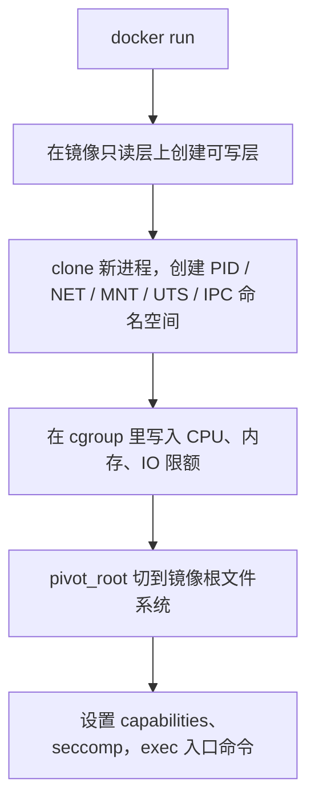

# 介绍

Docker 这条线绕不开三个问题：容器是什么，为什么需要它，它和虚拟机差在哪。这三问答不清，后面的命令就只能靠背。再补上一个“为什么换成 Podman 也差不多”，这一阶段的主线就齐了。

## 这一阶段在讲什么

| 笔记                                | 回答的问题      | 一句话答案                            |
| --------------------------------- | ---------- | -------------------------------- |
| [[01-容器\|容器]]                     | 容器到底是什么    | 被命名空间和 cgroups 限制住的一组进程，不是缩小版虚拟机 |
| [[02-为什么用容器\|为什么用容器]]             | 值不值得用      | 环境一致、交付快、密度高；代价是共享内核和额外运维        |
| [[03-虚拟机与容器\|虚拟机与容器]]             | 隔离边界在哪     | 虚拟机虚拟化硬件，容器隔离进程，是两套机制而非强弱之分      |
| [[04-Docker 与 OCI\|Docker 与 OCI]] | 为什么换工具还能互通 | 镜像、运行时、分发都有 OCI 规范，Docker 只是实现之一 |

阅读顺序就是 01 → 02 → 03 → 04：01 建立模型，02 判断收益和代价，03 划清边界，04 解释生态。加上 [[00-总览|总览]] 和后面的 [[00-底层技术|底层技术]]，概念线就完整了。

这条线还挂着两组可选前置：[[01-包管理器|包管理器]]、[[02-用户与组|用户与组]]、[[03-Shell 命令|Shell 命令]]、[[04-Shell 脚本|Shell 脚本]]，以及 [[01-编程语言|编程语言]]、[[02-应用架构|应用架构]]。不熟也能先跑容器，但写 Dockerfile、处理 `permission denied`、排查容器里为什么连不上数据库时，迟早会补。

## 先立住一个心智模型

一句话：**容器就是宿主机上的一组普通进程**，只是被四层机制包了起来。

| 机制                     | 管什么       | 抽掉之后会怎样                          |
| ---------------------- | --------- | -------------------------------- |
| 命名空间                   | 进程能看见什么   | `ps` 会列出宿主机全部进程，`ip addr` 看到所有网卡 |
| cgroups                | 进程能用多少资源  | 一个容器可以吃光宿主 CPU、内存和 IO            |
| 镜像 + 联合文件系统            | 进程看到什么根目录 | 没有独立依赖，也谈不上可复现                   |
| capabilities / seccomp | 进程能做什么    | 容器里的 root 接近宿主 root              |

`docker run` 就是按这个顺序把进程“关”起来：



没有 Hypervisor，没有 Guest OS，也没有 init 流程。所以容器里 `uname -r` 读到的是容器所在的 Linux 内核，PID 1 是应用本身。

`systemctl`、`modprobe`、`dmesg` 这些依赖完整系统的命令，要么没有，要么被权限挡住。这些不是镜像做得不好，是容器的定义决定的。

## 用两个实验验证

### 进程隔离，内核共享

```bash
docker run --rm alpine sh -c 'echo pid=$$; ps -ef; uname -r'
uname -r
```

`$$` 通常输出 `1`，`ps` 只有一两个进程，`uname -r` 和容器所在的 Linux 内核一致——三行输出正好对应 PID 命名空间、进程视图和共享内核。

在 Linux 上它和宿主机一致；在 Windows/macOS 上，它显示的是 Docker Desktop 启动的 Linux 虚拟机内核，比如 `5.15.x-microsoft-standard-WSL2`，不是 Windows 或 macOS 自己的内核。

### 数据在可写层里，容器一删就没

```bash
docker run --rm alpine sh -c 'echo hello > /tmp/demo.txt'
docker run --rm alpine cat /tmp/demo.txt
# 输出：cat: can't open '/tmp/demo.txt': No such file or directory

docker run --rm -v demo-data:/data alpine sh -c 'echo hello > /data/demo.txt'
docker run --rm -v demo-data:/data alpine cat /data/demo.txt
# 输出：hello
docker volume rm demo-data
```

第一条写进容器的可写层，`--rm` 删除容器时可写层一起消失；第二条写进命名卷，容器删了卷还在。

这就是“删掉容器后数据去了哪”的答案：默认跟着可写层一起没了。要留住，用卷；要固化进交付物，改 Dockerfile 重新构建。

> [!tip] 判断数据该放哪
> 问一句“容器重建后还需要它吗”。不需要，留在可写层；需要，放卷或绑定挂载。开发时的源码用绑定挂载，数据库和上传目录用命名卷。

## 几组容易混的概念

| 对比                             | 区别                          | 记法              |
| ------------------------------ | --------------------------- | --------------- |
| 镜像 vs 容器                       | 只读模板 vs 运行实例                | 类与对象            |
| 容器 vs 虚拟机                      | 隔离进程 vs 虚拟化硬件               | 共享内核 vs 各自内核    |
| Docker vs 容器                   | 工具链 vs 技术                   | 品牌名不等于品类        |
| Docker vs OCI                  | 实现 vs 规范                    | 换工具，镜像和运行时仍能互通  |
| `docker stop` vs `docker kill` | 先 SIGTERM 再宽限 vs 直接 SIGKILL | 143 和 137 的常见来源 |

`docker stop` 默认先发 SIGTERM，等 10 秒还没退出再 SIGKILL；`docker kill` 默认直接 SIGKILL。

所以看到 143 多半是正常停止，看到 137 要区分是手动 `kill`、`stop` 超时还是内存超限。

## 五组对比，逐个说清

### 镜像 vs 容器

镜像是构建产物：一组只读层加一份配置（入口命令、环境变量、工作目录等），按内容寻址，本身不可变。容器是运行实例：在镜像之上加一层可写层，再套上命名空间、cgroup 和一组进程。

“类与对象”的类比能帮上忙，但要知道它在哪里失效：

- 一个类可以实例化多个对象，一个镜像也可以起多个容器，这部分成立。
- 对象销毁不改变类，容器删除也不改变镜像，这部分也成立。
- 但对象是内存里的数据结构，容器是内核里真实存在的进程集合；对象的状态在堆上，容器的状态在可写层和外部卷里。所以“容器是镜像的对象”只是帮助记忆，不能拿来推导生命周期。

判断方法很直接：`docker images` 看到的是镜像，`docker ps -a` 看到的是容器；`docker build` 改镜像，`docker exec` 改容器。最常见的错误是 exec 进去改完配置，以为镜像也变了——重建容器就回到原样。

### 容器 vs 虚拟机

这两者不是同一把尺子上的“强弱”，而是隔离对象不同：

- 虚拟机虚拟化硬件，每台有<font color="#c00000">独立</font>的固件、bootloader、内核、init 和用户态；Hypervisor 负责 CPU、内存、设备的隔离。
- 容器隔离进程，所有容器<font color="#c00000">共享宿主内核</font>，靠 namespaces 限制“看得见什么”、cgroups 限制“用多少”、capabilities/seccomp 限制“能做什么”。

由此可以直接推出容器里的那些限制：`uname -r` 读到宿主内核，`modprobe` 加载不了模块，全局 `sysctl` 改不了，没有 systemd，宿主内核 panic 会波及所有容器。这些不是镜像做得不好，是共享内核的定义决定的。

选择上，需要独立内核、内核模块、非 Linux 系统、强隔离多租户时用虚拟机；需要快速交付、高密度、弹性伸缩时用容器。生产上最常见的结构是“VM 里跑容器”，两层边界一起用。详见 [[03-虚拟机与容器|虚拟机与容器]]。

### Docker vs 容器

Docker 是一套工具链：CLI、dockerd、containerd、runc、BuildKit、Compose、镜像仓库客户端。容器是 Linux 内核提供的一套隔离技术：namespaces、cgroups、capabilities、联合文件系统。

类比的话，Docker 是品牌和工具，容器是品类和技术。就像“纸巾”和某个纸巾品牌，日常口语混着说没关系，但讨论迁移、标准化、安全边界时必须分开。Podman、containerd、CRI-O 都能跑同样的 OCI 容器；Kubernetes 通过 CRI 调用运行时，并不依赖 Docker。

所以“Docker 容器”这个说法严格讲是“由 Docker 工具链创建和管理的 OCI 容器”。换掉 Docker，容器还在，镜像也还在。

### Docker vs OCI

Docker 最早把构建、分发、运行这条链路做顺，但镜像格式和运行时并不归它私有。OCI 定了三份规范：镜像规范、运行时规范、分发规范。Docker 是这些规范的实现之一，不是规范本身。

分开之后，每一层都可以替换：

- 构建：Docker BuildKit、Buildah、Kaniko、Podman build 都能产出 OCI 镜像。
- 运行：runc、crun、Kata、gVisor 都能按 OCI 运行时规范创建容器。
- 分发：任何兼容 distribution spec 的 registry 都能推拉镜像。
- 编排：Kubernetes、Nomad、Swarm 通过 CRI 或运行时接口调度。

一个容易踩的细节：`docker save` 导出的是 Docker 自有格式，不是 OCI 布局。要跨工具交换，用 `docker buildx build --output type=oci` 或 `skopeo copy`。详见 [[04-Docker 与 OCI|Docker 与 OCI]]。

### docker stop vs docker kill

`docker stop` 是“请应用自己退出”：先发 SIGTERM，默认等 10 秒，进程还没结束再发 SIGKILL。如果进程被 SIGTERM 直接终止，退出码是 143；如果应用捕获了 SIGTERM 并自己正常退出，退出码可能是 0；没接住信号、等到超时被 SIGKILL，退出码才是 137。

`docker kill` 默认直接发 SIGKILL，不给收尾机会；需要优雅终止时可以 `docker kill -s SIGTERM`。`docker rm -f` 相当于 SIGKILL 加删除。

选择很简单：正常发布、缩容、重启用 `stop`；进程卡死、必须立刻中断用 `kill`。但 `stop` 能不能优雅，取决于应用有没有处理 SIGTERM，以及 PID 1 是不是应用本身——如果 PID 1 是 shell 且没转发信号，`stop` 最终还是走到 SIGKILL。

## 四层机制：每一层抽掉会怎样

| 机制 | 管什么 | 具体手段 | 抽掉之后的后果 |
| --- | --- | --- | --- |
| 命名空间 | 进程能看见什么 | PID、NET、MNT、UTS、IPC、USER、CGROUP、TIME | `ps` 列出宿主全部进程，`ip addr` 看到所有网卡，根目录和宿主一样 |
| cgroups | 进程能用多少资源 | CPU、内存、IO、PID 数量限额 | 一个容器可以吃光宿主 CPU、内存和磁盘 IO |
| 镜像 + 联合文件系统 | 进程看到什么根目录 | overlay2 只读层 + 可写层，`pivot_root` 切换根 | 没有独立依赖，环境不可复现，也谈不上镜像交付 |
| capabilities / seccomp | 进程能做什么 | 默认 capability 集、syscall 白名单、AppArmor/SELinux | 容器里的 root 接近宿主 root，内核攻击面完全暴露 |

**命名空间**负责“视野”。PID 命名空间让容器里的进程只看到同一命名空间内的进程，所以 PID 1 是入口命令；NET 命名空间给容器独立的网卡、路由和端口空间；MNT 命名空间让容器有自己的挂载表；UTS 决定 `hostname`；IPC 隔离共享内存和消息队列。USER 命名空间默认不启用，这是“容器里的 root 就是宿主 root”的直接原因。

**cgroups** 负责“配额”。CPU 用 `cpu.max` 控制带宽，内存用 `memory.max` 控制上限并在超限时触发 OOM，IO 用 `io.max` 限速，`pids.max` 防止 fork 炸弹。`docker run --cpus`、`-m`、`--pids-limit` 最终都写进 cgroup。没有它，一个容器的内存泄漏就能把整台机器拖垮。

**镜像和联合文件系统**负责“根目录”。容器看到的 `/` 不是宿主根目录，而是镜像层叠加后的结果；`pivot_root` 把进程的根切过去，旧根挂到别处再卸载。没有这一层，应用只能直接用宿主机的库，依赖冲突和“本地能跑线上不能跑”就回来了。

**capabilities 和 seccomp** 负责“权限”。Linux 把 root 的特权拆成几十个 capability，Docker 默认只保留一部分（如 `CHOWN`、`DAC_OVERRIDE`、`SETUID`、`NET_BIND_SERVICE`），并加载默认 seccomp 配置拦截危险 syscall。没有这一层，容器里的 uid 0 就能改宿主时间、加载模块、挂载文件系统。

`docker run` 的顺序也对应这四层：创建可写层 → `clone` 新进程并建命名空间 → 写 cgroup 限额 → `pivot_root` 切根 → 设置 capabilities/seccomp → `exec` 入口命令。

## 学完的标准

| 标准 | 自检方式 |
| --- | --- |
| 能说清镜像和容器的关系，以及删掉容器后数据去了哪 | 能复现上面可写层和命名卷的对比 |
| 能解释容器为什么比虚拟机启动快 | 指出省掉了固件、bootloader、Guest 内核和 init |
| 知道哪些场景不适合容器 | 至少说出独立内核、强隔离多租户、GUI 或遗留系统 |
| 看到 `Exited (137)` 知道先查 OOM 还是信号 | `docker inspect --format '{{.State.OOMKilled}} {{.State.ExitCode}}' <容器>` |

`OOMKilled` 为 `true` 就是内存超限；为 `false` 再看 `docker events` 和操作记录，区分 `kill`、`stop` 超时还是应用自己退出。

## 常见误区

- **“容器是轻量级虚拟机”**：容器没有 Guest OS，PID 1 就是应用进程。
- **“容器里的 root 是隔离的”**：默认不启用 user 命名空间，容器里的 uid 0 在宿主上也是 uid 0，靠 capabilities、seccomp 和挂载命名空间收紧。
- **“容器删了，改动还在镜像里”**：镜像只读，运行时写入落在可写层，删容器即丢。
- **“容器启动一定快”**：进程启动是毫秒级，但冷启动要拉镜像，几百 MB 的镜像可能几十秒。
- **“Docker 就是容器”**：Docker 是工具链，容器是技术；Podman、containerd 跑的是同一套 OCI 规范。
- **“一个容器只能跑一个进程”**：这是最佳实践，不是内核限制；多进程容器在信号、日志和生命周期管理上更麻烦。

## 下一步

概念立住后，接着看 [[00-底层技术|底层技术]]，把命名空间、cgroups 和联合文件系统拆开看；然后 [[00-安装配置|安装配置]] 装环境，[[00-基础|基础]] 跑通第一个闭环。

## 相关笔记

- [[00-总览|Docker 路线图总览]]
- [[00-底层技术|底层技术]]
- [[01-容器|容器]]
- [[02-为什么用容器|为什么用容器]]
- [[03-虚拟机与容器|虚拟机与容器]]
- [[04-Docker 与 OCI|Docker 与 OCI]]
- [[00-安装配置|安装配置]]
- [[00-基础|基础]]

可选前置：

- [[01-包管理器|包管理器]]
- [[02-用户与组|用户与组]]
- [[03-Shell 命令|Shell 命令]]
- [[04-Shell 脚本|Shell 脚本]]
- [[01-编程语言|编程语言]]
- [[02-应用架构|应用架构]]
