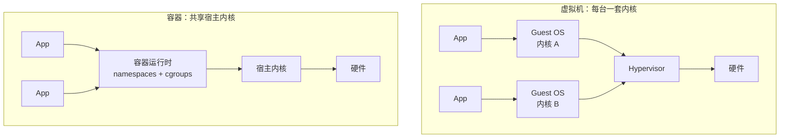

# 虚拟机与容器

虚拟机虚拟化的是硬件，容器隔离的是进程。这是两套不同的机制，不是"隔离程度的强弱"。

虚拟机里跑着一台完整的计算机：固件、bootloader、内核、init、用户态，一应俱全，每台有自己的内核。

==容器里的进程则和宿主机共用同一个内核==，只是被命名空间限制了视野、==被 cgroups 限制了资源、被 capabilities 和 seccomp 限制了权限。

理解了这一点，容器里那些"奇怪"的限制——不能加载内核模块、不能改全局内核参数、内核版本跟着宿主机走——都是直接推论，不用死记。



## 核心对比

| 维度 | 虚拟机 | 容器 |
| --- | --- | --- |
| 隔离对象 | 整台机器（硬件虚拟化） | 单个进程（内核隔离） |
| 隔离机制 | Hypervisor + 完整 Guest OS | namespaces + cgroups + capabilities/seccomp |
| 内核 | 每台一个，版本可以不同 | 共享宿主内核，版本由宿主决定 |
| 启动 | 十几秒到分钟级 | 毫秒级到秒级（冷启动拉镜像除外） |
| 镜像体积 | GB 级 | MB 级 |
| 单机密度 | 几十台 | 几百个 |
| 内存开销 | 每台几百 MB 到 1GB+ | 每个几 MB 起 |
| 安全边界 | 硬件级，逃逸要突破 Hypervisor | 内核级，逃逸可利用内核或运行时漏洞 |
| 故障域 | 只影响那一台 VM | 同宿主的所有容器共享内核 |
| 迁移与快照 | 成熟（vMotion、快照、克隆） | 基本没有，CRIU 只覆盖少数场景 |
| 内核补丁 | 每台都要打 | 宿主打一次，全部生效 |
| 可观测性 | 黑盒，需要装 agent | 就是宿主上的进程，`ps`、`perf`、`bpftrace` 直接看 |
| 典型代表 | ESXi、KVM、Hyper-V、Xen | Docker、containerd、Podman |

## 虚拟机：虚拟化硬件

按 Hypervisor 的位置分两类。

| 类型 | 运行位置 | 代表 | 说明 |
| --- | --- | --- | --- |
| Type 1 | 直接跑在硬件上 | ESXi、KVM、Xen、Hyper-V | 云厂商和数据中心的主力 |
| Type 2 | 跑在宿主操作系统上 | VMware Workstation/Fusion、VirtualBox | 桌面开发、测试环境 |

KVM 严格说是 Linux 内核里的虚拟化模块，把 Linux 变成了 Hypervisor，通常归入 Type 1。QEMU 是模拟器，配合 KVM 加速后也常用于调试镜像。

一台 VM 的启动链是完整的：

```
UEFI/BIOS → bootloader(GRUB) → 内核 → init/systemd → 用户态服务
```

每一步都要时间，也都要内存。这是 VM 启动慢、占用高的根源。硬件辅助虚拟化（VT-x/AMD-V、EPT、IOMMU）负责 CPU、内存和设备的隔离，半虚拟化驱动（virtio）则把 I/O 开销降下来。

因为有完整内核，VM 里可以：

- 跑任意 Linux 发行版、Windows、BSD，甚至不同版本的内核；
- `modprobe` 加载模块、编译安装驱动；
- 改任意 sysctl，包括全局参数；
- 用 systemd 管理服务、跑 Docker（需要嵌套虚拟化）；
- 装 GUI、桌面环境、遗留软件。

代价也很明确：镜像按 GB 算，每台一份系统盘；内存要预留；克隆、快照、迁移都比容器重一个数量级。

## 容器：隔离进程

`docker run` 做的事情可以拆成几步：

1. 把镜像的只读层叠起来，上面加一层可写层（overlay2）；
2. `clone()` 创建新进程，同时创建新的 PID、NET、MNT、UTS、IPC 命名空间；
3. 在 cgroup 里写入 CPU、内存、IO 限制；
4. `pivot_root` 切到镜像的根文件系统；
5. 设置 capabilities、seccomp、AppArmor/SELinux；
6. `exec` 镜像里的入口命令。

没有 Hypervisor，没有 Guest OS，也没有完整的 init 流程。启动就是 fork + exec 加上这些配置，所以快。容器里 `ps` 只有几个进程，`ip addr` 是自己的网卡，`/` 是镜像的根，但 `uname` 读到的是宿主内核。细节见 [[01-容器|容器]] 和 [[00-底层技术|底层技术]]。

## 共享内核意味着什么

下面这些实验在容器里跑一遍，比看定义直观。

### 内核版本跟着宿主机走

```bash
$ docker run --rm alpine uname -r
6.8.0-45-generic
$ uname -r
6.8.0-45-generic
```

`/proc/version` 也一样。容器没有自己的内核，`uname` 读到的永远是宿主内核。

### 没有 /lib/modules，也加载不了模块

```bash
$ docker run --rm alpine modprobe br_netfilter
modprobe: can't change directory to '/lib/modules': No such file or directory
```

镜像里通常不带内核模块，默认也没有 `CAP_SYS_MODULE`。就算把 `/lib/modules` 挂进去，模块也是装进宿主内核，不是装进"容器自己的内核"——根本没有那个东西。

### 全局内核参数改不了

```bash
$ docker run --rm alpine sysctl -w vm.swappiness=10
# sysctl: permission denied on key "vm.swappiness"
```

有的版本会报 `Read-only file system`，因为 `/proc/sys` 默认只读挂载。要分清两类键：

- 按命名空间隔离的键（`net.*`、`kernel.shm*` 等）可以设置，只影响这个容器：

  ```bash
  docker run --rm --sysctl net.ipv4.ip_forward=1 alpine sysctl net.ipv4.ip_forward
  # net.ipv4.ip_forward = 1
  ```

- 全局键（`vm.swappiness`、`kernel.pid_max`、`kernel.kptr_restrict` 等）改了会影响整台宿主机，`--sysctl` 会直接被拒绝。

`--privileged` 能改，但等于把宿主内核的控制权交出去。虚拟机里随便改，改坏了重启那台 VM 就行。需要调内核、装驱动、加载模块的负载，容器不是好选择。

### 看不到宿主内核日志

```bash
$ docker run --rm alpine dmesg
dmesg: read kernel buffer failed: Operation not permitted
```

默认没有 `CAP_SYSLOG`。排查内核问题时，容器里看不到，只能回宿主机。

### 不能随便 mount

```bash
$ docker run --rm alpine mount -t tmpfs none /mnt
mount: permission denied (are you root?)
```

没有 `CAP_SYS_ADMIN`。需要挂载文件系统的工具（某些 VPN 客户端、FUSE 工具）在容器里跑不起来，除非加 capability 或 `--privileged`。

### 设备访问受 device cgroup 限制

容器里能 `mknod`（默认有 `CAP_MKNOD`），但打开设备节点会被 device cgroup 拦住。要用 GPU、串口、USB 设备，得显式 `--device` 或挂载对应设备。

### 没有 init，PID 1 是应用

```bash
$ docker run --rm alpine ps
PID   USER     TIME  COMMAND
    1 root      0:00 ps
```

`ps` 自己就是 1 号进程。没有 systemd、没有 syslog、没有 cron。需要 init 回收孤儿进程时用 `--init`；真想跑 systemd，得用特权模式和专门镜像，通常说明这个负载更适合虚拟机。

### 宿主机一出问题，所有容器一起遭殃

内核 panic、全局 OOM 策略、文件系统 bug，影响整台机器上的所有容器。VM 的内核 panic 只挂那一台。升级宿主内核要重启，所有容器随之中断（除非有 livepatch）。

> [!note] Windows 和 macOS 上的"宿主"
> Docker Desktop 并不是直接在 Windows/macOS 上跑容器，而是先启动一个 Linux 虚拟机（WSL2 或 LinuxKit），容器跑在里面。所以 `uname -r` 看到的是那个 VM 的内核，比如 `6.6.x-microsoft-standard-WSL2`。它本身就是"VM 里跑容器"的现成例子。

## 隔离不是安全边界

命名空间只改变"看得见什么"，不改变权限模型。默认配置下 Docker 不启用 user 命名空间，容器里的 uid 0 在宿主上也是 uid 0；挡住它的是 capabilities、seccomp、AppArmor/SELinux 和 mount 命名空间，而不是 UID 映射。

历史上不少逃逸都出在这一层：

| 漏洞 | 问题 | 后果 |
| --- | --- | --- |
| CVE-2019-5736 | runc 被恶意容器覆盖宿主二进制 | 容器逃逸，拿到宿主 root |
| CVE-2022-0492 | cgroups v1 `release_agent` 配合 `CAP_SYS_ADMIN` | 提权、逃逸 |
| CVE-2024-21626 | runc 文件描述符泄漏，工作目录落到宿主文件系统 | 逃逸、读写宿主文件 |

宿主内核自身的漏洞（比如 Dirty Pipe）在容器里同样可以利用——共享的就是这个内核。相比之下，VM 要逃逸得先突破 Hypervisor 或虚拟设备，攻击面小得多。

但 VM 也不是绝对安全。QEMU 的 VENOM、各类 Hypervisor CVE 都真实存在；共享文件夹、拖放、USB 直通、剪贴板配置不当也能穿透隔离。区别在于层次更多、利用难度更高。

需要强隔离时，加固顺序大致是：rootless 或 `--userns-remap` → 去掉多余 capabilities → 只读根文件系统 → seccomp 白名单 → 不挂 `docker.sock`、不用 `--privileged`。仍然不够，就换 microVM 或 gVisor，见 [[02-运行时安全|运行时安全]]。

## 镜像、内存与密度

镜像分层放大了密度优势。十个基于 `nginx` 的容器共享同一份只读层，磁盘上只有一份；每个容器只多一个可写层。虚拟机每台都要复制系统盘，克隆、快照、迁移都按 GB 算。

内存同理。同一份 nginx 二进制和基础库的代码页在 page cache 里共享，十个容器不会各占一份；VM 每台都要跑自己的内核、init、systemd 和日志服务。

这也解释了两个常见现象：

- 镜像小不等于运行内存小。应用本身的堆、缓存、连接池照样占内存，镜像只决定了基础环境。
- 容器开得多了，先到瓶颈的往往是内核对象（socket、conntrack、inode），而不是 CPU 或内存。

## 启动与弹性

容器启动是创建命名空间、挂根文件系统、exec 应用，通常几十到几百毫秒；VM 要走固件、bootloader、内核、init，十几秒起步。扩容时这个差距很直观：起 20 个容器几秒钟，起 20 台 VM 要等几十秒到几分钟。

两个容易忽略的点：

- "毫秒级"指的是进程启动，不含拉镜像。冷启动拉一个几百 MB 的镜像可能要几十秒。
- microVM 把差距缩到了百毫秒级。Firecracker 官方数据是启动约 125ms、额外内存不到 5MiB，serverless 容器平台靠的就是它。

## 对比表里没展开的几项

### 迁移与快照

虚拟机的迁移和快照是 Hypervisor 层的能力：vMotion 把运行中的内存页和 CPU 状态迁到另一台宿主机，快照把磁盘和内存状态一起冻结，克隆直接复制整台机器。成熟、通用，但都以 GB 为单位，耗时和存储开销都高。

容器这边没有等价的通用能力。CRIU 可以做 checkpoint/restore，把进程内存和命名空间状态落盘再恢复，但受内核版本、应用类型和命名空间支持限制，GPU、复杂 I/O、部分 socket 状态都不好处理，生产上很少作为常规手段。容器的实际做法是“不迁移，重建”：镜像在仓库里，状态在卷或外部服务里，调度器在另一台机器上起一个新副本，旧副本删掉。Kubernetes 的滚动更新、驱逐、扩缩容都是这个模型。

这也是“宠物 vs 牲畜”的区别：VM 更像宠物，出问题要救、要迁；容器被设计成牲畜，坏了就换。需要保留长连接、内存态、本地临时状态的长生命周期负载，虚拟机仍然更合适。

### 内核补丁

虚拟机每台有自己的内核，补丁要逐台打、逐台重启，内核版本可以各不相同。好处是你可以让不同业务跑在不同内核上，坏处是几十台 VM 的补丁窗口很难协调。

容器共享宿主内核，宿主打一次补丁，所有容器同时生效，运维上简单得多。代价是：宿主重启会中断所有容器（除非用 livepatch 这类免重启补丁）；内核版本只有一份，无法为某个业务保留旧内核；内核漏洞和 panic 的影响面是整台机器。

所以“内核补丁”这一行不是单纯的优势，而是把“版本灵活性”换成了“运维集中度”。需要多内核版本并存、需要长期不重启的负载，虚拟机的边界更合适。

### 可观测性

虚拟机对 Hypervisor 来说是一个黑盒：能看到 CPU、内存、磁盘、网络的用量，但里面的进程、syscall、文件访问要靠 Guest 内装 agent。优点是隔离清楚，缺点是排查要进系统、要装工具。

容器就是宿主上的进程，宿主可以直接 `ps`、`top`、`perf`、`bpftrace`、`strace`，cgroup 也提供每容器的资源统计。`docker top`、`nsenter` 能从宿主进入容器的命名空间。代价是镜像里往往没有调试工具，需要旁路容器或宿主工具；同时 seccomp、capabilities 可能挡住某些观测手段。

这两种可观测性没有绝对优劣：容器在宿主侧更强，虚拟机在“客户机内部完全自治”上更彻底。

### 典型代表

这一行容易把不同层的东西混在一起：

- Hypervisor：ESXi、KVM、Hyper-V、Xen。
- 容器运行时：runc、crun、containerd、CRI-O。
- 容器工具链：Docker、Podman、Buildah、Skopeo。
- 编排：Kubernetes、Nomad、Swarm。
- 增强隔离运行时：Kata Containers、gVisor、Firecracker。

所以“Docker vs ESXi”不是同一层的对比；更合理的说法是“Docker 工具链 + runc 运行时”与“KVM + Guest OS”在隔离模型上的差异。

## 中间地带

现实里不是只有“VM”和“容器”两个选项。

| 方案 | 机制 | 隔离级别 | 启动 | 兼容性 | 典型用途 |
| --- | --- | --- | --- | --- | --- |
| 系统容器（LXC/LXD） | 共享内核，提供完整发行版用户态 | 同普通容器 | 秒级 | 高 | 想要“像 VM 的容器”的轻量隔离环境 |
| microVM（Firecracker） | 精简 KVM 虚拟机，通常只跑一个容器 | 接近 VM | ~125ms | 高，真内核 | Fargate、Serverless |
| Kata Containers | 每个 Pod 一个轻量 VM，OCI 兼容 | VM 级 | 数百 ms | 高 | 多租户 Kubernetes |
| gVisor | 用户态内核拦截 syscall | 强，但不是硬件隔离 | 快 | 中，syscall 覆盖不全 | Cloud Run、不可信代码 |
| Wasm / WASI | 沙箱字节码 | 强 | 极快 | 低，需要重新编译 | 边缘计算、插件系统 |
| chroot / jail | 只换根目录 | 弱 | 极快 | 高 | 不能当安全边界用 |

逐个展开：

**LXC/LXD** 是“系统容器”：它用 namespaces 和 cgroups 隔离出一个完整的发行版用户态，能 `systemd`、能装包、能像 VM 一样登录。它和普通容器共享同一个内核，所以隔离级别并没有本质提升；适合开发测试、轻量隔离环境、把遗留应用从 VM 搬过来，不适合多租户不可信负载。

**microVM（Firecracker）** 用 KVM 起一台极简虚拟机，只保留必要的设备模型，通常里面只跑一个容器或一个函数。它同时拿到接近容器的启动速度（官方数据约 125ms、额外内存不到 5MiB）和接近 VM 的硬件隔离，代价是每个实例仍有独立内核和内存开销，密度低于普通容器，而且需要 KVM 支持。

**Kata Containers** 给每个 Pod 套一台轻量 VM，对外仍然是 OCI 兼容的运行时。它适合多租户 Kubernetes，但需要嵌套虚拟化或裸金属；部分云实例不支持嵌套虚拟化，会退回普通 runc，隔离等级就降下来了。

**gVisor** 在用户态实现一个内核（Sentry），拦截应用的 syscall，不直接落到宿主内核。它不需要硬件虚拟化，隔离强于普通容器，但 syscall 覆盖不全，I/O 密集、依赖特殊 syscall 或 GPU 的程序可能跑不起来，性能也有额外开销。

**Wasm/WASI** 是字节码沙箱，应用编译成 Wasm 后在运行时里执行，不经过 Linux syscall。启动极快、隔离强，但需要重新编译，生态和系统能力仍在演进，适合插件、边缘函数，不是通用容器的替代品。

**chroot/jail** 只改变进程看到的根目录，没有命名空间、cgroup、capability 限制，逃逸非常容易。它可以用来做文件系统隔离或兼容旧环境，但不能当安全边界。

隔离强度大致可以排成：chroot < 普通容器 < gVisor/Wasm（用户态隔离）≈ microVM/Kata（硬件隔离）。但兼容性、启动速度和密度并不是单调变化的，选型时要一起看。

## Windows 容器是另一种边界

Windows 容器有两种隔离模式，经常被混为一谈：

| 模式 | 内核 | 隔离 | 启动与密度 | 适用 |
| --- | --- | --- | --- | --- |
| Process isolation | 共享 Windows 内核 | 进程级，类似 Linux 容器 | 快、密度高 | 宿主与容器 OS 版本兼容 |
| Hyper-V isolation | 每个容器一个轻量 VM | 硬件级 | 慢一些、内存开销高 | 版本不兼容、需要强隔离 |

所以在 Windows 上，“容器”不一定等于“共享内核”。而 Linux 容器跑在 Windows/macOS 上时，Docker Desktop 会先起一个 Linux 虚拟机（WSL2 或 LinuxKit），容器跑在那台 VM 里——这本身就是“VM 里跑容器”的例子。

## 怎么选

| 场景 | 倾向 | 理由 |
| --- | --- | --- |
| 多租户、跑用户提交的代码 | VM / microVM / gVisor | 需要硬件级或用户态内核级隔离 |
| 需要特定内核版本、内核模块、驱动 | VM | 容器无法自带内核 |
| 非 Linux 系统、GUI、遗留软件 | VM | 容器基本只跑 Linux（Windows 容器另说） |
| 内部微服务、Web 服务、CI 构建 | 容器 | 启动快、密度高、镜像可复现 |
| 需要频繁扩缩容 | 容器 | 秒级启动，调度粒度小 |
| 合规要求强隔离 | VM，或 Kata | 边界清晰，便于审计 |
| 本地开发环境 | 容器 | 与生产一致；Docker Desktop 底层仍是 VM |
| 单机定时脚本、静态页面 | 直接部署 | 引入容器只增加运维成本 |

生产上最常见的不是二选一。云上 Kubernetes 集群的节点本身就是 VM，Pod 是容器，两层边界一起用：

```
物理机 → Hypervisor → VM（节点） → 容器运行时 → 容器（Pod）
```

云厂商的托管集群（EKS、GKE、ACK）基本都是这个结构。Serverless 容器更进一步：每个任务起一个 microVM，用户看不到节点，也就没有"共享内核"的顾虑。

> [!tip] 数字感受
> 同样 16GB 内存的主机：一台带完整发行版的 VM 空转就要几百 MB 到 1GB+，剩下才能给应用；容器本身只占几 MB，16GB 能塞下几十个中等服务。启动 50 个容器通常几秒，启动 50 台 VM 要几十秒到几分钟。磁盘上，十个基于 `nginx` 的容器共享一份镜像层；十台 VM 就是十份系统盘。

## 常见误区

- **"容器是轻量虚拟机"**：不是。容器没有 Guest OS，PID 1 就是应用，它更接近"被关进笼子的进程"。
- **"容器里的 root 是隔离的"**：默认没有 user 命名空间，容器里的 uid 0 就是宿主 uid 0，靠 capabilities 和 seccomp 兜底。
- **"容器启动一定快"**：进程启动快，但冷启动要拉镜像，可能几十秒。
- **"容器里跑 systemd 很正常"**：默认没有 init，PID 1 是应用。硬上 systemd 需要特权或特殊镜像，通常说明负载更适合 VM。
- **"VM 绝对安全"**：Hypervisor 和虚拟设备也有漏洞，共享目录、USB 直通配置不当同样会穿透。
- **"容器不能跑数据库"**：能跑，但数据要放卷、要考虑备份和主从；生产上更常见的是用托管数据库。

## 相关笔记

- [[00-介绍|介绍]]
- [[01-容器|容器]]
- [[02-为什么用容器|为什么用容器]]
- [[01-命名空间|命名空间]]
- [[02-控制组|控制组]]
- [[03-联合文件系统|联合文件系统]]
- [[02-运行时安全|运行时安全]]
- [[04-Docker 与 OCI|Docker 与 OCI]]
- [[01-Docker 桌面版|Docker 桌面版]]
- [[03-Kubernetes|Kubernetes]]
