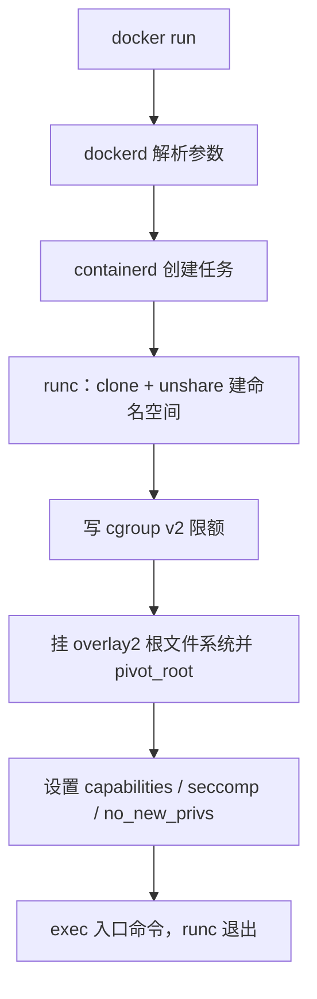

# 底层技术

Docker 的命令行只是外壳，真正干活的是 Linux 内核的几套机制。把这几样分清楚，容器的大多数“怪现象”都能当场解释，不用翻文档。

容器不是凭空造出来的隔离环境，而是把已有内核能力组合起来：

命名空间决定“看得见什么”，
cgroups 决定“能用多少”，
联合文件系统决定“根目录长什么样”，
capabilities 和 seccomp 决定“能做什么”。

前三个是这一阶段的主线，第四个留到安全部分展开。

| 机制      | 管什么           | 典型现象                             | 观察命令                                             |
| ------- | ------------- | -------------------------------- | ------------------------------------------------ |
| 命名空间    | ==进程能看见什么==   | 容器里 `ps` 只有几个进程，`ip addr` 是自己的网卡 | `lsns -p <PID>`                                  |
| cgroups | ==进程能用多少资源==  | 超过 `--memory` 被杀，退出码 137         | `cat /sys/fs/cgroup/...`                         |
| 联合文件系统  | ==文件系统怎么叠起来== | 镜像层共享，容器写操作落在最上面的可写层             | `docker inspect -f '{{json .GraphDriver.Data}}'` |

## 一次 docker run 发生了什么

一条命令同时用到了三者：

```bash
docker run -d --name web --memory=256m --cpus=1 -p 8080:80 nginx
```



拆开对应到机制上：

- 为新进程创建 PID、NET、MNT、UTS、IPC 命名空间，所以它有自己的 1 号进程、网卡和根文件系统；
- 在 cgroup v2 里建一个 scope，写入 `memory.max=268435456`、`cpu.max=100000 100000`；
- 用 overlay2 把 nginx 的只读镜像层和一层空的可写目录挂成 `/`；
- `-p 8080:80` 在宿主机的网络命名空间里加转发规则，把流量送进容器的 80 端口。

注意顺序：命名空间建立之后，进程才“看不见”宿主机的大部分资源；cgroup 限额在进程真正跑起来前写进去；`pivot_root` 在最后阶段切换根目录。任何一步失败，容器都起不来，而报错会落在不同的层上。

## 亲手观察三层

```bash
docker run -d --name probe --memory=256m --cpus=1 nginx:1.27

PID=$(docker inspect -f '{{.State.Pid}}' probe)
CID=$(docker inspect -f '{{.Id}}' probe)

# 1. 命名空间：同一 TYPE 下，容器进程的编号与宿主机 1 号进程不同
sudo lsns -p "$PID"

# 2. cgroups：容器进程属于哪个 cgroup
cat /proc/"$PID"/cgroup
# 0::/system.slice/docker-$CID.scope
sudo cat /sys/fs/cgroup/system.slice/docker-"$CID".scope/memory.max
# 268435456

# 3. 联合文件系统：四个目录分别在哪
docker inspect probe -f '{{json .GraphDriver.Data}}' | jq
```

三条命令分别落到三个子系统和三份笔记上：`lsns` 的 `TYPE` 对应命名空间类型，`cgroup` 路径对应控制器文件，`GraphDriver` 的 `LowerDir` / `UpperDir` 对应镜像层和可写层。记住这个对应关系，后面看单篇时不容易迷路。

## 三者是正交的

命名空间、cgroups、联合文件系统互不依赖，可以任意组合。理解这一点，很多“为什么这个开关没影响那个行为”的问题就消失了：

| 组合 | 效果 | 例子 |
| --- | --- | --- |
| 独立命名空间 + 不限 cgroup | 隔离视野，但可以吃满宿主机资源 | 默认 `docker run` 不设 `--memory` |
| 共享网络 + 限内存 | 复用宿主网络栈，但限制内存 | `--network=host --memory=256m` |
| 独立挂载 + 共享 PID | 自己的根目录，但能看到宿主进程 | `--pid=host` 调试 |
| 独立挂载 + 独立 PID | 完整的容器视图 | 常规容器 |
| 独立命名空间 + 共享 cgroup | 看得见隔离，配额却算在一起 | `--cgroupns=host` 且不设限额 |

同理，联合文件系统只决定根目录，和“能不能看到宿主进程”完全无关；cgroup 只决定配额，和“容器里有没有 systemd”也无关。把问题归到正确的机制上，排查才有方向。

## 现象 → 机制

| 现象 | 先怀疑 | 先跑什么 |
| --- | --- | --- |
| 容器里 `ps` 只有几个进程 | PID 命名空间 | `sudo lsns -p "$PID"` |
| 容器连不上宿主机服务 | NET 命名空间 | `sudo nsenter -t "$PID" -n ss -lntp` |
| 端口映射不生效 | NET 命名空间 + NAT/防火墙 | `sudo iptables -t nat -L -n`、`docker port` |
| `Exited (137)`、`OOMKilled=true` | cgroup 内存限制 | `cat memory.events` |
| CPU 用不满或延迟抖动 | cgroup CPU 配额/节流 | `cat cpu.stat` |
| 镜像几个 GB | overlay 层与构建方式 | `docker history`、`docker image inspect` |
| 删掉容器数据就没了 | 可写层与卷 | `docker diff`、检查挂载 |
| 容器里的 root 能改宿主文件 | user 命名空间未启用 | `cat /proc/"$PID"/uid_map` |
| 容器里 `mount` 报权限不足 | capabilities / seccomp | `capsh --print` |

## 为什么换工具行为一致

命名空间、cgroups、OverlayFS 都是内核特性，Docker 做的是组合和编排。真正执行 `clone()`、`unshare()`、`mount()` 的是 OCI 运行时（默认 runc），所以换 Podman 或 containerd 时这些行为基本一致。

```text
docker CLI → dockerd → containerd → containerd-shim → runc → 容器进程
```

这也解释了另外两件事：Windows 和 macOS 上的容器跑在一个 Linux 虚拟机里，因为内核机制只在 Linux 上存在；容器跑起来后 runc 就退出了，留下 shim 当父进程，所以重启 dockerd 不一定杀掉容器。

## 学习顺序

按“隔离 → 限制 → 存储”来：

1. 先看 [[01-命名空间|命名空间]]，能解释 `docker exec` 为什么进得去、`--network=host` 为什么省一层 NAT。
2. 再看 [[02-控制组|控制组]]，能解释 OOMKilled、CPU 跑不满和 `docker stats` 的数字。
3. 然后是 [[03-联合文件系统|联合文件系统]]，能解释镜像为什么分层、容器数据为什么丢。

> [!tip] 这些不是 Docker 发明的
> 命名空间、cgroups、OverlayFS 都是内核特性，Docker 做的是组合和编排。真正执行系统调用的是 OCI 运行时，所以换 Podman 或 containerd 时这些行为基本一致。反过来说，内核版本、cgroup 版本、文件系统类型会直接影响容器行为，遇到“换台机器就不一样”的问题，先查这些底层条件。

## 相关笔记

- [[01-命名空间|命名空间]]
- [[02-控制组|控制组]]
- [[03-联合文件系统|联合文件系统]]
- [[01-容器|容器]]
- [[04-Docker 与 OCI|Docker 与 OCI]]
- [[03-虚拟机与容器|虚拟机与容器]]
- [[00-基础|基础]]
- [[00-容器安全|容器安全]]
- [[02-运行时安全|运行时安全]]
