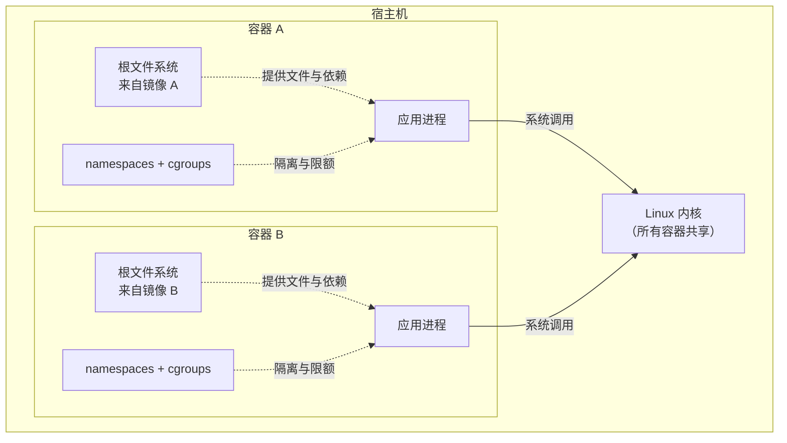
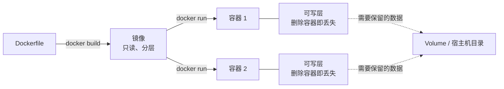
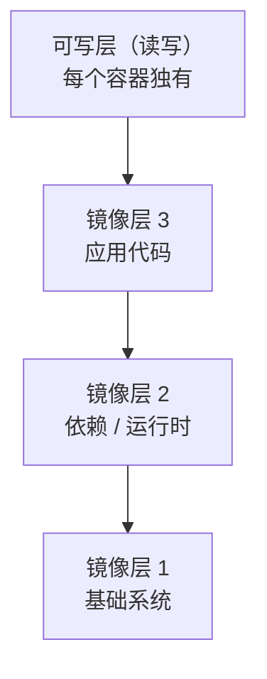
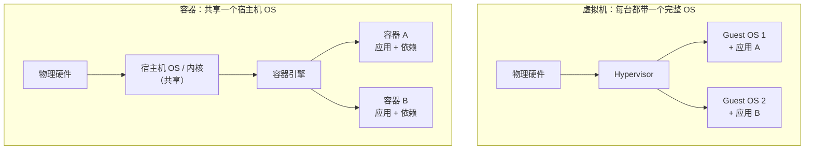
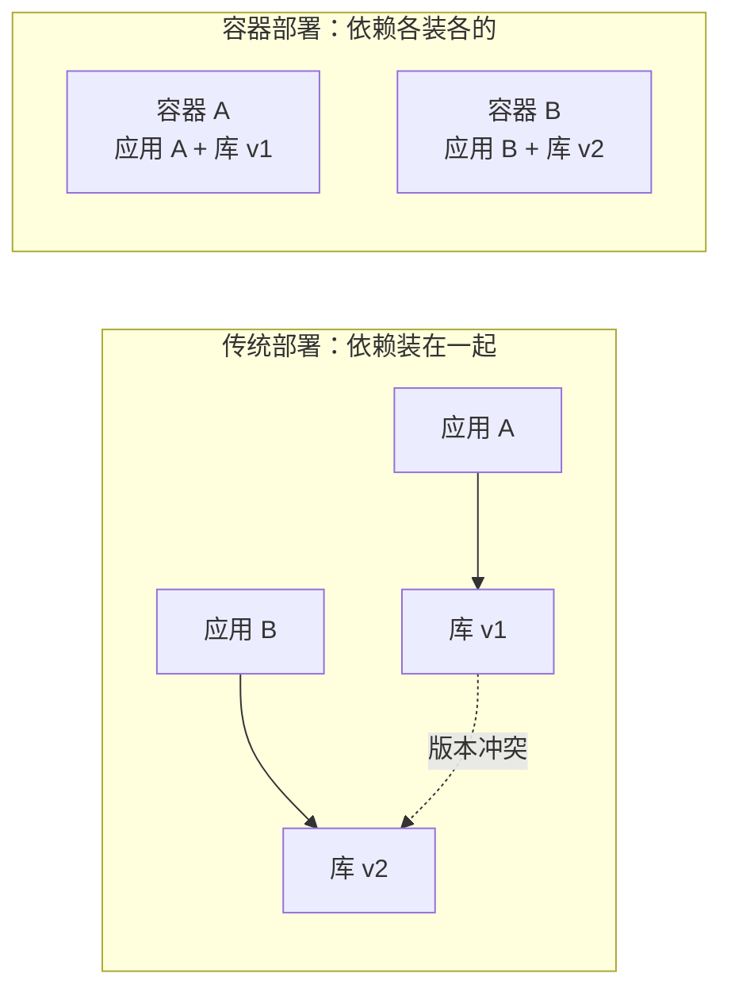
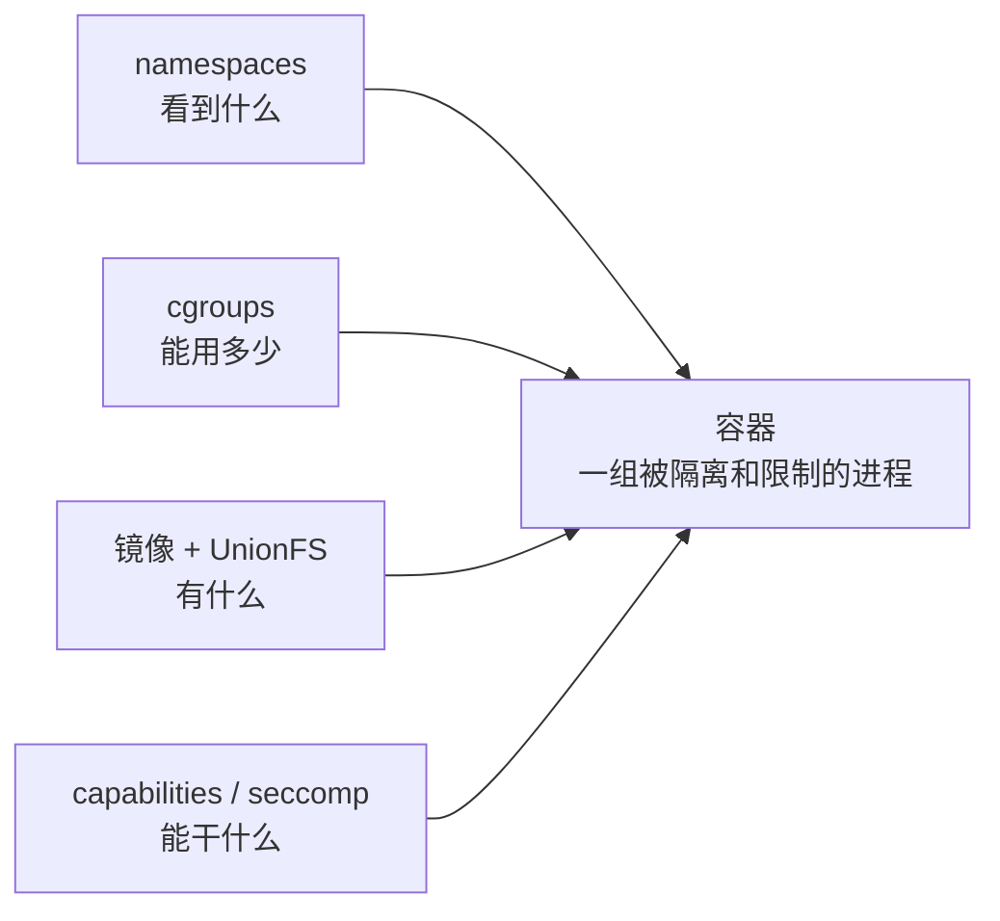
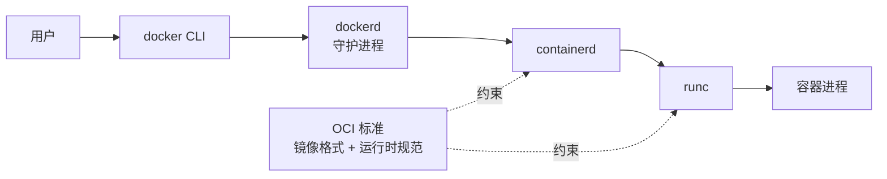
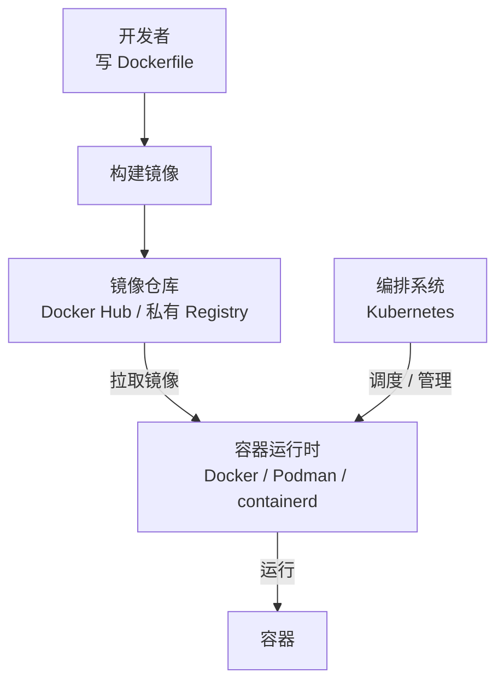
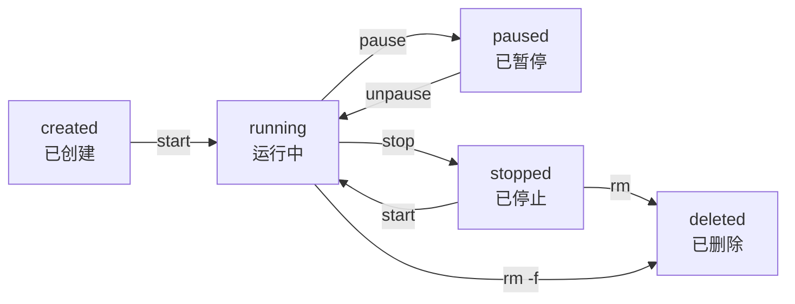

---
tags:
  - Docker
  - 后端
  - 容器
---

> 一句话：容器是==**把应用和它的依赖打包在一起、在宿主机上隔离运行的一组进程**==——它共享宿主机内核，所以比虚拟机轻得多，启动通常只要秒级甚至更短。

## 是什么

- 容器（Container）是一种**轻量级、可移植的运行环境**：把应用代码、运行时、系统库、配置一起打包，换一台机器也能以同样的方式跑起来
- 它听起来像"一台小虚拟机"，但本质完全不同：==**容器就是宿主机上的普通进程**==，只是被加上了隔离和限制
  - 在宿主机的进程列表里能看到它（PID 隔离只是让它"以为"自己是 1 号进程）
  - 它运行的是**宿主机的内核**，自己不携带内核
- 一个容器通常包含四样东西：

| 组成 | 作用 | 由什么实现 |
| --- | --- | --- |
| 一组进程 | 真正在跑的应用 | 宿主机内核调度 |
| 独立的文件系统视图 | 应用看到的根目录、依赖库 | 镜像 + 联合文件系统 |
| 独立的"世界观" | 自己的 PID、网络、主机名、挂载点 | Linux namespaces |
| 资源配额 | 最多用多少 CPU、内存、IO | Linux cgroups |

用一张图看它们的位置关系：

- 两个容器在宿主机上就是**两组普通进程**，最终都落到同一个内核——这正是容器"轻"的根源
- 容器之间彼此看不见（namespaces），也抢不走对方的资源配额（cgroups）

### 容器 vs 镜像

这两个词经常混用，但它们是**模板**和**实例**的关系：

| | 镜像（Image） | 容器（Container） |
| --- | --- | --- |
| 本质 | 只读的、分层的文件系统模板 | 镜像跑起来后的进程实例 |
| 状态 | 静态，不会被修改 | 动态，有运行状态 |
| 数量关系 | 一个镜像可以起多个容器 | 每个容器对应一个镜像 |
| 类比 | 类 / 安装包 / 菜谱 | 对象 / 运行中的程序 / 做好的菜 |

镜像本身是一摞只读层，容器只是在最上面盖了一张可写层：

- 容器启动时，会在镜像的只读层之上加一层**可写层**；写文件采用写时复制（Copy-on-Write），所以镜像本身始终不变
- ==**容器删掉，可写层里的临时数据就没了**==；需要持久化的数据要放到 volume 或宿主机目录

### 容器 vs 虚拟机

这是理解容器最关键的一组对比：

| | 容器 | 虚拟机 |
| --- | --- | --- |
| 隔离边界 | 宿主机内核（namespace / cgroup） | Hypervisor + 虚拟硬件 |
| 是否自带内核 | **否**，共享宿主机内核 | **是**，客户机有完整内核 |
| 启动速度 | 秒级甚至毫秒级 | 数十秒 |
| 体积 | 几十 MB 起 | 几 GB 起 |
| 性能开销 | 接近原生 | 有虚拟化损耗 |
| 单机密度 | 可以跑成百上千个 | 通常几个到几十个 |
| 隔离强度 | 中（取决于配置） | 强 |
| 能跑不同内核 / 不同 OS | 不能（Linux 容器只能跑在 Linux 内核上） | 能 |

从分层图能一眼看出差在哪：

- 虚拟机多出来的是**每一份 Guest OS**——体积、启动时间、内存开销主要都花在这里
- 容器省掉了这一层，所以更轻；代价是**内核也共享了**，隔离强度自然弱一些
- 记忆点：==**虚拟机虚拟的是"整台计算机"，容器隔离的只是"一个进程"**==
- 容器不是"更小的虚拟机"，两者不是同一层的东西：容器复用了宿主内核，省掉了操作系统那一大块开销

## 为什么需要容器（解决什么问题）

容器流行不是因为它"新"，而是因为它同时踩中了几个真实痛点：

### 1. 环境不一致："在我机器上能跑"

- 开发机、测试机、生产机的系统版本、库版本、环境变量经常不一样
- 容器把**运行环境本身**一起打包，交付的不再是代码，而是"代码 + 能跑它的环境"
- 一句话：==**Build once, run anywhere**==（构建一次，到处运行）

### 2. 依赖冲突

- 同一台机器上，应用 A 要 Python 3.8、应用 B 要 Python 3.11，直接装会打架
- 每个应用放进自己的容器，各有各的文件系统和依赖，互不干扰

### 3. 部署慢、回滚难

- 传统部署要装系统、配环境、改配置，动辄几十分钟，出了问题难以复原
- 容器部署就是"拉镜像、起容器"，回滚就是换回上一个镜像标签
- 配合**不可变基础设施**：环境只构建一次，之后不再手工修改

### 4. 资源利用率与弹性

- 一台物理机跑虚拟机，资源切得比较粗，空闲浪费多
- 容器共享内核、按需限制资源，密度高，扩缩容快，天然适合微服务和弹性伸缩

### 5. 交付与协作

- 镜像可以推到仓库（Docker Hub、私有 Registry），像代码一样版本化管理
- 开发、测试、运维拿到的是同一个产物，减少"环境锅"

## 容器是怎么实现的

在 Linux 上，容器不是什么"魔法"，而是几项内核能力拼起来的组合：

| 技术 | 管什么 | 一句话 |
| --- | --- | --- |
| **namespaces** | 隔离"看得见什么" | 让进程以为自己独占 PID、网络、主机名、挂载点 |
| **cgroups** | 限制"能用多少" | 限制 CPU、内存、磁盘 IO、进程数 |
| **UnionFS / overlayfs** | 决定"有什么" | 把镜像的分层文件系统叠加成一个只读根目录 |
| **capabilities / seccomp** | 收紧"能干什么" | 削减 root 权限、限制系统调用 |

- 常见 namespace：`mnt`（挂载点）、`pid`（进程号）、`net`（网络）、`ipc`（进程间通信）、`uts`（主机名）、`user`（用户）、`cgroup`、`time`

这四项能力各管一个维度，合起来才是一个容器：

- 所以可以粗略地记成：==**容器 = 进程 + namespaces + cgroups + 根文件系统**==

> [!warning] 关键局限
> 容器**共享宿主机内核**。内核有漏洞，或者容器被以 `--privileged`、挂载 `docker.sock` 等方式错误配置，都可能导致**容器逃逸**。容器默认不是强安全边界——详见 [[计算机类/计算机杂学/沙箱|沙箱]]。

## Docker 和容器是什么关系

- **容器是技术/概念，Docker 是最流行的实现和工具链之一**
- 容器思想早于 Docker：`chroot`、FreeBSD Jail、Solaris Zones、LXC 都是前辈
- Docker 在 2013 年把"镜像构建 + 分发 + 运行"做成了一套顺手的工具，才让容器真正出圈
- Docker 的运行时栈大致是：

- 再往上，镜像仓库、编排系统（Kubernetes）与 Docker 的关系：

- 现在容器生态已经标准化：**OCI**（Open Container Initiative）定义了镜像格式和运行时规范
- 因此 Docker 不是唯一选择：**Podman**（无守护进程、可 rootless）、**containerd**、**CRI-O**、**Kubernetes** 使用的 CRI 运行时等，都能跑 OCI 容器
- 一句话：==**Docker ≈ 容器的"品牌名"，但不是容器的同义词**==

## 容器的生命周期

容器从创建到删除有明确的状态流转，记住这张图就不会搞混 `create / start / stop / rm`：

- `create` 只是造出容器，`start` 才真正启动里面的进程
- `stop` 先发 SIGTERM，等待宽限期后再 SIGKILL；`kill` 则直接发信号
- 容器删除后可写层随之消失，需要保留的数据必须放在 volume 里

## 容器适合做什么

- **微服务部署**：每个服务一个容器，独立构建、独立升级
- **CI/CD**：流水线里用容器提供干净、可复现的构建环境
- **统一开发环境**：新同事拉下镜像就能跑，不用配半天环境
- **快速交付与回滚**：镜像即产物，版本可追溯
- **弹性伸缩**：配合 Kubernetes 等编排系统按负载增减实例
- **运行一次性任务**：批处理、数据迁移、测试任务，跑完即删

## 容器不适合什么

- **需要强隔离的多租户场景**：容器共享内核，隔离强度不如虚拟机；高安全要求可考虑 microVM（Firecracker、Kata Containers）或直接用虚拟机
- **需要不同操作系统 / 内核**：Linux 容器跑不了 Windows 内核的程序，反之亦然
- **重型 GUI 桌面应用**：不是容器的强项，配置麻烦、体验差
- **需要精细管理状态的场景**：容器本身适合无状态，数据库等有状态服务要额外设计持久化和备份
- **极简的单机小工具**：直接跑二进制可能比引入容器更简单

## 常见误区

- **"容器就是轻量级虚拟机"** —— 不是。虚拟机模拟整台机器并自带内核；容器只是宿主机上被隔离的进程
- **"容器绝对安全"** —— 默认不是安全边界，共享内核，配置不当可逃逸
- **"容器里的数据不会丢"** —— 删容器会连同可写层一起删掉，持久数据必须外挂 volume
- **"镜像一定能跨平台运行"** —— 镜像和 CPU 架构、内核类型相关；`linux/amd64` 的镜像不能直接在 ARM 上跑（除非多架构镜像或模拟）
- **"Docker 就是容器"** —— Docker 是工具，容器是技术；Podman、containerd 同样能跑容器
- **"一个容器只能跑一个进程"** —— 这是**约定和最佳实践**，不是技术强制。但多进程容器会带来信号处理、日志、生命周期管理上的麻烦

## 一句话记忆

- 容器 = **一个被关起来、带着自己文件系统的普通进程**
- 它靠 **namespaces 隔离视野、cgroups 限制资源、镜像提供文件系统**，共享宿主机内核
- 相比虚拟机：==**更轻、更快、更密，但隔离更弱**==
- 它解决的核心问题是：**让应用带着环境一起走，到哪都能一模一样地跑起来**
