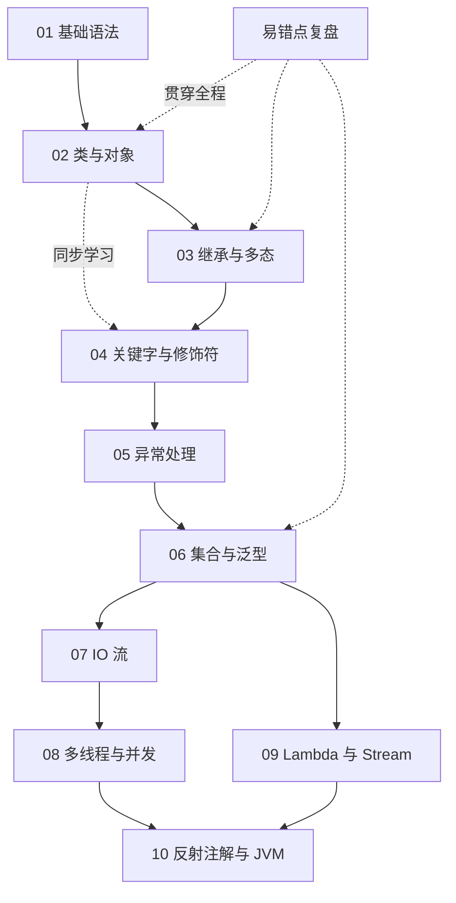

---
tags:
  - Java
  - 学习路线
---

# Java 学习路线

> 这份路线对应本目录 `01`～`10` 的学习模块，按“先会用，再理解，再深入”的顺序编排。
> 每一篇空笔记建议都按同一个模板补全：**一句话解释 → 代码示例 → 易错点 → 关联笔记**。

## 一、总览

## 二、阶段任务

### 阶段 1　基础语法

**目标**：能读懂并写出简单的 Java 程序，不依赖框架。

- [ ] [[数据类型与变量]]
- [ ] [[运算符]]
- [ ] [[流程控制]]
- [ ] [[数组]]
- [ ] [[字符串]]

**阶段产出**：一个控制台小工具（如成绩统计、猜数字、简易记账）。

---

### 阶段 2　类与对象

**目标**：理解“类—对象—引用”的关系，能自己设计一个简单的类。

- [ ] [[类的声明]]、[[成员变量]]、[[方法]]
- [ ] [[构造方法]]、[[创建对象]]、[[使用对象]]、[[对象的引用和实体]]
- [ ] [[封装的意义与作用]]、[[封装代码示例区]]、[[常见误区]]
- [ ] [[Getter读]]、[[Setter写]]、[[在Setter里面做数据检验]]
- [ ] [[重载]]
- [ ] [[两者关系大汇总]]
- [ ] [[嵌套类]]
- [ ] [[对象的复用]]、[[对象复用的具体例子]]、[[UML]]
- [ ] [[枚举]]

**阶段产出**：用 2～3 个类完成一个“图书 / 学生 / 商品”管理小模型，并画出对应 UML 类图。

---

### 阶段 3　继承与多态

**目标**：理解“父类与子类”“向上转型”“动态绑定”，能面向抽象编程。

- [ ] [[继承]]
- [ ] [[父类的构造方法与子类的关系]]
- [ ] [[向上转型与向下转型]]、[[动态绑定]]、[[instanceof]]
- [ ] [[抽象类]]、[[接口]]、[[接口与抽象类的区别]]
- [ ] [[面向抽象编程]]、[[开闭原则]]

**阶段产出**：用“抽象类 / 接口 + 多实现”重构阶段 2 的模型，体会开闭原则。

---

### 阶段 4　关键字与修饰符

**目标**：能准确说出每个常用关键字“修饰谁、起什么作用、什么时候用”。

- [ ] [[访问修饰符有哪些]]、[[java中的权限修饰符]]
- [ ] [[public公开]]、[[protected保护]]、[[default默认]]、[[private私有]]
- [ ] [[this关键字]]、[[super关键字]]
- [ ] [[static关键字]]、[[final关键字]]、[[abstract关键字]]
- [ ] [[protected关键字]]
- [ ] [[class跟public class]]
- [ ] [[package]]、[[import]]

> 本阶段可以与阶段 2、3 穿插学习：遇到哪个关键字，就补哪一篇。

---

### 阶段 5　异常处理

**目标**：程序出错时能定位问题，并写出可读的异常处理代码。

- [ ] [[异常体系]]
- [ ] [[try-catch-finally]]
- [ ] [[throws与throw]]
- [ ] [[自定义异常]]

**阶段产出**：给阶段 2 的小模型加上参数校验和自定义业务异常。

---

### 阶段 6　集合与泛型

**目标**：能根据场景选对集合，并会用泛型约束类型。

- [ ] [[集合总览]]
- [ ] [[List]]
- [ ] [[Set]]
- [ ] [[Map]]
- [ ] [[迭代器]]
- [ ] [[泛型]]

**阶段产出**：用 `List` + `Map` 重写阶段 1 的成绩统计工具，支持按姓名和分数排序。

---

### 阶段 7　IO 流

**目标**：能读写文件，理解字节流与字符流的区别。

- [ ] [[File类]]
- [ ] [[字节流]]
- [ ] [[字符流]]
- [ ] [[序列化]]

**阶段产出**：把阶段 6 的数据保存到文件，下次启动自动读回。

---

### 阶段 8　多线程与并发

**目标**：理解线程的生命周期、共享变量问题，以及线程池的基本用法。

- [ ] [[线程基础]]
- [ ] [[线程同步]]
- [ ] [[锁]]
- [ ] [[线程池]]

**阶段产出**：写一个多线程下载 / 批量处理示例，并说明为什么需要同步。

---

### 阶段 9　Lambda 与 Stream

**目标**：能用函数式写法替代大量循环，读懂常见集合处理代码。

- [ ] [[Lambda表达式]]
- [ ] [[函数式接口]]
- [ ] [[方法引用]]
- [ ] [[Stream]]

**阶段产出**：把阶段 6 的集合操作改写成 Stream 管道。

---

### 阶段 10　反射注解与 JVM

**目标**：知道框架“为什么能自动装配”，并对 JVM 内存与类加载有基本认识。

- [ ] [[反射]]
- [ ] [[注解]]
- [ ] [[JVM基础]]

**阶段产出**：写一个极简的“注解 + 反射”示例，模拟依赖注入。

---

## 三、建议节奏

| 阶段 | 内容 | 建议用时 | 完成标志 |
| --- | --- | --- | --- |
| 1 | 基础语法 | 1～2 周 | 能独立写控制台程序 |
| 2 | 类与对象 | 2～3 周 | 能设计多类协作的小模型 |
| 3 | 继承与多态 | 1～2 周 | 能解释动态绑定与接口解耦 |
| 4 | 关键字与修饰符 | 穿插 1 周 | 能说清访问权限与常用关键字 |
| 5 | 异常处理 | 3～5 天 | 能自定义异常并合理捕获 |
| 6 | 集合与泛型 | 1～2 周 | 能按场景选集合并使用泛型 |
| 7 | IO 流 | 1 周 | 能完成文件读写与持久化 |
| 8 | 多线程与并发 | 1～2 周 | 能解释并复现线程安全问题 |
| 9 | Lambda 与 Stream | 3～5 天 | 能读懂并改写 Stream 管道 |
| 10 | 反射注解与 JVM | 1～2 周 | 能写注解 + 反射小示例 |

## 四、学习原则

1. **每个知识点都要有可运行代码**：只抄概念很容易忘，代码跑通才算真正理解。
2. **先写“错误版本”再修正**：把踩过的坑记进 [[OOP基础易错点详解]] 或对应笔记的“易错点”小节。
3. **每阶段做一次复盘**：合上笔记，用自己的话复述核心概念，再回看遗漏。
4. **用项目串知识**：阶段 2、6、7、8 的产出可以逐步叠加到同一个项目上。
5. **不追求一次学完**：路线是地图，不是打卡清单；按自己的节奏推进即可。

## 五、复盘入口

- 面向对象易错点：[[OOP基础易错点详解]]
- 零散概念与工具：[[Java方法的解释]]
