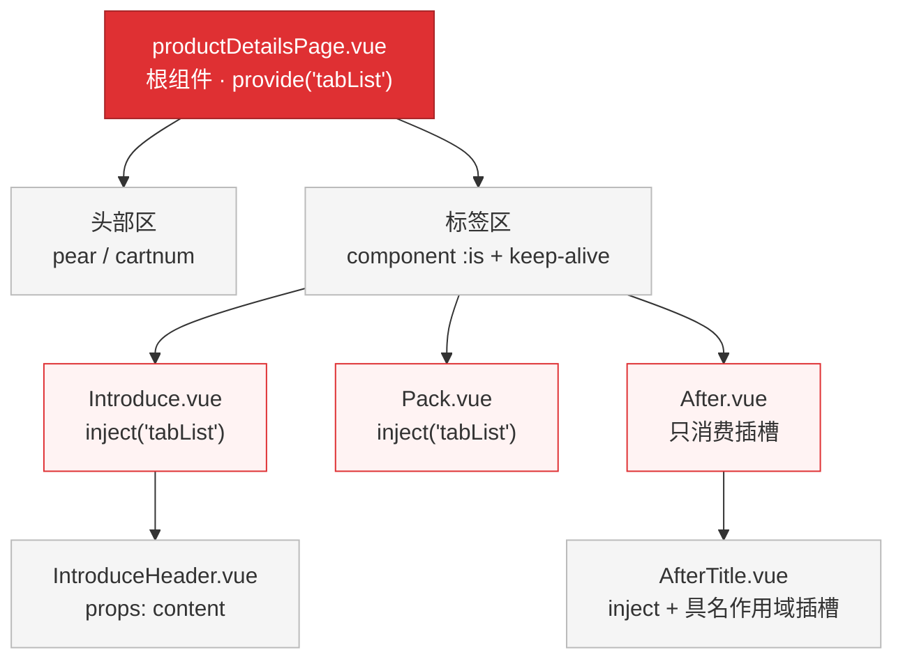
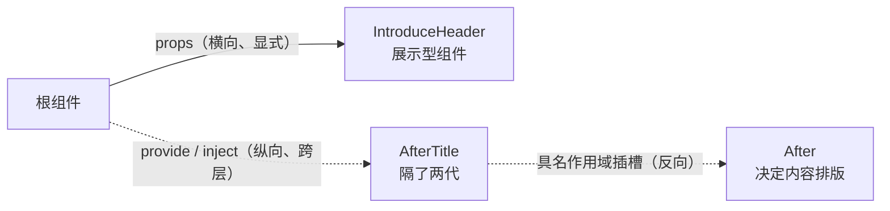
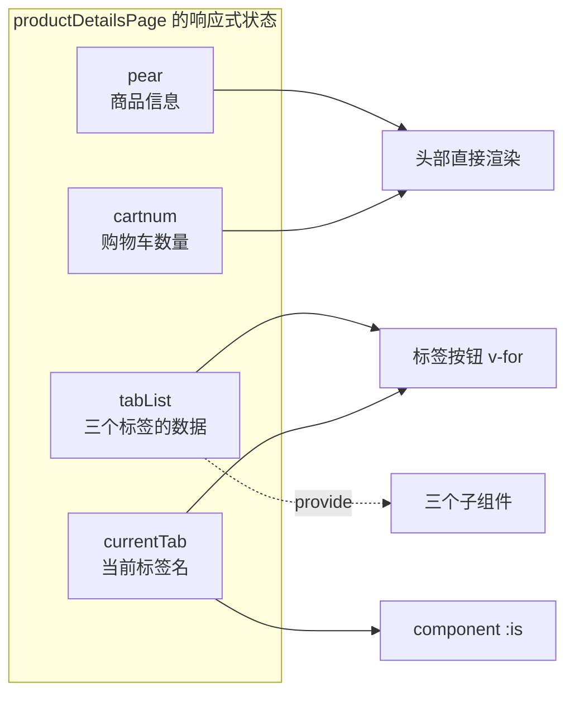
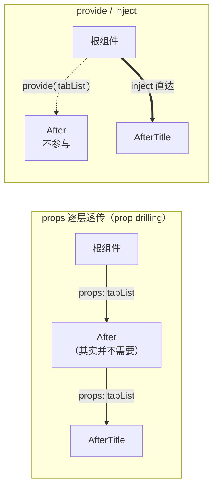
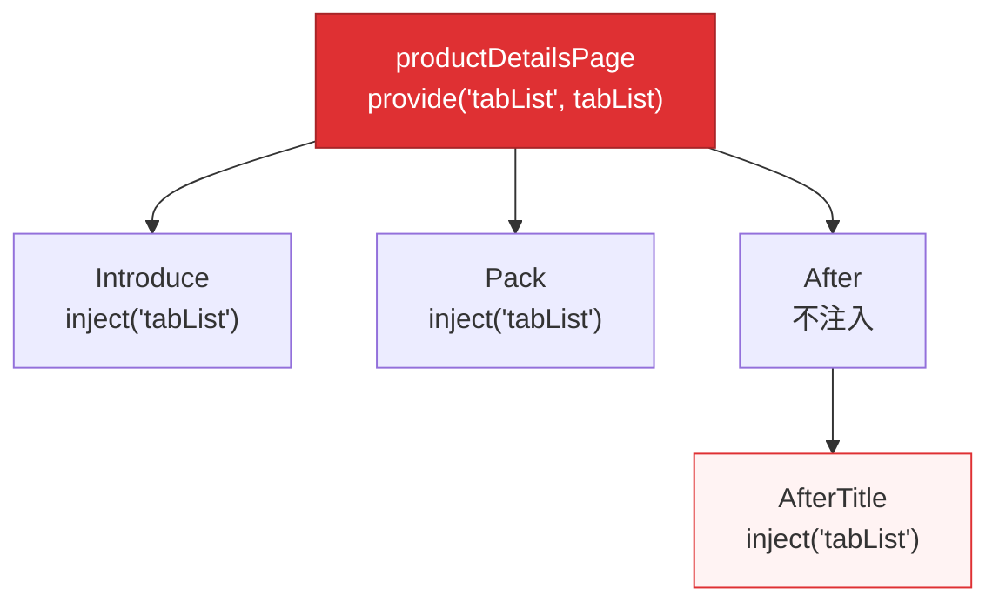
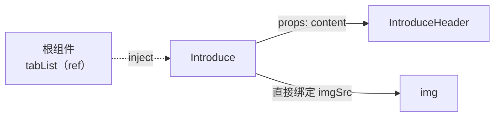
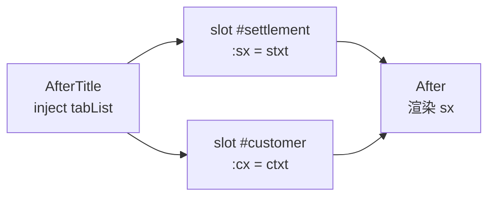
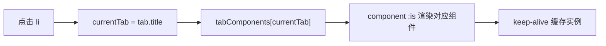
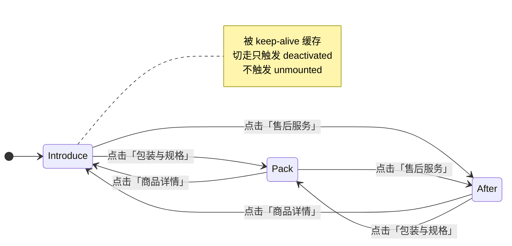
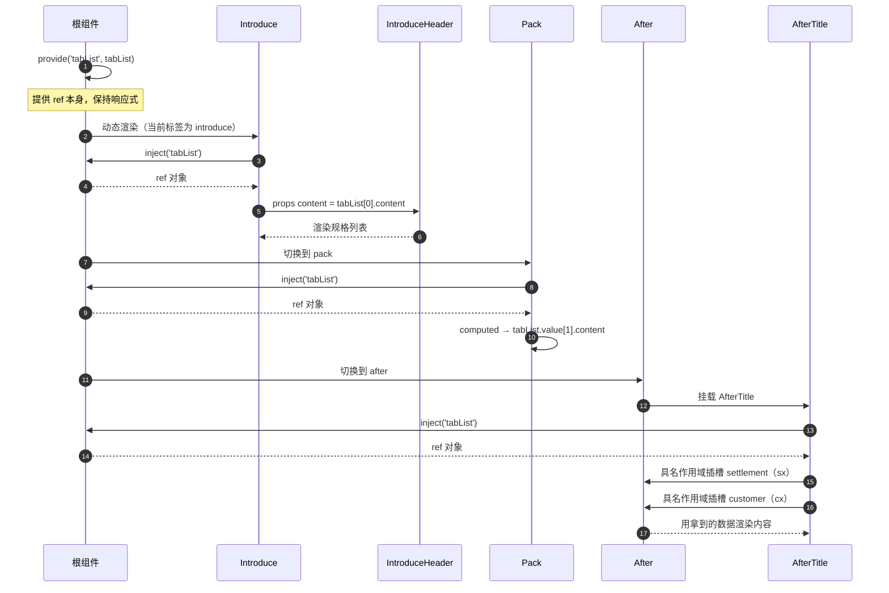

> [!abstract] 一句话
> 一个商品详情页把前面几篇的能力串在一起：**纵向**用 `provide / inject` 跨层传数据，**横向**用 `props` 交给展示组件，**反向**用具名作用域插槽把内容控制权交回父级；标签区再用动态组件 + `<keep-alive>` 切换。==这是一次"组件组合"的综合练习，不是新 API 的单点演示。==

📁 源码：`Exp11/productDetailsPage.vue`、`Exp11/Introduce.vue`、`Exp11/IntroduceHeader.vue`、`Exp11/Pack.vue`、`Exp11/After.vue`、`Exp11/AfterTitle.vue`

---

## 一、先看全局

### 1.1 组件树



### 1.2 职责与数据来源

| 文件                       | 角色        | 数据从哪来                      | 数据送给谁                                       |
| ------------------------ | --------- | -------------------------- | ------------------------------------------- |
| `productDetailsPage.vue` | 根组件 / 数据源 | 自身 `ref`                   | `provide` 下发 `tabList`；模板直接渲染商品与购物车         |
| `Introduce.vue`          | 标签页（详情）   | `inject('tabList')`        | 通过 `props` 把 `content` 交给 `IntroduceHeader` |
| `IntroduceHeader.vue`    | 展示型组件     | `defineProps({ content })` | 无（纯渲染）                                      |
| `Pack.vue`               | 标签页（包装）   | `inject` + `computed`      | 无                                           |
| `After.vue`              | 标签页（售后）   | 无（接收插槽 props）              | 决定售后长文案的排版                                  |
| `AfterTitle.vue`         | 售后内容      | `inject('tabList')`        | 用作用域插槽抛出 `sx` / `cx`                        |

### 1.3 三种通信方向

| 方向 | 技术 | 链路 | 传输内容 | 响应式 |
| --- | --- | --- | --- | --- |
| ⬇️ 跨层 | `provide / inject` | 根 → Introduce / Pack / AfterTitle | `tabList`（ref） | ✅ |
| ⬇️ 父子 | `props` | Introduce → IntroduceHeader | `content` 对象 | ✅ |
| ⬆️ 反向 | 具名作用域插槽 | AfterTitle → After | `sx`、`cx` 字符串 | ✅ |
| ↔ 同层切换 | 动态组件 | 根内部 `currentTab` 决定渲染谁 | 组件名 | ✅ |



---

## 二、根组件：数据的唯一源头

### 2.1 它持有什么



### 2.2 模板

```vue
<template>
  <h1>商品详情页</h1>

  <!-- ① 头部：商品图 / 标题 / 价格 / 促销 / 购物车 -->
  <div class="headerbox">
    
    <div class="content">
      <h2>{{ pear.title }}</h2>
      <p>价格：{{ pear.price }}</p>
      <p>促销：{{ pear.promotion }}</p>
      <div class="cart" @click="cartnum++">加入购物车</div>
      <div class="cartbox">
        
        <span>{{ cartnum }}</span>
      </div>
    </div>
  </div>

  <!-- ② 标签区：按钮 + 动态组件 -->
  <div class="trendsComponent">
    <ul>
      <li
        v-for="tab in tabList"
        :key="tab.title"
        :class="['tab-button', { active: currentTab === tab.title }]"
        @click="currentTab = tab.title"
      >
        {{ tab.displayName }}
      </li>
    </ul>

    <keep-alive>
      <component :is="tabComponents[currentTab]" class="tab" />
    </keep-alive>
  </div>
</template>
```

### 2.3 脚本

```vue
<script setup>
// 书本原示例用 provide 抛出 tabList、$root 取数据，
// 这里改为 provide + inject（Vue 3 推荐），
// 并把商品信息、购物车数量做成响应式。

import { ref, provide } from 'vue'
import Introduce from './Introduce.vue'
import Pack from './Pack.vue'
import After from './After.vue'

const cartnum = ref(1)

const pear = ref({
  id: 1,
  title: '河北皇冠梨生鲜水果',
  price: 39.9,
  promotion: '满99-30',
})

const tabList = ref([
  {
    title: 'introduce',
    content: {
      barnd: 'QF',
      type: '皇冠梨',
      bunmber: 123456,
      placeProduction: '河北',
      storageConditions: '冷藏',
      imgSrc: './img/pear1.jpg',
    },
    displayName: '商品详情',
  },
  {
    title: 'pack',
    content: {
      main: '皇冠梨',
      weight: '2.5kg',
      inventory: '河北皇冠梨 2.5kg装*1',
    },
    displayName: '包装与规格',
  },
  {
    title: 'after',
    content: {
      settlement: '理赔绿色通道',
      stxt: '优理赔服务是为等级2及以上的优质客户提供的售后特色服务……',
      customer: '专业生鲜客服团队—让您售后无忧',
      ctxt: '微信在线客服：XX-fresh,生鲜客服电话：400-606-3311,服务时间：09:00-24:00。',
    },
    displayName: '售后服务',
  },
])

// 当前单击的标签名
const currentTab = ref('introduce')

// 标签名 → 组件 的映射表
const tabComponents = {
  introduce: Introduce,
  pack: Pack,
  after: After,
}

// 把 ref 本身注入给后代
provide('tabList', tabList)
</script>
```

> [!info] 样式
> 根组件另有约 120 行 `<style>`（头部布局、购物车角标、标签按钮、选中态等），与知识点无关，完整内容见源码。注意它**没有 `scoped`**，是全局样式。

### 2.4 模板里的两处自动解包

```vue
v-for="tab in tabList"
:is="tabComponents[currentTab]"
```

- `tabList` 是 `ref`，**模板中自动解包**，直接写 `tabList` 而不是 `tabList.value`。
- `currentTab` 同理：`tabComponents[currentTab]` 实际等于 `tabComponents[currentTab.value]`。

> [!tip] 记忆规则
> **`<script>` 里用 `.value`，`<template>` 里不用。** 例外：把 ref 塞进普通对象/数组后再在模板访问深层属性时，解包可能失效——所以 ref 尽量保持为顶层变量。

### 2.5 `cartnum++` 写在模板里

```vue
<div class="cart" @click="cartnum++">加入购物车</div>
```

模板表达式里的自增，Vue 会自动处理 `.value`；点击后右上角角标同步 +1。

---

## 三、纵向通道：provide / inject

### 3.1 为什么不用 props 一层层传

`tabList` 要被 `Introduce`、`Pack`、`AfterTitle` 使用，其中 `AfterTitle` 隔了两层：



用 props 时，`After` 被迫接收并原样转发自己根本不需要的数据——中间组件被"污染"。

### 3.2 写法

祖先（根组件，`setup` 同步阶段）：

```js
provide('tabList', tabList)
```

后代（任意深度）：

```js
const tabList = inject('tabList')
```



> [!important] 注入的是 ref 本身，不是值
> `provide('tabList', tabList)` 传的是 **ref 对象**。因此：
> - 后代 `<script>` 中写 `tabList.value[...]`；
> - 后代 `<template>` 中写 `tabList[...]`（自动解包）。
>
> 正因为注入的是 ref，数据变化才能保持响应式。若写成 `provide('tabList', tabList.value)`，后代拿到的只是一次性快照。

### 3.3 响应式与只读约定

- `provide` 一个 `ref` / `reactive` → 后代读取是响应式的。
- 后代**不应直接修改**祖先数据；需要修改时，祖先同时 provide 一个修改函数：

```js
provide('tabList', tabList)
provide('updateTab', (index, patch) => {
  Object.assign(tabList.value[index].content, patch)
})
```

> [!warning] inject 找不到 key 不会报错
> 找不到时返回 `undefined`，直到你访问 `.value` 才抛错。可以给默认值：
> ```js
> const tabList = inject('tabList', ref([]))
> ```

---

## 四、三个子组件怎么取数据

### 4.1 Introduce：在模板里直接解包

```vue
<!-- Introduce.vue -->
<script setup>
import { inject } from 'vue'
import IntroduceHeader from './IntroduceHeader.vue'

const tabList = inject('tabList')
</script>

<template>
  <div>
    <IntroduceHeader :content="tabList[0].content" />
    
  </div>
</template>

<style scoped>
.introImg {
  width: 100%;
}
</style>
```

`tabList[0]` 只出现在模板里，模板自动解包，所以**没有** `.value`；一旦搬进脚本，就必须 `tabList.value[0]`。



### 4.2 IntroduceHeader：纯 props 展示

```vue
<!-- IntroduceHeader.vue -->
<script setup>
defineProps({
  content: {
    type: Object, // 要求是对象
    required: true,
  },
})
</script>

<template>
  <div>
    <ul class="introUl">
      <li>品牌：{{ content.barnd }}</li>
      <li>品种：{{ content.type }}</li>
      <li>编号：{{ content.bunmber }}</li>
      <li>产地：{{ content.placeProduction }}</li>
      <li>贮存条件：{{ content.storageConditions }}</li>
    </ul>
  </div>
</template>
```

它不关心数据从哪来，只声明"我需要一个 `content` 对象"——典型的**展示型组件**：数据来源与外层解耦，可复用、易测试。

> [!warning] 源文件的两处拼写笔误
> - `barnd` 应为 `brand`
> - `bunmber` 应为 `number`
>
> 它们与根组件数据定义的键名一致，所以能正常运行，但属于命名错误。

### 4.3 Pack：脚本里 computed + `.value`

```vue
<!-- Pack.vue -->
<script setup>
import { inject, computed } from 'vue'

const tabList = inject('tabList')
const content = computed(() => tabList.value[1].content)
// inject('tabList') 拿到的是根组件的 ref，
// 所以取值时必须 .value。
// 这依赖根组件 provide('tabList', tabList) 提供的是 ref 本身。
</script>

<template>
  <div>
    <ul class="introUl">
      <li>主体：{{ content.main }}</li>
      <li>重量：{{ content.weight }}</li>
      <li style="width: 300px">包装清单：{{ content.inventory }}</li>
    </ul>
  </div>
</template>
```

`content` 是 `computed`，模板自动解包成对象，所以写 `content.main`。

> [!tip] 这里其实可以不做 computed
> `tabList.value[1].content` 本身在 `tabList` 变化时就会重新求值；`computed` 的价值在于给"取第 1 项内容"这个派生逻辑命名并缓存。数据静态时两种写法效果一样。

### 4.4 After：只负责消费插槽

```vue
<!-- After.vue -->
<script setup>
import AfterTitle from './AfterTitle.vue'
</script>

<template>
  <div>
    <AfterTitle>
      <template #settlement="slotSettlement">
        <p>{{ slotSettlement.sx }}</p>
      </template>
      <!-- 等价解构写法：
      <template #settlement="{ sx }">
        <p>{{ sx }}</p>
      </template>
      -->
      <template #customer="slotCustomer">
        <p>{{ slotCustomer.cx }}</p>
      </template>
    </AfterTitle>
  </div>
</template>
```

`After` **不注入任何数据**，只决定"长文案怎么排版"。它扮演的是"插槽内容的提供方"。

### 4.5 AfterTitle：注入数据 + 抛出插槽

```vue
<!-- AfterTitle.vue -->
<script setup>
import { inject } from 'vue'

const tabList = inject('tabList')
const content = tabList.value[2].content
</script>

<template>
  <div>
    <p class="after_p">{{ content.settlement }}</p>
    <slot name="settlement" :sx="content.stxt"></slot>

    <p class="after_p">{{ content.customer }}</p>
    <slot name="customer" :cx="content.ctxt"></slot>
  </div>
</template>
```



> [!note] 一个容易忽略的细节
> `const content = tabList.value[2].content` 是 **setup 执行时的一次性读取**，不是响应式派生。本例数据静态，没有问题；若根组件将来整体替换 `tabList`，这里不会自动更新。要跟随变化，应像 `Pack` 那样用 `computed`。

### 4.6 三种读取方式对比

| 组件 | 读取位置 | 写法 | 响应式表现 |
| --- | --- | --- | --- |
| `Introduce` | 模板 | `tabList[0].content` | ✅ 每次渲染时读取 |
| `Pack` | 脚本 | `computed(() => tabList.value[1].content)` | ✅ 追踪依赖并缓存 |
| `AfterTitle` | 脚本 | `tabList.value[2].content` | ⚠️ 仅 setup 时取一次 |

---

## 五、横向切换：动态组件 + keep-alive

与 [[Exp10 动态组件]] 同一套模式。



```js
const currentTab = ref('introduce')
const tabComponents = { introduce: Introduce, pack: Pack, after: After }
```

```vue
<keep-alive>
  <component :is="tabComponents[currentTab]" class="tab" />
</keep-alive>
```

| 环节 | 代码 | 说明 |
| --- | --- | --- |
| 当前标签 | `currentTab` | 点击 `<li>` 改写 |
| 状态 → 组件 | `tabComponents[currentTab]` | 对象查表，模板自动解包 |
| 缓存 | `<keep-alive>` | 切回标签时保留组件实例与状态 |
| 高亮 | `{ active: currentTab === tab.title }` | 当前项追加 `active` 类 |



> [!success] 为什么详情页要缓存
> 用户从"商品详情"切到"包装与规格"再切回，`Introduce` 的图片不必重新加载，组件内部状态也不会丢。标签切换频繁，缓存收益明显。

---

## 六、完整数据流



> [!success] 一张图记住
> **纵向**用 `provide / inject` 送到深处，**横向**用 `props` 交给展示组件，**反向**用作用域插槽把内容控制权交回父级。三种方向各司其职。

---

## 七、易错点与源码问题

### 7.1 源码本身的问题

| 位置 | 问题 | 说明 |
| --- | --- | --- |
| `productDetailsPage.vue` | `./img/main_img.jpg`、`./img/jd2015img.png` | 源目录 `Exp11/img/` 为空，运行会 404 |
| `productDetailsPage.vue` | `imgSrc: './img/pear1.jpg'` | 图片不存在，同上 |
| `productDetailsPage.vue` | `<style>` 未加 `scoped` | 全局样式，可能波及其他组件 |
| `IntroduceHeader.vue` | `barnd`、`bunmber` | 拼写笔误，键名一致故不影响运行 |
| `AfterTitle.vue` | `content` 非 `computed` | 仅 setup 时读取一次，替换数据不会更新 |

> [!warning] 想直接运行
> 要么补三张图片到 `Exp11/img/`，要么把 `img` 的 `src` 换成已有资源或删掉。否则控制台会有一串资源加载失败（不影响其他逻辑）。

### 7.2 常见手误

- [ ] `provide` 放在 `await` 之后 → 必须在 `setup` 同步阶段调用
- [ ] `provide('tabList', tabList.value)` → 丢失响应式
- [ ] 后代脚本里写 `tabList[0]` → 应为 `tabList.value[0]`
- [ ] `<keep-alive>` 包在 `<component>` 内层 → 无效
- [ ] 插槽名 `#settlement` 写成 `#Settlement` → 匹配失败
- [ ] `defineProps` 写成 `const props = defineProps(...)` 却没用到 `props` → 只是冗余，不报错

---

## 八、自测

1. `provide('tabList', tabList)` 与 `provide('tabList', tabList.value)` 有什么区别？
2. `Introduce.vue` 模板里为什么可以写 `tabList[0]`，而 `Pack.vue` 脚本里必须写 `tabList.value[1]`？
3. `AfterTitle` 的两个具名插槽分别传了什么字段？父组件如何接收？
4. 如果把 `AfterTitle` 里的 `content` 改成 `computed`，模板要不要改？
5. 商品详情页切换标签时，为什么输入状态/图片不会丢？
6. `IntroduceHeader` 若改成从 `inject` 直接取数据，会失去什么？

> [!success]- 参考答案
> 1. 前者注入 ref 本身，后代读取保持响应式；后者注入的是当时的值快照，后续变化不会同步。
> 2. 模板里的顶层 ref 会自动解包；`<script>` 中不会，必须显式 `.value`。
> 3. `#settlement` 传 `sx="content.stxt"`，`#customer` 传 `cx="content.ctxt"`；父组件用 `<template #settlement="slotSettlement">` 接整个对象，或用 `#settlement="{ sx }"` 解构。
> 4. 不用。模板会自动解包 `computed`，仍写 `content.settlement`。
> 5. 外层 `<keep-alive>` 缓存了组件实例，切走只触发 `deactivated`，不销毁。
> 6. 会失去"展示型组件"的解耦：组件被迫依赖外层的注入键，复用性与可测试性下降。props 让数据来源显式化。

---

## 九、关联

- 前一篇：[[Exp10 动态组件]]
- 依赖注入基础：[[Exp9 依赖注入（provide-inject）]]
- 插槽基础：[[Exp8 具名作用域插槽]]、[[Exp7 作用域插槽]]
- props：[[Exp1 父传子 props]]
- 总览：[[00 组件通信与插槽总览]]
