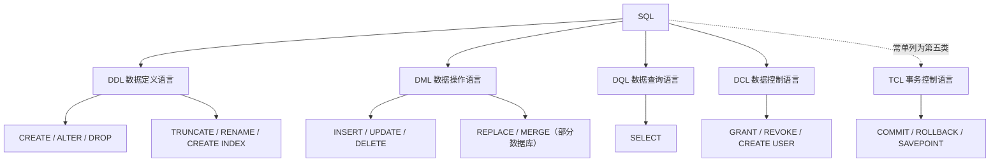

# 四大 SQL 分类讲解

> [!abstract] 一句话
> SQL 按"**操作对象 + 目的**"分成四类：**DDL 管结构、DML 管数据、DQL 管查询、DCL 管权限**。
> 记忆口诀：**DDL 定骨架，DML 动血肉，DQL 看全局，DCL 发钥匙**；而"提交 / 回滚"另属 **TCL**。

---

## 一、分类总览



| 分类 | 英文全称 | 中文 | 作用对象 | 核心动词 | 改表结构 | 改数据 | 典型语句 |
| --- | --- | --- | --- | --- | --- | --- | --- |
| **DDL** | Data Definition Language | 数据定义语言 | 库、表、视图、索引等**对象** | 建、改、删结构 | ✅ | ❌ | `CREATE` / `ALTER` / `DROP` / `TRUNCATE` / `RENAME` |
| **DML** | Data Manipulation Language | 数据操作语言 | 表中的**行** | 增、删、改 | ❌ | ✅ | `INSERT` / `UPDATE` / `DELETE` / `REPLACE` |
| **DQL** | Data Query Language | 数据查询语言 | 表中的**行** | 查 | ❌ | ❌（只读） | `SELECT` |
| **DCL** | Data Control Language | 数据控制语言 | **用户、角色、权限** | 授权、收权 | ❌ | ❌ | `GRANT` / `REVOKE` |

> [!tip] 拿到一条语句，先问三个问题
> 1. **它改结构吗？**（建表、加列、删索引）→ DDL
> 2. **它改数据吗？**（插、改、删行）→ DML
> 3. **它只是读吗？**（查询）→ DQL
> 4. **它管人吗？**（谁能做什么）→ DCL
>
> 三个问题都答"否"，再看是不是 `COMMIT` / `ROLLBACK` 这类事务语句 → TCL。

> [!info] 分类没有全球统一标准
> - SQL 标准本身并没有把 `SELECT` 单列为 DQL，很多厂商文档把查询归入 DML。
> - 国内数据库教材（如王珊《数据库系统概论》）通常把查询单独拎出来，形成 **DDL / DML / DQL / DCL 四大类**。
> - 有的教材再加 TCL，称"五大类"。
>
> ==分类是为了理解语义，不是为了背名词。真正要分清的是：**改结构 / 改数据 / 只读 / 管权限**。==

---

## 二、DDL —— 数据定义语言

> [!abstract] 一句话
> DDL 操作的是**数据库对象本身**：建库、建表、加字段、改类型、删索引、删表。它只管"**长什么样**"，不管"**里面装了什么**"。

### 2.1 核心语句

| 语句 | 作用 | 示例 |
| --- | --- | --- |
| `CREATE` | 创建库、表、视图、索引 | `CREATE TABLE student (...);` |
| `ALTER` | 修改对象结构 | `ALTER TABLE student ADD COLUMN phone VARCHAR(20);` |
| `DROP` | 删除对象（结构 + 数据一起没） | `DROP TABLE student;` |
| `TRUNCATE` | 清空表数据，保留表结构 | `TRUNCATE TABLE student;` |
| `RENAME` | 重命名表 | `RENAME TABLE student TO student_bak;` |
| `CREATE INDEX` | 建索引 | `CREATE INDEX idx_class ON student (class);` |
| `CREATE VIEW` | 建视图 | `CREATE VIEW v_90 AS SELECT ...;` |

### 2.2 完整示例

```sql
-- 1. 建库
CREATE DATABASE IF NOT EXISTS school DEFAULT CHARACTER SET utf8mb4;
USE school;

-- 2. 建表
CREATE TABLE IF NOT EXISTS student (
    id      BIGINT       NOT NULL AUTO_INCREMENT,
    name    VARCHAR(50)  NOT NULL,
    gender  CHAR(1)      DEFAULT 'U',          -- M男 F女 U未知
    age     TINYINT      DEFAULT 0,
    score   DECIMAL(5,2),
    class   VARCHAR(20),
    PRIMARY KEY (id),
    UNIQUE KEY uk_name_class (name, class)
) ENGINE=InnoDB DEFAULT CHARSET=utf8mb4;

-- 3. 改结构
ALTER TABLE student ADD COLUMN phone VARCHAR(20) AFTER name;
ALTER TABLE student MODIFY COLUMN class VARCHAR(50);
ALTER TABLE student DROP COLUMN phone;

-- 4. 建索引、建视图
CREATE INDEX idx_class ON student (class);
CREATE VIEW v_student_90 AS
SELECT id, name, score FROM student WHERE score >= 90;

-- 5. 清空数据（保留结构）
TRUNCATE TABLE student;

-- 6. 删除对象
DROP VIEW  IF EXISTS v_student_90;
DROP TABLE IF EXISTS student;
DROP DATABASE IF EXISTS school;
```

### 2.3 DDL 的四个关键特点

> [!warning] 特点一：DDL 会**隐式提交**，不能回滚
> MySQL 在执行 DDL 前会**自动提交**当前事务，执行后又会**自动提交**一次。
> 所以 `ROLLBACK` 对 `CREATE` / `ALTER` / `DROP` / `TRUNCATE` **完全无效**。
> ==更危险的是：DDL 会把你之前**还没提交的 DML 一起提交掉**。==

```sql
START TRANSACTION;

INSERT INTO student (name) VALUES ('临时数据');
-- 此时还没提交，理论上可以 ROLLBACK

CREATE TABLE t_tmp (id INT);
-- ⚠️ DDL 隐式提交：上面那条 INSERT 也被一起提交了

ROLLBACK;
-- 只能回滚 CREATE TABLE 之后的操作；
-- '临时数据' 已经落盘，撤不回来了
```

> [!info] 特点二：MySQL 8.0 的"原子 DDL"≠ 可回滚
> MySQL 8.0 引入了 **Atomic DDL**：一条 DDL 要么完整成功，要么完整失败，不会留下"改了一半"的数据字典。
> 但它仍然是**语句级原子性**，不是**事务级可回滚**。用户事务里的 `ROLLBACK` 依然管不了 DDL。
> 一句话区分：**"这条 DDL 不会做一半" ≠ "你可以反悔"。**

> [!warning] 特点三：DDL 对线上表不友好
> `ALTER TABLE` 等操作会拿 **元数据锁（MDL）**，大表上可能阻塞读写。
> 生产环境改大表结构，优先用 **Online DDL**、`pt-online-schema-change`、`gh-ost` 等工具，并避开业务高峰。

> [!tip] 特点四：权限要求高
> `CREATE` / `ALTER` / `DROP` 通常只给 DBA 或迁移账号，**业务账号不应拥有 DDL 权限**。见 [[Nosql跟sql]] 里"最小权限"的思路。

### 2.4 DDL 的边界

| 属于 DDL | 不属于 DDL |
| --- | --- |
| `CREATE TABLE` / `ALTER TABLE` / `DROP TABLE` | `INSERT` / `UPDATE` / `DELETE`（DML） |
| `CREATE INDEX` / `DROP INDEX` | `SELECT`（DQL） |
| `CREATE VIEW` / `ALTER VIEW` / `DROP VIEW` | `GRANT` / `REVOKE`（DCL） |
| `TRUNCATE TABLE` | `COMMIT` / `ROLLBACK`（TCL） |
| `RENAME TABLE` | `EXPLAIN` / `SHOW`（工具语句） |

> [!note] `RENAME` 和 `TRUNCATE` 是最容易被归错类的两个
> 它们看起来像"操作数据"，实际上都改的是**表的整体状态**：
> - `RENAME` 改的是对象名 → DDL
> - `TRUNCATE` 是"**删表重建**"（InnoDB 内部就是 drop + create）→ DDL
>
> 判断标准：**能不能放在事务里回滚？** 不能 → 大概率是 DDL。

---

## 三、DML —— 数据操作语言

> [!abstract] 一句话
> DML 操作的是**表里的行**：增、删、改。它不碰表结构，只改内容，因此可以放进事务里**提交或回滚**。

### 3.1 核心语句

| 语句 | 作用 | 对应笔记 |
| --- | --- | --- |
| `INSERT` | 插入新行 | [[Insert]] |
| `UPDATE` | 修改已有行 | [[Update]] |
| `DELETE` | 删除行 | [[Delete]] |
| `REPLACE` | 冲突时先删后插（MySQL 特有，DML） | [[Insert]] 第七节 |
| `MERGE` | 有则更新、无则插入（Oracle / SQL Server 等，MySQL 无） | — |

### 3.2 示例

```sql
-- 增
INSERT INTO student (name, gender, age, score, class)
VALUES ('张三', 'M', 18, 92.50, '高一1班'),
       ('李四', 'F', 17, 88.00, '高一1班');

-- 改
UPDATE student
   SET score = score + 5
 WHERE name = '张三';

-- 删
DELETE FROM student
 WHERE score < 60;
```

### 3.3 DML 的事务特点

```sql
START TRANSACTION;

UPDATE student SET score = 0 WHERE class = '高一1班';
DELETE FROM student WHERE name = '李四';

ROLLBACK;   -- ✅ 两条操作一起撤销，数据恢复原状
```

| 对比项 | DML 的表现 |
| --- | --- |
| 是否可回滚 | ✅ 在事务中可 `ROLLBACK`（前提：还没 `COMMIT`） |
| 是否隐式提交 | ❌ 不隐式提交；`autocommit=1` 时每条语句**自动提交**，但可显式开事务 |
| 是否触发触发器 | ✅ `INSERT` / `UPDATE` / `DELETE` 触发器都会触发 |
| 影响行数 | 返回 `rows affected`，可用来判断是否命中 |
| 锁 | 行锁为主（InnoDB），并发友好 |
| 权限 | `INSERT` / `UPDATE` / `DELETE` |

> [!warning] `autocommit` 是回滚的前提
> MySQL 默认 `autocommit = 1`：每条 DML 执行完立刻提交。
> 这时你敲 `ROLLBACK` 是**没用的**——因为没有未提交的事务可回滚。
> 想回滚，必须先 `START TRANSACTION`（或 `BEGIN`），或者把 `autocommit` 设为 `0`。
>
> ```sql
> SHOW VARIABLES LIKE 'autocommit';   -- 默认 ON
> SET autocommit = 0;                 -- 关闭自动提交（谨慎，记得手动 COMMIT）
> ```

> [!danger] `UPDATE` / `DELETE` 忘写 `WHERE`
> `DELETE FROM student;` 会清空全表；`UPDATE student SET score = 0;` 会把所有行改成 0。
> 生产环境建议开启 MySQL 的 **safe-updates** 模式，强制 `UPDATE` / `DELETE` 的 `WHERE` 走主键或索引。

---

## 四、DQL —— 数据查询语言

> [!abstract] 一句话
> DQL 只有一条核心语句 `SELECT`。它**只读不写**，但语法最复杂：过滤、分组、聚合、连接、排序、分页、子查询全在这里。

### 4.1 完整语法骨架

```sql
SELECT   [DISTINCT] 字段列表
FROM     表名
JOIN     另一张表 ON 连接条件
WHERE    行级过滤
GROUP BY 分组字段
HAVING   组级过滤
ORDER BY 排序字段 [ASC|DESC]
LIMIT    [偏移量,] 条数;
```

### 4.2 书写顺序 ≠ 执行顺序

| 执行步骤 | 子句 | 这一步在干什么 |
| --- | --- | --- |
| 1 | `FROM` / `JOIN` | 确定数据源，拼出"虚拟大表" |
| 2 | `ON` | 连接条件过滤 |
| 3 | `WHERE` | 逐行过滤 |
| 4 | `GROUP BY` | 把行折叠成组 |
| 5 | `HAVING` | 逐组过滤 |
| 6 | `SELECT` | 算列、算聚合、起别名 |
| 7 | `DISTINCT` | 去重 |
| 8 | `ORDER BY` | 排序（此时才能用 `SELECT` 别名） |
| 9 | `LIMIT` | 截断结果集 |

> [!tip] 记住这条链，很多"为什么报错"就通了
> `FROM → WHERE → GROUP BY → HAVING → SELECT → ORDER BY → LIMIT`
> - `WHERE` 在 `SELECT` 之前 → **不能用别名**
> - `HAVING` / `ORDER BY` 在 `SELECT` 之后 → **可以用别名**
> 详见 [[Select]]。

### 4.3 示例：连接 + 分组 + 过滤 + 排序 + 分页

```sql
SELECT s.class,
       COUNT(*)          AS cnt,
       AVG(s.score)      AS avg_score,
       MAX(s.score)      AS max_score
  FROM student s
  JOIN class_info c ON s.class = c.class_name
 WHERE s.age >= 16
 GROUP BY s.class
HAVING avg_score >= 80
 ORDER BY avg_score DESC
 LIMIT 3;
```

### 4.4 DQL 的注意事项

> [!info] 归类的关键：看**最外层动词**
> - `INSERT INTO ... SELECT ...` → 最外层是 `INSERT`，属于 **DML**
> - `CREATE TABLE ... AS SELECT ...` → 最外层是 `CREATE`，属于 **DDL**
> - `SELECT ... FOR UPDATE` → 仍然是 DQL，但会**加行锁**，不能在只读事务里随便用

> [!warning] 查询也可能"不单纯只读"
> | 写法 | 副作用 |
> | --- | --- |
> | `SELECT ... FOR UPDATE` | 对命中行加排他锁，可能阻塞其他事务 |
> | `SELECT ... LOCK IN SHARE MODE` | 加共享锁 |
> | `SELECT ... INTO OUTFILE` | 往服务器磁盘写文件 |
> | `SELECT` 里调用自定义函数 | 函数内部可能改数据 |
>
> 日常业务查询尽量保持纯 `SELECT`；需要锁时明确知道自己在做什么。

---

## 五、DCL —— 数据控制语言

> [!abstract] 一句话
> DCL 管的是"**谁能对什么做什么**"：创建用户、授予权限、收回权限、管理角色。它不碰数据和结构，碰的是**访问控制**。

### 5.1 核心语句

| 语句 | 作用 |
| --- | --- |
| `GRANT` | 授予权限 |
| `REVOKE` | 收回权限 |
| `CREATE USER` / `DROP USER` / `ALTER USER` | 用户管理（常与 DCL 一起讲） |
| `CREATE ROLE` / `DROP ROLE` | 角色管理（MySQL 8.0+） |
| `SHOW GRANTS` | 查看权限 |

### 5.2 示例：创建业务账号并最小授权

```sql
-- 1. 创建用户（% 表示任意主机；生产环境应限定具体网段）
CREATE USER 'app_user'@'%' IDENTIFIED BY 'StrongPass_2026!';

-- 2. 只给业务需要的权限：查、增、改，不给删、不给 DDL
GRANT SELECT, INSERT, UPDATE ON school.* TO 'app_user'@'%';

-- 3. 单独给某张表加查询权限
GRANT SELECT ON school.student TO 'report_user'@'%';

-- 4. 收回删除权限
REVOKE DELETE ON school.* FROM 'app_user'@'%';

-- 5. 查看最终权限
SHOW GRANTS FOR 'app_user'@'%';

-- 6. 删除用户
DROP USER 'app_user'@'%';
```

### 5.3 权限的作用层级

```sql
-- 全局
GRANT SELECT ON *.* TO 'dba_read'@'%';

-- 单库
GRANT SELECT ON school.* TO 'app_user'@'%';

-- 单表
GRANT SELECT, UPDATE ON school.student TO 'app_user'@'%';

-- 单列（只能看/改指定列）
GRANT SELECT (name, score) ON school.student TO 'app_user'@'%';
```

> [!danger] 三条授权红线
> 1. **不要用 `root` 跑业务**。应用账号只给业务所需的最小权限。
> 2. **慎用 `GRANT ALL ON *.*`**。这等于把整个实例交给对方，包括 `DROP`。
> 3. **慎用 `'user'@'%'`**。能限定 IP / 网段就限定，避免任意主机尝试连接。
>
> `WITH GRANT OPTION` 表示被授权者还能把权限转授给别人，除非确有需要，否则不要加。

### 5.4 角色（MySQL 8.0+）

```sql
-- 建一个只读角色
CREATE ROLE 'r_read';
GRANT SELECT ON school.* TO 'r_read';

-- 把角色授予用户
GRANT 'r_read' TO 'app_user'@'%';
SET DEFAULT ROLE 'r_read' TO 'app_user'@'%';
```

> [!tip] 角色解决了"权限重复授予"的问题
> 多个账号需要同一套权限时，先建角色、再发角色。改权限只改角色一处，不用逐个账号 `GRANT`。

### 5.5 两个常见误区

> [!warning] `FLUSH PRIVILEGES` 不是每次授权后都要执行
> 用 `GRANT` / `REVOKE` 正常授权时，MySQL 会**自动刷新权限缓存**，不需要 `FLUSH PRIVILEGES`。
> 只有当你**直接 `INSERT` / `UPDATE` / `DELETE` 了 `mysql` 库的权限表**时，才需要手动刷新。

> [!warning] DCL 在 MySQL 中也会隐式提交
> `GRANT` / `REVOKE` / `CREATE USER` 等账号管理语句会隐式结束当前事务。
> 所以**不要把授权语句和业务 DML 混在同一个事务里**，否则前面的 DML 会被一起提交。

---

## 六、TCL —— 常被漏掉的第五类

> [!abstract] 一句话
> TCL（Transaction Control Language，事务控制语言）管的是"**这次操作到底算不算数**"：提交、回滚、保存点。

| 语句 | 作用 |
| --- | --- |
| `COMMIT` | 提交事务，永久生效 |
| `ROLLBACK` | 回滚整个事务 |
| `SAVEPOINT sp` | 设置保存点 |
| `ROLLBACK TO SAVEPOINT sp` | 回滚到保存点（事务未结束） |
| `RELEASE SAVEPOINT sp` | 删除保存点 |
| `SET TRANSACTION` | 设置事务隔离级别等 |

```sql
START TRANSACTION;

INSERT INTO student (name, score) VALUES ('王五', 76.50);
SAVEPOINT sp1;

UPDATE student SET score = 100 WHERE name = '王五';
ROLLBACK TO SAVEPOINT sp1;    -- 只撤销 UPDATE，INSERT 还在

COMMIT;                       -- 最终提交：王五以 76.50 入库
```

> [!important] TCL 不是 DCL
> 很多人把 `COMMIT` / `ROLLBACK` 归进 DCL，这是错的：
> - **DCL** 管的是**用户权限**（`GRANT` / `REVOKE`）
> - **TCL** 管的是**事务边界**（`COMMIT` / `ROLLBACK`）
>
> 一个是"谁能操作"，一个是"操作算不算数"，完全两回事。

> [!danger] DDL 会把事务"截断"
> 在 `START TRANSACTION` 中执行任何 DDL，都会**隐式提交**当前事务。
> 所以事务脚本里不要混入 `CREATE` / `ALTER` / `DROP` / `TRUNCATE`，否则回滚计划会失效。

---

## 七、四类对比（重点）

### 7.1 语义与对象

| 对比项 | DDL | DML | DQL | DCL |
| --- | --- | --- | --- | --- |
| 中文 | 数据定义 | 数据操作 | 数据查询 | 数据控制 |
| 操作对象 | 库 / 表 / 视图 / 索引 | 表中的行 | 表中的行 | 用户 / 角色 / 权限 |
| 是否改结构 | ✅ | ❌ | ❌ | ❌ |
| 是否改数据 | ❌ | ✅ | ❌ | ❌ |
| 是否只读 | ❌ | ❌ | ✅ | ❌ |
| 典型语句 | `CREATE` `ALTER` `DROP` `TRUNCATE` | `INSERT` `UPDATE` `DELETE` | `SELECT` | `GRANT` `REVOKE` |
| 执行频率 | 低（上线、迁移） | 高（业务） | 最高（业务） | 低（开户、调权） |
| 典型权限 | `CREATE` / `ALTER` / `DROP` | `INSERT` / `UPDATE` / `DELETE` | `SELECT` | `GRANT OPTION` |

### 7.2 事务行为

| 对比项 | DDL | DML | DQL | DCL |
| --- | --- | --- | --- | --- |
| 能否 `ROLLBACK` | ❌（隐式提交） | ✅（事务内） | —（不写数据） | ❌（隐式提交） |
| 是否隐式提交 | ✅ | ❌ | ❌ | ✅（MySQL 账号管理语句） |
| 是否触发 DML 触发器 | ❌ | ✅ | ❌ | ❌ |
| 主要锁 | 元数据锁 MDL | 行锁 / 表锁 | 一般不加锁（`FOR UPDATE` 除外） | 权限表相关锁 |
| 对并发的影响 | 可能阻塞整表 | 影响命中行 | 读多，通常 MVCC 不阻塞 | 很小 |

> [!success] 一张图记住回滚能力
> ```
> 能回滚：DML（事务内）
> 不能回滚：DDL、DCL（隐式提交）
> 无需回滚：DQL（只读）
> ```

---

## 八、易混淆点集中辨析

### 8.1 `DELETE` / `TRUNCATE` / `DROP` 到底谁是谁

| 对比项 | `DELETE` | `TRUNCATE` | `DROP` |
| --- | --- | --- | --- |
| 分类 | **DML** | **DDL** | **DDL** |
| 删除对象 | 表中的**行** | 表中的**所有行** | **整张表**（结构 + 数据） |
| 支持 `WHERE` | ✅ | ❌ | ❌ |
| 能否回滚 | ✅ 事务内 | ❌ 隐式提交 | ❌ 隐式提交 |
| `AUTO_INCREMENT` | 不重置 | **重置为 1** | 表没了 |
| 触发器 | ✅ 触发 `DELETE` 触发器 | ❌ 不触发 | ❌ 不触发（触发器随表删除） |
| 速度 | 慢（逐行删 + 写日志） | 快（drop + create） | 快 |
| 磁盘空间 | 不立即释放 | 重建表，通常释放 | 释放 |
| 所需权限 | `DELETE` | `DROP` | `DROP` |

> [!tip] 一句话选型
> - 删**部分行** → `DELETE ... WHERE`
> - 清空**全表但保留结构** → `TRUNCATE`
> - **表不要了** → `DROP`
>
> 详见 [[Delete]]、[[Truncate Table]]、[[Drop Table]]。

### 8.2 `SELECT` 到底属于 DQL 还是 DML？

> [!question] 两种说法都对，取决于教材体系
> - **按 SQL 标准 / 厂商文档**：`SELECT` 是 DML 的一部分（DML = 增删改查）。
> - **按国内教材常见分法**：查询单独列为 **DQL**，与 DML（增删改）并列，形成"四大类"。
>
> 面试时如果被问到，最稳的回答是：
> "`SELECT` 在广义上属于 DML；国内教材常单独划为 DQL。**分类名称不重要，语义是只读查询**。"

### 8.3 DDL 不能回滚，那"原子 DDL"是什么意思？

> [!info] 两个"回滚"不是一回事
> | 概念 | 含义 | 谁控制 |
> | --- | --- | --- |
> | **事务回滚** | 用户执行 `ROLLBACK` 撤销未提交操作 | 用户 |
> | **原子 DDL** | 一条 DDL 内部要么全成功、要么全失败 | MySQL 引擎 |
>
> MySQL 8.0 的 Atomic DDL 保证的是后者：不会出现"数据字典改了、文件没改"的半成品。
> 但它**不会**让 `DROP TABLE` 变成可以用 `ROLLBACK` 撤销的操作。

### 8.4 `TRUNCATE` 为什么是 DDL？

> [!note] 因为它动的是表的"整体状态"
> - InnoDB 的 `TRUNCATE` 本质是 **drop 原表 + 重建空表**
> - 它会**重置 `AUTO_INCREMENT`**
> - 它**不触发 `DELETE` 触发器**
> - 它**隐式提交**，不能回滚
> - 它需要 **`DROP` 权限**，而不是 `DELETE` 权限
>
> 这些行为全都指向"定义层面"，所以归 DDL。

### 8.5 一条语句跨类怎么办？

> [!tip] 看最外层动词
> ```sql
> INSERT INTO student_bak SELECT * FROM student;   -- DML（外层 INSERT）
> CREATE TABLE student_bak AS SELECT * FROM student; -- DDL（外层 CREATE）
> UPDATE student SET score = (SELECT MAX(score) FROM student); -- DML（外层 UPDATE）
> ```
> 嵌套的 `SELECT` 只是"零件"，不改变整条语句的分类。

### 8.6 不属于四类的常见语句

| 语句 | 归类 |
| --- | --- |
| `COMMIT` / `ROLLBACK` / `SAVEPOINT` | TCL |
| `SHOW` / `DESCRIBE` / `EXPLAIN` | 工具 / 元数据查询 |
| `USE db_name` | MySQL 客户端命令（切换默认库） |
| `SET @var = ...` / `SET autocommit = 0` | 会话 / 系统变量设置 |
| `CALL procedure()` | 存储过程调用 |
| `PREPARE` / `EXECUTE` / `DEALLOCATE` | 预处理语句 |

> 这些语句各有用途，但统称"SQL"时，通常不塞进四大类里。

---

## 九、把四类串成一条完整业务流程

```sql
-- ① DDL：建库建表
CREATE DATABASE IF NOT EXISTS school DEFAULT CHARACTER SET utf8mb4;
USE school;

CREATE TABLE IF NOT EXISTS student (
    id     BIGINT      NOT NULL AUTO_INCREMENT,
    name   VARCHAR(50) NOT NULL,
    score  DECIMAL(5,2),
    class  VARCHAR(20),
    PRIMARY KEY (id)
) ENGINE=InnoDB DEFAULT CHARSET=utf8mb4;

-- ② DCL：建业务账号，只给必要权限
CREATE USER 'app_user'@'%' IDENTIFIED BY 'StrongPass_2026!';
GRANT SELECT, INSERT, UPDATE, DELETE ON school.* TO 'app_user'@'%';

-- ③ DML：写入数据
INSERT INTO student (name, score, class) VALUES
    ('张三', 92.50, '高一1班'),
    ('李四', 88.00, '高一1班'),
    ('王五', 76.50, '高一2班');

-- ④ DQL：查询数据
SELECT class, AVG(score) AS avg_score
  FROM student
 GROUP BY class
 ORDER BY avg_score DESC;

-- ⑤ DML：修改数据
UPDATE student SET score = score + 5 WHERE name = '张三';

-- ⑥ DML：删除数据
DELETE FROM student WHERE score < 60;

-- ⑦ DDL：调整结构
ALTER TABLE student ADD COLUMN phone VARCHAR(20);

-- ⑧ DDL：对象不要了
DROP TABLE IF EXISTS student;
DROP DATABASE IF EXISTS school;
```

> [!success] 一个业务系统的权限分配惯例
> | 角色 | 典型权限 |
> | --- | --- |
> | 业务应用账号 | `SELECT` / `INSERT` / `UPDATE` / `DELETE`（DML + DQL） |
> | 报表 / 只读账号 | `SELECT`（DQL） |
> | 迁移 / DBA 账号 | `CREATE` / `ALTER` / `DROP`（DDL） |
> | 权限管理员 | `GRANT` / `REVOKE`（DCL），通常只给 DBA |
>
> ==业务账号**不应该**拥有 DDL 权限，更不应该拥有 `GRANT OPTION`。==

---

## 十、常见面试问答

> [!question] Q1：SQL 分哪四类？各举三个语句。
> **DDL**：`CREATE` / `ALTER` / `DROP`（还有 `TRUNCATE` / `RENAME`）
> **DML**：`INSERT` / `UPDATE` / `DELETE`（还有 `REPLACE`）
> **DQL**：`SELECT`
> **DCL**：`GRANT` / `REVOKE` / `CREATE USER`

> [!question] Q2：`DELETE`、`TRUNCATE`、`DROP` 有什么区别？
> - `DELETE` 是 **DML**，按行删、可带 `WHERE`、**可回滚**、触发触发器、不重置自增。
> - `TRUNCATE` 是 **DDL**，清空全表、**不可回滚**、重置自增、不触发触发器、速度快。
> - `DROP` 是 **DDL**，删除**表结构 + 数据 + 索引 + 触发器**，整张表消失。

> [!question] Q3：DDL 为什么不能回滚？
> 因为 MySQL 对 DDL 采用**隐式提交**：执行前提交当前事务，执行后立即提交自身。
> 即使用户在事务中写了 `ROLLBACK`，也撤销不了已经提交的 DDL。
> MySQL 8.0 的 Atomic DDL 只保证**单条 DDL 的原子性**，不等于事务可回滚。

> [!question] Q4：`SELECT` 属于 DQL 还是 DML？
> 两种分法都对。SQL 标准和很多厂商把查询归入 DML；国内教材常单独列为 DQL。
> 关键语义是：**只读、不修改数据**。

> [!question] Q5：事务中执行 DDL 会怎样？
> DDL 会**隐式提交**当前事务，导致之前未提交的 DML 也一起落盘。
> 之后执行 `ROLLBACK` 只能回滚 DDL 之后的操作，前面的 DML 已经无法撤销。
> ==所以事务脚本中不要混入 DDL。==

> [!question] Q6：DCL 和 TCL 有什么区别？
> - **DCL**（`GRANT` / `REVOKE`）管**权限**：谁能对什么对象做什么操作。
> - **TCL**（`COMMIT` / `ROLLBACK` / `SAVEPOINT`）管**事务**：这次操作算不算数。
>
> 两者都常被误归为一类，但一个管"钥匙"，一个管"反悔"。

> [!question] Q7：`GRANT` 之后一定要 `FLUSH PRIVILEGES` 吗？
> 不需要。正常用 `GRANT` / `REVOKE` 时权限缓存会自动更新。
> 只有**直接修改 `mysql` 库权限表**后，才需要手动 `FLUSH PRIVILEGES`。

---

## 十一、总结

> [!quote] 一句话记忆
> **DDL 定骨架，DML 动血肉，DQL 看全局，DCL 发钥匙；TCL 管反悔。**
>
> - 改**结构** → DDL（`CREATE` / `ALTER` / `DROP` / `TRUNCATE`）
> - 改**数据** → DML（`INSERT` / `UPDATE` / `DELETE`）
> - 只**查询** → DQL（`SELECT`）
> - 管**权限** → DCL（`GRANT` / `REVOKE`）
> - 管**事务** → TCL（`COMMIT` / `ROLLBACK` / `SAVEPOINT`）

> [!tip] 最后三条实战原则
> 1. **业务账号只给 DML + DQL，不给 DDL**，权限按最小化原则分配。
> 2. **事务里不要混 DDL**，否则隐式提交会让回滚失效。
> 3. **分不清某条语句属于哪类时，看它改的是结构、数据、权限，还是事务边界。**

---

## 相关笔记

### 结构与定义（DDL）

- [[Create Table]] —— 建表：字段、类型、约束、引擎
- [[Alter Table]] —— 改表结构：加列、改类型、加索引
- [[Drop Table]] —— 删除整张表
- [[Truncate Table]] —— 清空数据、保留结构
- [[数据约束概述]] · [[PRIMARY KEY]] · [[FOREIGN KEY]] · [[UNIQUE]] · [[DEFAULT]] · [[NOT NULL]] · [[CHECK]] · [[AUTO_INCREMENT]]
- [[创建视图]] · [[修改视图]] · [[删除视图]]

### 数据操作（DML）

- [[Insert]] —— 插入数据、批量插入、upsert
- [[Update]] —— 修改数据
- [[Delete]] —— 删除数据

### 查询（DQL）

- [[Select]] —— 查询语法与执行顺序
- [[From]] · [[Where]] · [[计算机类/数据库/Mysql/DQL/Group By|Group By]] · [[计算机类/数据库/Mysql/DQL/Having|Having]] · [[Order By]]
- [[Join]] · [[嵌套查询]] · [[相关子查询]]
- [[字符串函数]] · [[数值函数]] · [[日期与时间]] · [[计算机类/数据库/Mysql/进阶函数与功能/条件|条件函数]]

### 概念背景

- [[Nosql跟sql]] —— 关系型与非关系型数据库的差异
- [[码的定义]] —— 主键、候选码、外码等关系模型基础
- [[计算机类/数据库/Mysql/数据库概念/三级模式|三级模式]] —— 数据库的体系结构
