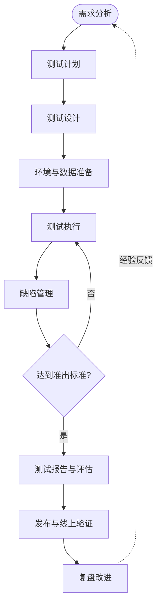
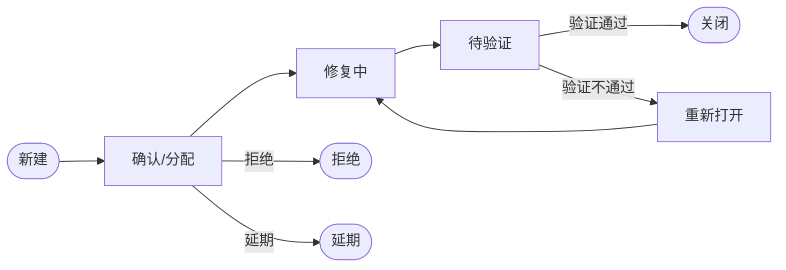

# 测试流程

> [!abstract] 一句话定义
> 测试流程是**从需求到上线、围绕"验证质量、暴露风险"组织起来的一系列活动与产出物**。它把"测试"从零散的点变成==可计划、可执行、可度量、可追溯==的过程。

---

## 一、总体流程



每个阶段都应有：

- **输入**：开始前必须拿到什么。
- **活动**：具体做什么。
- **产出**：交付什么、由谁评审。
- **准出标准**：什么条件下可以进入下一阶段。

> [!important] 流程不是目的
> 流程的价值在于**降低遗漏、明确责任、让质量可追溯**。流程过重会拖慢交付，流程缺失则风险失控——应根据项目规模、风险等级裁剪。

---

## 二、各阶段详解

### 1. 需求分析与评审

**输入**：PRD、原型、技术方案、历史缺陷。

**活动**：

- 参与需求评审，检查**完整性、一致性、可测试性**。
- 识别歧义、遗漏、冲突、不可实现的约束。
- 识别风险点：核心业务、复杂逻辑、外部依赖、安全/合规。
- 建立**需求追溯矩阵**：需求 ↔ 测试点 ↔ 用例。

**产出**：测试需求/测试点清单、风险清单、需求问题列表。

**准出**：需求无重大歧义；关键需求都有可验证的验收标准。

> [!tip] 需求评审是性价比最高的测试
> 在需求阶段发现一个歧义，可能避免开发返工、测试重写用例、上线后修复三笔成本。

### 2. 测试计划

**输入**：需求、排期、资源、架构。

**计划应包含**：

| 内容 | 说明 |
|---|---|
| 测试目标 | 本次要验证什么、达到什么质量水平 |
| 测试范围 | 测什么、**明确不测什么** |
| 测试策略 | 层次（单元/集成/系统/验收）、方法、自动化比例 |
| 资源与环境 | 人、设备、环境、账号、数据 |
| 进度与里程碑 | 提测、冒烟、回归、发布节点 |
| 准入/准出标准 | 什么条件开始测、什么条件可发布 |
| 风险与应对 | 高风险模块、依赖、可能的延期 |
| 交付物 | 用例、报告、缺陷清单 |

**产出**：测试计划（可轻量化为迭代测试说明）。

### 3. 测试设计

**输入**：测试需求、需求文档、设计文档。

**活动**：

- 将需求拆解为**测试条件**（要验证什么）。
- 选择测试方法（等价类、边界值、判定表、场景法、白盒覆盖等，见 [[测试方法]]）。
- 设计用例：前置条件、步骤、数据、**预期结果**（见 [[测试预言机]]）。
- 标注优先级（见 [[测试优先级分配]]）。
- 用例评审：覆盖度、可执行性、可判定性、冗余度。

**产出**：测试用例集、测试数据、自动化脚本设计。

### 4. 环境与数据准备

**活动**：

- 准备**环境矩阵**：开发/测试/预发/生产，浏览器、系统、设备、数据库版本。
- 准备测试数据：正常数据、边界数据、异常数据、脏数据。
- 处理外部依赖：Mock、Stub、沙箱、测试账号。
- 确认环境与生产的差异，并评估差异带来的风险。

**常见坑**：

- 环境不一致导致"测试通过、线上失败"。
- 数据被污染、用例之间互相影响。
- 依赖第三方不可用，测试被迫阻塞。
- 环境版本与待测版本不一致。

> [!warning] 环境也是测试对象的一部分
> 配置错误、证书过期、DNS、时钟不同步，都可能制造"假缺陷"或掩盖真缺陷。环境问题应被记录和治理，而不是每次靠人肉绕过。

### 5. 测试执行

**执行顺序**（典型）：

1. **冒烟测试**：确认版本基本可用，不通过则打回。
2. **系统测试**：按优先级执行 P0 → P1 → P2。
3. **回归测试**：验证修复与变更影响。
4. **验收测试**：业务/用户确认。

**活动**：

- 按用例执行，记录实际结果。
- 失败时判断：是产品缺陷、用例问题、环境问题还是数据问题。
- 提交缺陷并跟踪闭环。
- 记录阻塞、跳过、未执行的原因。

**产出**：执行记录、缺陷单、测试日志。

### 6. 缺陷管理

**缺陷生命周期**：



**一份好的缺陷报告应包含**：

| 要素 | 说明 |
|---|---|
| 标题 | 一句话说清"什么条件下发生了什么" |
| 环境 | 版本、系统、浏览器、账号、数据 |
| 前置条件 | 复现所需状态 |
| 复现步骤 | 最小、可重复的步骤 |
| 期望结果 | 依据是什么（需求/规格/常识） |
| 实际结果 | 实际发生了什么 |
| 附件 | 截图、录屏、日志、请求响应 |
| 严重程度 | 对系统的影响 |
| 优先级 | 修复的紧急程度 |
| 复现率 | 必现/偶现，偶现需说明尝试次数 |

> [!tip] 缺陷标题公式
> `【模块】在【条件】下【操作】导致【结果】`
> 例：【结算页】使用已过期优惠券提交订单，导致订单金额少算 30 元。

> [!warning] 不要只报 bug，要跟闭环
> 缺陷提交后要跟踪：是否被确认、是否修复、修复是否引入新问题、是否需要在发布说明中告知。**未闭环的缺陷就是未管理的风险。**

### 7. 测试报告与评估

**报告应回答**：

- 测了什么、没测什么？
- 执行了多少、通过多少、失败多少、阻塞多少？
- 缺陷分布如何？严重缺陷是否收敛？
- 还剩哪些风险？是否可接受？
- 结论：**可以发布 / 有条件发布 / 不可发布**。

**常见发布标准（示例）**：

- P0/P1 用例 100% 通过。
- 无未解决的高严重度缺陷。
- 已知缺陷都有规避方案或明确接受。
- 冒烟、核心回归通过。
- 性能/安全关键指标达标。
- 回滚方案与监控就绪。

**产出**：测试报告、发布建议（Go / No-Go）。

### 8. 发布与线上验证

- **灰度发布**：先小流量验证，再逐步放量。
- **上线冒烟**：核心链路快速验证。
- **监控与告警**：错误率、延迟、业务指标、日志。
- **回滚预案**：明确触发条件、操作步骤、负责人。
- **右移验证**：A/B、混沌工程、生产环境巡检。

### 9. 复盘改进

- 分析**缺陷逃逸**：为什么没在更早阶段发现？
- 分析流程瓶颈：环境、数据、评审、自动化。
- 更新检查表、用例库、自动化与准入标准。
- 把改进项落到下一个迭代，而不是停留在会议纪要。

---

## 三、不同开发模式下的流程

| 模式 | 流程特点 |
|---|---|
| 瀑布 / V 模型 | 阶段清晰、文档重；测试在编码后集中进行；变更成本高 |
| 敏捷迭代 | 每个 Sprint 内完成"需求→设计→开发→测试"；持续评审、自动化回归 |
| DevOps / 持续测试 | 流水线自动执行单元/集成/契约测试；质量门禁；快速反馈 |
| 众测 / Beta | 真实用户参与，覆盖长尾场景；需要反馈收集与分级处理 |

**V 模型**中测试与开发阶段的对应关系：

```
需求分析  ←→  验收测试
概要设计  ←→  系统测试
详细设计  ←→  集成测试
编码      ←→  单元测试
```

> [!note] 左移与右移
> 现代流程强调**左移**（测试活动前移：需求评审、单元测试、静态分析）与**右移**（生产验证：监控、灰度、混沌工程）。二者不是替代关系，而是覆盖不同风险。

---

## 四、准入与准出标准

### 4.1 提测准入（开发 → 测试）

- [ ] 需求已完成并通过评审。
- [ ] 开发自测完成，单元测试通过。
- [ ] 构建成功，版本可部署。
- [ ] 冒烟用例通过。
- [ ] 接口/数据库变更已说明。
- [ ] 测试环境与数据就绪。
- [ ] 已知问题清单已提供。

### 4.2 发布准出（测试 → 生产）

- [ ] P0/P1 用例通过率达到约定标准。
- [ ] 无未解决的高严重度缺陷。
- [ ] 回归测试完成，无新增阻断问题。
- [ ] 性能/安全/兼容性关键项达标。
- [ ] 测试报告已评审。
- [ ] 发布计划、回滚方案、监控告警就绪。
- [ ] 业务/产品方确认验收。

> [!important] 准出标准要提前定
> 如果发布前才讨论"什么算达标"，质量就会变成谈判。准出标准应在测试计划阶段由各方确认，并在版本周期内保持一致。

---

## 五、角色与职责

| 角色 | 主要职责 |
|---|---|
| 产品/业务 | 需求定义、验收标准、优先级、最终验收 |
| 开发 | 可测性设计、单元测试、修复缺陷、提供变更说明 |
| 测试/QA | 测试计划、用例设计、执行、缺陷跟踪、质量评估 |
| 运维/SRE | 环境、部署、监控、回滚、容量 |
| 项目经理 | 排期、资源、风险协调、发布决策 |

> [!note] 质量是团队责任
> 测试角色负责"让质量可见、让风险可控"，但缺陷是开发引入的，需求是产品定义的，环境是运维提供的。流程的价值在于让每个角色在正确的时间承担正确的质量责任。

---

## 六、常见问题

| 问题 | 后果 | 改进 |
|---|---|---|
| 需求不清就开测 | 用例反复改、返工 | 需求评审 + 可测试性标准 |
| 没有测试计划 | 范围失控、资源冲突 | 轻量计划 + 明确不测范围 |
| 用例不复审 | 覆盖不足、冗余 | 同行评审 + 覆盖检查 |
| 环境与生产不一致 | 假通过/假失败 | 环境矩阵 + 差异评估 |
| 缺陷描述不清 | 来回沟通、修复慢 | 缺陷模板 + 附件要求 |
| 只报 bug 不闭环 | 风险遗留 | 缺陷生命周期 + 定期清理 |
| 没有准出标准 | 发布靠拍脑袋 | 提前定义 Go/No-Go |
| 测试报告只报数字 | 无法支撑决策 | 结论 + 剩余风险 + 建议 |
| 流程过重 | 团队绕过流程 | 按风险裁剪、自动化 |
| 不复盘 | 同类问题反复发生 | 缺陷逃逸分析 + 改进跟踪 |

---

## 七、流程度量

| 指标 | 说明 |
|---|---|
| 用例执行率 | 已执行 / 计划执行 |
| 用例通过率 | 通过 / 已执行 |
| 需求覆盖率 | 已覆盖需求 / 总需求 |
| 缺陷发现率 | 单位时间/阶段发现缺陷数 |
| 缺陷修复率 | 已修复 / 已提交 |
| 缺陷重开率 | 重开 / 已修复（衡量修复质量） |
| 缺陷逃逸率 | 线上缺陷 / 总缺陷 |
| 阻塞时长 | 环境/依赖导致的停滞时间 |
| 平均修复时间 MTTR | 从发现到修复的时长 |
| 自动化覆盖率 | 自动化用例 / 可自动化用例 |

> [!tip] 度量要服务于决策
> 指标不是越多越好。选择 3–5 个能驱动行动的指标（如逃逸率、回归耗时、P0 通过率），比堆一张大报表更有效。

---

## 相关笔记

- [[什么是QA]]
- [[QA思维模式]]
- [[测试方法]]
- [[测试预言机]]
- [[测试优先级分配]]
